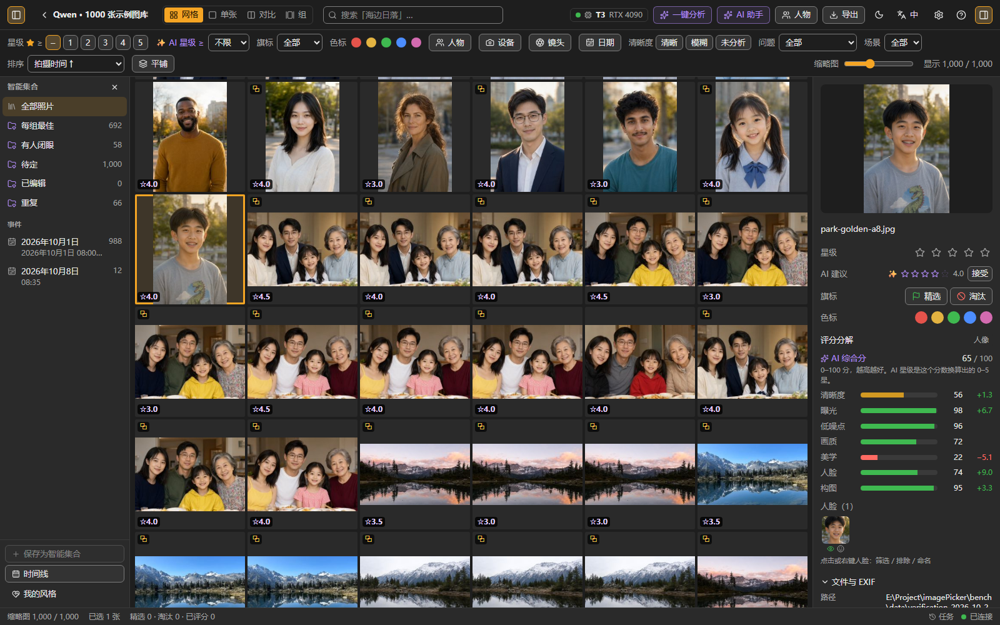
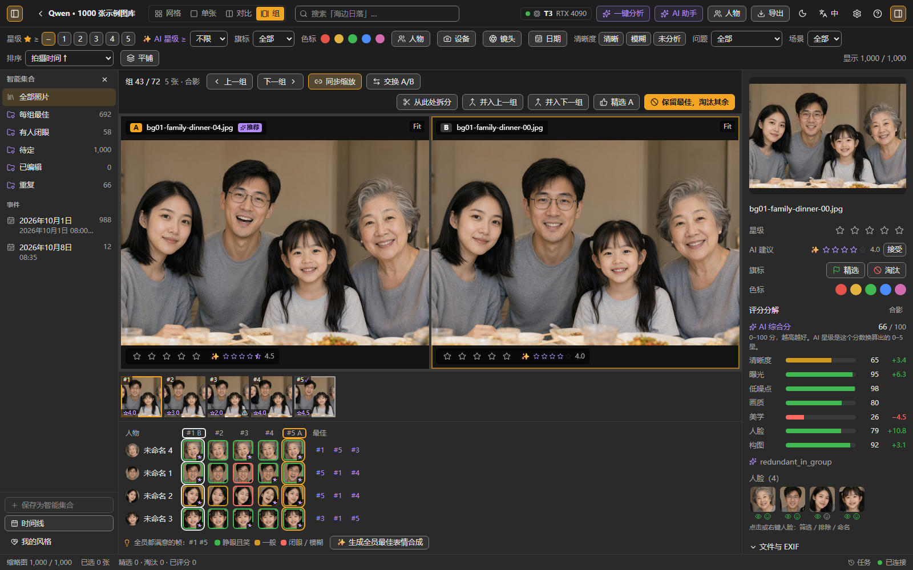
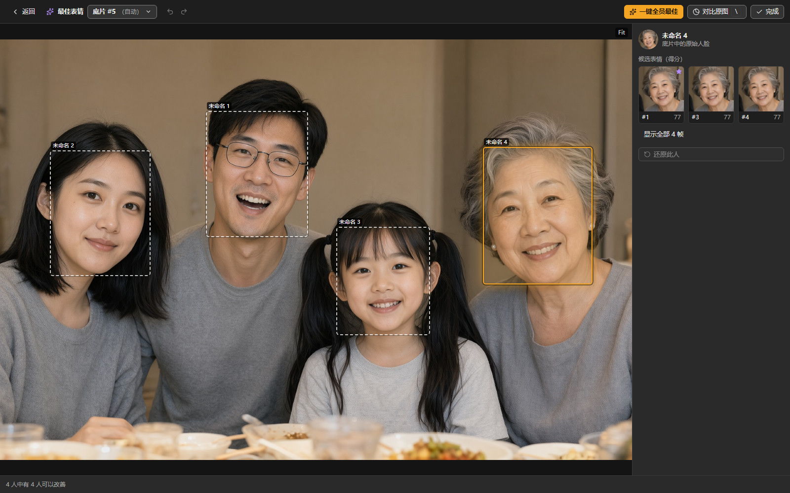
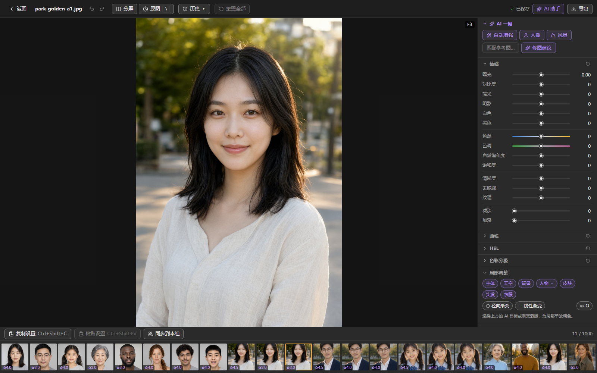
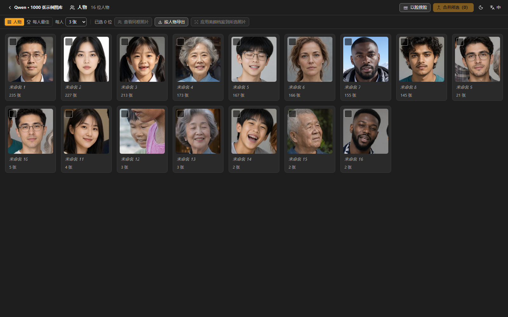
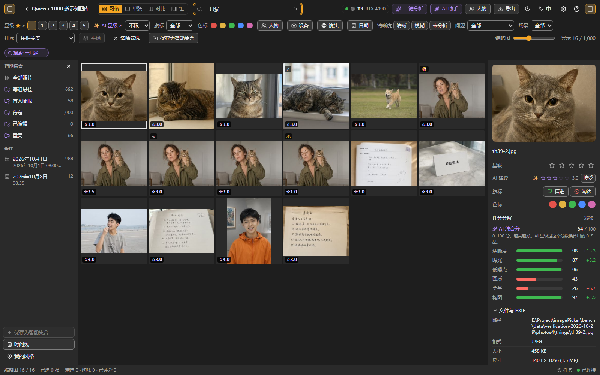
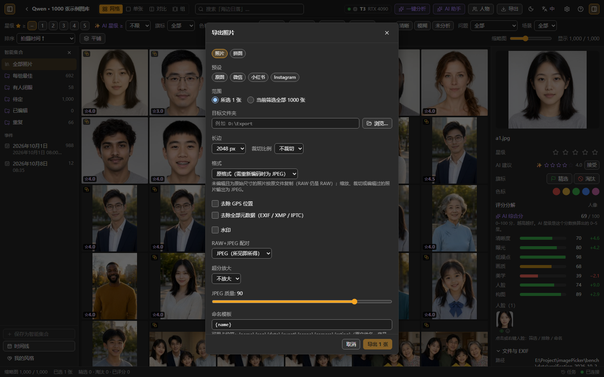
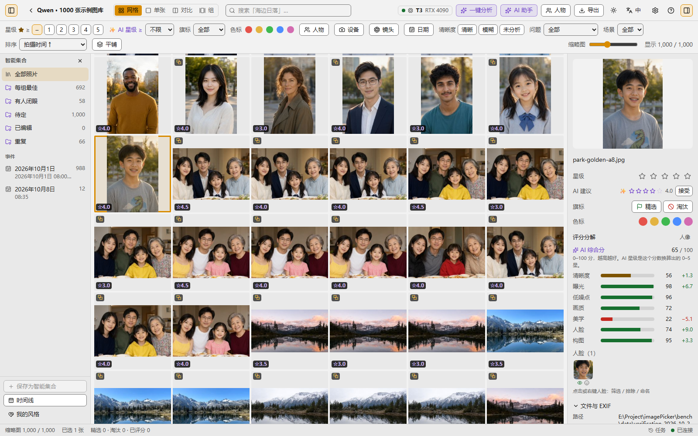

<div align="center">

# imagePicker

**本地优先、隐私安全、跨平台的 AI 照片挑选与修图工作台**
**A local-first, privacy-first, cross-platform AI photo culling & retouching workstation**

[中文](#中文) · [English](#english) · [用户指南 / User Guide](docs/user-guide/README.md) · [文档 / Docs](docs/README.md)



</div>

---

## 中文

旅行、聚会、婚礼拍了上千张？拖进来，一键分析：连拍与相似照片自动成组、0–5 星智能评分、闭眼/模糊自动标记、合影「全员最佳表情」合成、自动光影色彩与人像美化。**所有处理都在你自己的电脑上完成，照片不会上传。**

### 状态

**预发布（开发中；各处版本号仍为 0.1.0，尚无正式发布版）**：桌面端核心功能（导入、分析、分组、评分、人物、最佳表情、编辑、人像美化、修复、导出、AI 助手、局域网 WebUI、XMP 互通、设置）已实现，主要由 mock 与合成图库验证。已知限制（详见 [待办与已知问题](docs/backlog.md) 与 [完成度评审](docs/09-完成度评审与收尾计划.md)）：

- 评分阈值尚未在大规模真实照片上校准；标准档尚未在全部真实模型上端到端评测。
- **未提供**：「匹配参考图」（编辑面板按钮禁用）、虚拟副本、HTTPS（局域网与远程 AI 使用明文 HTTP，仅限可信局域网）。
- **Android 版**：已有应用外壳、移动端界面（手势挑片、快速挑片、底部抽屉编辑）、本机「快速」分析（仅清晰度/曝光/噪点/连拍分组，没有闭眼与人物）和远程 AI 配对，CI 能构建 debug APK；但**从未在真机或模拟器上运行过**，release 包也很可能无法加载界面（见 [08](docs/08-Android版本设计.md)）。
- HEIC/HEIF 依赖系统解码器、AI 组件自带的 libheif 或文件内嵌 JPEG，未在真实 iPhone/安卓样张上实测。
- 安装包与 AI 组件安装器已就绪，但发布链路还没有完整跑过；首个正式版发布前请参考下文「从源码运行」。

### 功能亮点

| | |
|---|---|
| ⚡ 极速载入 | Rust 原生缩略图流水线（优先提取内嵌预览，支持 HEIC/HEIF 与 RAW 内嵌预览、RAW+JPEG 配对），万张级虚拟化网格；监听已导入文件夹的变化；可从存储卡复制导入；支持便携模式（数据放在程序旁） |
| 🧠 一键智能分析 | 连拍/场景/事件分组、重复照片检测、可解释的多维评分映射为 0–5 星，闭眼、模糊、过曝、欠曝、噪点、倾斜等问题标签；没有 AI 组件时仍可用本机「快速」分析 |
| 📚 堆栈与组视图 | 连拍折叠成堆栈；组视图 A/B 对比、同步缩放、一键「保留最佳，淘汰其余」 |
| 👥 人物 | 本地人脸聚类，按人物筛选（包含/排除、睁眼、笑容、看镜头）、每人最佳、按人物导出、以脸搜脸 |
| 😀 最佳表情 | 人物 × 帧的表情矩阵；每个人选最佳表情，合成到同一张底片 |
| 🎨 非破坏性编辑 | 基础/曲线/HSL/色彩分级、AI 蒙版（主体/天空/人物/皮肤/头发/衣服）、渐变、裁剪、预设、LUT |
| 🖌️ 精修 | 纹理、减淡/加深、暗角与颗粒、锐化与自适应降噪、范围蒙版（按亮度或颜色收窄蒙版） |
| 💄 人像美化 | 磨皮、美白、去瑕疵、亮眼、瘦脸、瘦手臂/腿等；按人物保存档案，自然度提醒 |
| 🧽 修复 | 消除路人、画笔消除、降噪、人脸修复、导出时超分 |
| 🤖 AI 助手 | 中英文自然语言指令 → 先出计划，确认后执行，可一步撤销 |
| 🌐 局域网 WebUI | 手机/平板用浏览器访问；所有者与只读访客两种角色，扫码访问 |
| 🔁 XMP 互通 | 与 Lightroom / darktable 共享星级、旗标、色标、关键词 |
| 🎛️ 硬件自适应 | 纯 CPU 到 RTX 4090 四档（T0–T3），可手动覆盖；模型按需下载，可选 HF 镜像（设置里的 ModelScope 选项目前等同「自动」，尚无模型托管在那里） |
| 📤 导出 | JPEG / PNG / TIFF / WebP，可去 GPS / 去全部 EXIF，文字水印，拼图 / 联系表，按事件/场景/相机/星级命名，导出时可超分 |
| 📱 移动端与远程 AI（实验） | 窄屏自动切换移动布局（手势挑片、快速挑片、底部抽屉编辑）；手机可把重计算交给已配对的家中电脑（远程 AI）。Android 版尚未在真机上验证 |

### 截图

以下为当前版本在 **Qwen 生成的 1000 张图片图库**上的实际运行截图，使用本地 Rust 服务和正式构建的 WebUI。涵盖人像、家庭合影、旅行风景、美食与宠物等素材。

| 1000 张图库与 AI 评分 | 连拍对比与表情矩阵 |
|---|---|
|  |  |
| **最佳表情：逐人选择候选帧** | **非破坏性编辑** |
|  |  |
| **人物聚类** | **中文自然语言搜索** |
|  |  |
| **导出设置** | **浅色主题** |
|  |  |

> 素材由 ComfyUI + Qwen-Image 2.1 生成，并非真实相机照片；评分、分组、人物和搜索结果来自实际后端，未使用 mock 数据。截图展示当前界面和已有分析结果，不代表真实照片上的准确率。截图日期：2026-10-30；[来源与复现方法](docs/images/qwen/README.md)。

### 硬件档位

首次启动时自动检测，可在「设置 → 硬件与模型」查看。档位只决定默认启用哪些模型，核心功能在 CPU 上都能工作，只是更慢；本地 AI 助手模型需要 T2 及以上（T1 且有 GPU 时可用规划模型；再低使用离线规则引擎），扩散修补（SDXL）需要 T3。

| 档位 | 典型硬件 | 体验 |
|---|---|---|
| **T0** | 无独显 / 老笔记本，8 GB+ 内存 | 快速分析可用；标准分析与生成式修复较慢（超分每张可能数十秒） |
| **T1** | Apple M 系列 ≥ 8 GB 统一内存、4–6 GB 独显、DirectML 集显 | 标准分析、AI 蒙版、降噪、人脸修复 |
| **T2** | 8–12 GB 显存（RTX 3060 / 4070）、M Pro/Max ≥ 16 GB | 加上本地 AI 助手模型（LLM/VLM） |
| **T3** | ≥ 16 GB 显存（如 RTX 4090） | 全部可选增强包（如 SDXL 修补） |

NVIDIA 显卡需要安装 AI 组件的 CUDA 版本才会被识别为 GPU 档位（见用户指南）。

### 安装与快速开始

**普通用户**：安装包将发布在 [GitHub Releases](https://github.com/harveyxiacn/imagePicker/releases)（Windows / macOS / Linux 含 CachyOS）。发布前请使用下面的方式从源码运行。安装包暂未代码签名：Windows 首次运行点「更多信息 → 仍要运行」，macOS 右键 → 打开。安装步骤详见 [用户指南 · 安装](docs/user-guide/zh-CN.md#2-安装)。

**从源码运行（桌面版）**

```sh
# 需要 Rust、Node 24、pnpm 10；Linux 另需 WebKitGTK 等依赖（见 apps/desktop/README.md）
cd web && pnpm install && cd ../apps/desktop && pnpm install
pnpm tauri dev                          # 开发模式
pnpm tauri build                        # 打包当前系统的安装包
```

**只用 WebUI（浏览器）**

Windows 用户直接双击根目录的 **`Start-WebUI.cmd`**：启动本机服务，等待就绪后自动打开浏览器。保留启动窗口，按 `Ctrl+C` 或关闭窗口即可停止服务；重复双击会打开已运行的 WebUI。

Windows 启动脚本默认允许 GPU 图像渲染，并仅对本服务进程及子进程禁用 Vulkan 隐式叠加层，避开部分录屏软件叠加层引发的启动崩溃；需要 CPU 兼容模式时运行 `Start-WebUI.cmd -CpuRender`。已有的 `ai-worker/.venv` 会直接复用，保留已安装的 CUDA 依赖；AI 是否使用 GPU 仍取决于模型和 AI 组件配置。已设置的 `IMAGEPICKER_RENDER`、`IMAGEPICKER_WORKER_CMD`、`IMAGEPICKER_WORKER_DIR` 和 `VK_LOADER_LAYERS_DISABLE` 环境变量会保留。

脚本优先使用已有的 `target/release/imagepicker.exe`（其次为 debug）和 `web/dist`。缺少产物时自动构建，需要 Rust / Visual Studio C++ Build Tools、Node 24 和 pnpm 10；首次构建需要联网。源码更新后运行 `Start-WebUI.cmd -Rebuild` 重新构建。端口被占用时可运行 `Start-WebUI.cmd -Port 7879`；`-NoBrowser` 可关闭自动打开浏览器，`-Check` 仅检查启动文件。AI 组件仍按下文单独安装。

```sh
cd web && pnpm install && pnpm build && cd ..
cargo run -p ip-cli -- serve --web-dir web/dist     # http://127.0.0.1:7878
```

**AI 组件**：安装包内置安装器——首次启动在欢迎卡片或「设置 → 硬件与模型」点「安装 AI 组件」即可（私有 Python 环境，NVIDIA 显卡自动用 CUDA 版，约 2.3 GB）。从源码开发时则在 `ai-worker/` 运行 `uv sync --extra cuda --extra mediapipe`（仅 CPU 用 `--extra cpu`），并先执行 `bash apps/desktop/scripts/fetch-uv.sh`。

**5 步上手**：① 拖入文件夹导入 → ② 点「一键分析」（首次会提示下载模型；不想下载可选「快速（本机）」）→ ③ 用数字键 1–5 打星、`P` 精选、`X` 淘汰，`S` 展开堆栈、`B` 进组视图 → ④ `D` 进入编辑 → ⑤ `Ctrl+E` 导出。`Ctrl+K` 打开命令面板，`?` 查看全部快捷键。完整流程见 [用户指南](docs/user-guide/zh-CN.md)。

### 隐私

- 照片、人脸特征、评分、编辑都只保存在本机（目录库 `catalog.db` 与缓存）。
- 联网只用于**按需下载模型**（Hugging Face / hf-mirror 镜像），下载前会展示模型清单与大小；在「设置 → 人脸与隐私」关闭「允许联网」后完全离线运行。
- 人脸识别需要你首次同意（同意前不提取人脸特征），可整体关闭，也可一键清除全部人脸数据。
- 局域网访问默认关闭；开启必须先设置所有者密码，访客只读且看不到人物。局域网与远程 AI 目前是明文 HTTP，请只在可信网络中使用。

详见 [用户指南 · 隐私与数据位置](docs/user-guide/zh-CN.md#16-隐私与数据位置)。

### 许可

代码采用 [Apache-2.0](LICENSE)。AI 模型权重**不随仓库分发**，由应用按需下载并遵循各自许可证；标记为「非商业」的模型仅限个人使用。详见 [模型清单与许可](docs/07-模型清单与许可.md)。

### 文档

[用户指南（中文）](docs/user-guide/zh-CN.md) · [User Guide (English)](docs/user-guide/en.md) · [设计文档总览](docs/README.md) · [完成度评审与收尾计划](docs/09-完成度评审与收尾计划.md) · [路线图](docs/10-路线图.md) · [待办与已知问题](docs/backlog.md) · [贡献指南](CONTRIBUTING.md) · [安全策略](SECURITY.md)

---

## English

Thousands of shots from a trip, party or wedding? Drop the folder in and hit Analyze: bursts and near-duplicates are stacked automatically, every photo gets an explainable 0–5 star suggestion, closed eyes / blur / clipping are flagged, group shots can be composed from everyone's best expression, and auto tone and portrait retouching are one click away. **Everything runs on your own machine; your photos are never uploaded.**

### Status

**Pre-release (in development; the version is still 0.1.0 everywhere and no official release exists yet).** The desktop feature set (import, analysis, grouping, scoring, people, best take, editing, portrait retouching, repair, export, AI assistant, LAN WebUI, XMP interop, settings) is implemented and verified mostly against a mock backend and a synthetic library. Known limitations (see the [backlog](docs/backlog.md) and the [completeness review](docs/09-完成度评审与收尾计划.md), both in Chinese):

- Score thresholds are not yet calibrated on a large real-photo set; the Standard profile has not been evaluated end to end with all real models.
- **Not available:** "Match reference…" (the button in the edit panel is disabled), virtual copies, HTTPS (LAN and remote AI use plain HTTP; trusted networks only).
- **Android:** there is an app shell, a mobile UI (gesture culling, quick cull, bottom-sheet editing), on-device "Fast (on this device)" analysis (sharpness / exposure / noise / burst grouping only; no closed-eye or people detection) and remote-AI pairing, and CI builds a debug APK. It has **never been run on a real device or emulator**, and the release APK probably cannot load its UI (see [08](docs/08-Android版本设计.md), Chinese).
- HEIC/HEIF relies on the OS decoder, the libheif bundled with the AI components, or the JPEG embedded in the file; it has not been tested on real iPhone/Android samples.
- Installers and the built-in AI component setup are ready, but the release pipeline has not been run end to end; until the first release is published, see "Run from source" below.

### Highlights

| | |
|---|---|
| ⚡ Fast | Native Rust thumbnail pipeline (embedded previews first; HEIC/HEIF, RAW embedded previews, RAW+JPEG pairing), virtualised grid for 10k+ photos; imported folders are watched for changes; copy-import from memory cards; portable mode (data kept next to the program) |
| 🧠 One-click analysis | Burst / scene / event grouping, duplicate detection, explainable multi-factor score mapped to 0–5 stars, issue tags (closed eyes, blur, over/underexposure, noise, tilt); works without the AI components via the on-device "Fast" analysis |
| 📚 Stacks & group view | Bursts collapse into stacks; A/B compare with synced zoom, "keep best, reject the rest" |
| 👥 People | On-device face clustering; filter by person (include / exclude, eyes open, smiling, looking), best-per-person, export per person, search by face |
| 😀 Best take | Person × frame expression matrix; pick each person's best expression and composite onto one base frame |
| 🎨 Non-destructive editing | Basic / curves / HSL / colour grading, AI masks (subject, sky, person, skin, hair, clothes), gradients, crop, presets, LUTs |
| 💄 Portrait retouch | Smooth, brighten, blemish removal, eyes, face and body reshaping; per-person profiles; naturalness warning |
| 🧽 Repair | Remove bystanders, brush erase, denoise, face restore, upscale on export |
| 🤖 AI assistant | Natural-language commands (zh / en): shows a plan first, runs it after you confirm, undo in one step |
| 🌐 LAN WebUI | Phone / tablet in the browser; owner and read-only guest roles, QR code |
| 🔁 XMP interop | Shares ratings, flags, colour labels and keywords with Lightroom / darktable |
| 🎛️ Hardware tiers | CPU-only to RTX 4090 (T0–T3) with a manual override; models are downloaded on demand, HF mirror supported (the ModelScope option in Settings currently behaves like "Auto": no model is hosted there yet) |
| 📤 Export | JPEG / PNG / TIFF / WebP, strip GPS or all EXIF, text watermark, collage / contact sheet, naming by event / scene / camera / rating, optional upscaling |
| 📱 Mobile & remote AI (experimental) | Narrow screens switch to a mobile layout (gesture culling, quick cull, bottom-sheet editing); a phone can hand heavy work to a paired computer at home (remote AI). The Android app is not verified on real devices |

### Screenshots

Captured from the current version running a **1,000-image Qwen-generated library**, with the local Rust server and production WebUI build. The library includes portraits, family groups, travel landscapes, food, and pets.

| 1,000-image library with AI ratings | Burst comparison and expression matrix |
|---|---|
|  |  |
| **Best take: per-person frame selection** | **Non-destructive editing** |
|  |  |
| **People clustering** | **Natural-language search in Chinese** |
|  |  |
| **Export settings** | **Light theme** |
|  |  |

> Images were generated with ComfyUI + Qwen-Image 2.1, not captured by real cameras. Ratings, groups, people, and search results come from the actual backend, without mock data. These screenshots show the current UI and existing analysis results, not accuracy on real-world photos. Captured on 2026-10-30; see [provenance and reproduction instructions](docs/images/qwen/README.md). The UI is shown in Chinese; English is available in Settings.

### Hardware tiers

Detected on first start and shown in *Settings → Hardware & models*. The tier only decides which models are enabled by default. Core features work on CPU, just slower; the local assistant models need T2 or higher (T1 with a GPU can run the planning model; below that the assistant uses its offline rules engine) and diffusion inpainting (SDXL) needs T3.

| Tier | Typical hardware | What to expect |
|---|---|---|
| **T0** | No discrete GPU / old laptop, 8 GB+ RAM | Fast analysis works; standard analysis and generative repair are slow (upscaling can take tens of seconds per photo) |
| **T1** | Apple M-series ≥ 8 GB unified memory, 4–6 GB GPU, DirectML iGPU | Standard analysis, AI masks, denoise, face restore |
| **T2** | 8–12 GB VRAM (RTX 3060 / 4070), M Pro/Max ≥ 16 GB | Adds the local AI assistant models (LLM / VLM) |
| **T3** | ≥ 16 GB VRAM (e.g. RTX 4090) | All optional add-on packs (e.g. SDXL inpainting) |

NVIDIA GPUs are only recognised as a GPU tier when the AI components are installed with the CUDA extra (see the user guide).

### Install & quick start

**End users:** installers will be published on [GitHub Releases](https://github.com/harveyxiacn/imagePicker/releases) (Windows / macOS / Linux incl. CachyOS). Until then run from source as below. The installers are not code-signed yet: on Windows click *More info → Run anyway*, on macOS right-click → Open. Details: [User Guide · Installation](docs/user-guide/en.md#2-installation).

**Run from source (desktop)**

```sh
# needs Rust, Node 24, pnpm 10; Linux also needs WebKitGTK etc. (see apps/desktop/README.md)
cd web && pnpm install && cd ../apps/desktop && pnpm install
pnpm tauri dev                          # development
pnpm tauri build                        # installer for the host OS
```

**WebUI only (browser)**

```sh
cd web && pnpm install && pnpm build && cd ..
cargo run -p ip-cli -- serve --web-dir web/dist     # http://127.0.0.1:7878
```

**AI components:** the installers include a built-in setup — click *Install AI components* on the welcome card or in *Settings → Hardware & models* (private Python environment, CUDA build picked automatically on NVIDIA GPUs, about 2.3 GB). When developing from source, run `uv sync --extra cuda --extra mediapipe` in `ai-worker/` (CPU only: `--extra cpu`) and `bash apps/desktop/scripts/fetch-uv.sh` once first.

**Five steps:** ① drop a folder to import → ② click *Analyze* (the first run asks to download models; pick "Fast (on this device)" to skip that) → ③ rate with `1`–`5`, `P` pick, `X` reject, `S` expand a stack, `B` group view → ④ `D` to edit → ⑤ `Ctrl+E` to export. `Ctrl+K` opens the command palette, `?` lists all shortcuts. Full walkthrough in the [User Guide](docs/user-guide/en.md).

### Privacy

- Photos, face data, ratings and edits stay on your machine (catalog `catalog.db` plus caches).
- The network is only used to **download models on demand** (Hugging Face / hf-mirror), after showing the model list and sizes. Turn off *Allow network* in *Settings → Faces & privacy* to run fully offline.
- Face recognition asks for your consent first (no face features are extracted before you agree); it can be switched off entirely, and all face data can be wiped in one click.
- LAN access is off by default; enabling it requires an owner password first. Guests are read-only and cannot see people. LAN and remote AI currently use plain HTTP: use them on trusted networks only.

See [User Guide · Privacy & data locations](docs/user-guide/en.md#16-privacy--data-locations).

### License

Code is licensed under [Apache-2.0](LICENSE). AI model weights are **not** distributed with this repository; the app downloads them on demand under their own licenses, and models marked "non-commercial" are for personal use only. See [model list & licenses](docs/07-模型清单与许可.md) (Chinese).

### Docs

[User Guide (中文)](docs/user-guide/zh-CN.md) · [User Guide (English)](docs/user-guide/en.md) · [Design docs](docs/README.md) · [Completeness review](docs/09-完成度评审与收尾计划.md) · [Roadmap](docs/10-路线图.md#7-english-summary) · [Backlog](docs/backlog.md) · [Contributing](CONTRIBUTING.md) · [Security](SECURITY.md)
