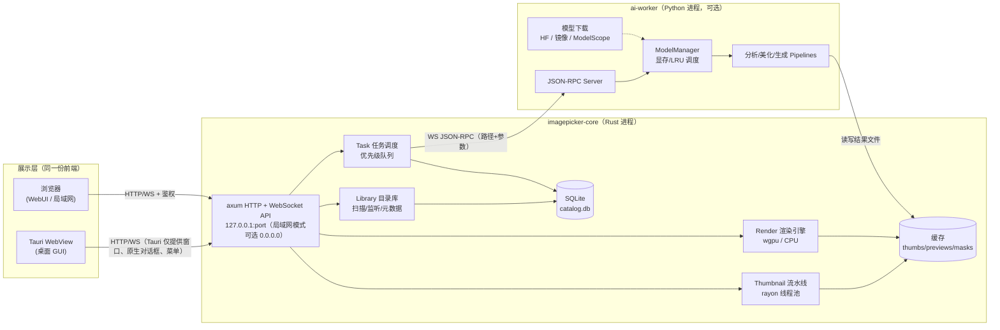
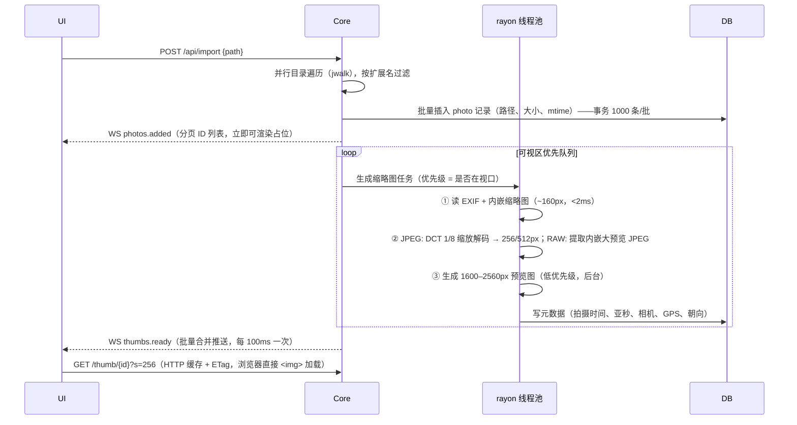
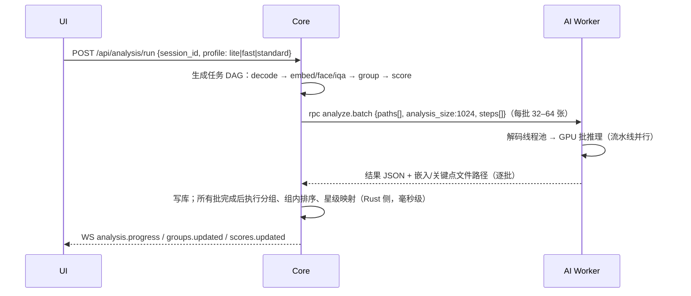
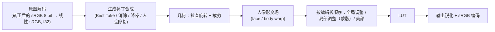

# 02 系统架构设计

## 1. 设计原则

1. **本地优先、隐私第一**：默认零联网；原图只读；所有派生数据（缩略图、分析结果、编辑栈）存放在应用缓存与目录库中。
2. **快是第一功能**：IO/解码/缩略图走 Rust 原生多线程；AI 推理走独立进程批处理；前端只做展示，永不阻塞。
3. **一套前端，两种形态**：桌面 GUI（Tauri）与 WebUI（浏览器）共用同一份前端与同一套 HTTP/WebSocket API。
4. **非破坏性**：所有编辑是参数化编辑栈 + 派生图层（蒙版、形变场、生成补丁），渲染引擎确定性地合成。
5. **AI 可插拔、硬件自适应**：模型通过注册表声明能力、档位、显存；调度器根据硬件选择实现并管理显存。
6. **AI 建议，人来决定**：AI 结果与用户决定分开存储，所有自动操作可预览、可撤销。

## 2. 技术栈总览

| 层 | 选型 | 理由 |
|---|---|---|
| 桌面壳 | **Tauri 2** | 体积小（~10MB）、跨平台（WebView2 / WKWebView / WebKitGTK）、Rust 原生能力、自带打包与自动更新 |
| 核心服务 | **Rust**：tokio + axum + rayon | 高性能并发 IO、解码、缩略图、渲染；同时作为 WebUI 服务器 |
| 图像解码 | **纯 Rust 优先**：`jpeg-decoder` / `zune-jpeg`（DCT 域 1/2、1/4、1/8 缩放解码）、`image`、RAW 内嵌预览自研解析（TIFF IFD / CR3 BMFF / RAF）、`rawler`（RAW 全解码，P1）、`fast_image_resize`（SIMD）。**HEIF/AVIF** 不打包 HEVC 解码器：文件内 JPEG → 系统解码器（Windows WIC 需 HEIF + HEVC 扩展、macOS ImageIO）→ 运行时加载 libheif（Linux 系统库或 AI 组件自带），缺失时报出缺什么（见 [5.1](#51-导入与缩略图极速路径)）。libjpeg-turbo 作为后续可选加速 | 不依赖 cmake/nasm，三平台零配置构建；系统解码器自带硬件加速与专利授权 |
| 元数据 | `nom-exif` / `kamadak-exif`（读）、XMP 读写（自研轻量 XML） | EXIF 时间、亚秒、GPS、相机参数 |
| 渲染引擎 | **wgpu**（WGSL compute shader）+ CPU 兜底（rayon） | 一套着色器覆盖 Vulkan / Metal / DX12；预览与导出同源，结果一致 |
| 数据库 | **SQLite**（WAL）+ `rusqlite`；向量用 `sqlite-vec` 或内存索引 | 单文件、零运维、可靠 |
| 前端 | **React 19 + TypeScript + Vite**；TanStack Query / Virtual / Router；Zustand；Tailwind CSS + Radix(shadcn/ui)；i18next | 生态成熟、虚拟列表、类型安全 |
| 图像查看 | 浏览器原生 `` + CSS 变换（Loupe 缩放/平移、对比同步缩放）；放大超过 4096 预览像素时改取 `/api/full/{id}` 的全分辨率图。**没有** WebGL/Canvas 查看器与瓦片金字塔（1.x 视需要再做） | 实现简单、跨 WebView 一致；24 MP 以内 1:1 够用 |
| AI Worker | **Python 3.12**（`uv` 管理，python-build-standalone 内嵌）；**ONNX Runtime** 为主（CUDA / DirectML / CoreML / CPU EP；TensorRT、ROCm 为计划项，未在 `pyproject.toml` extras 中提供），**PyTorch** 用于重模型（VLM、扩散）；OpenCV、MediaPipe、`huggingface_hub` | AI 生态最全；ONNX 让轻模型跨平台；重模型按需安装 |
| 进程通信 | Core ⇄ Worker：WebSocket JSON-RPC（localhost + 随机 token）；大数据走共享缓存文件路径 | 简单、可调试、语言无关 |
| 打包 | Windows：NSIS/MSI；macOS：DMG（arm64 + x64）；Linux：AppImage + **AUR PKGBUILD**（CachyOS）+ Flatpak（P2）；Android：APK（Tauri 2 移动端） | 覆盖四平台 |
| 端侧推理 | `ip-infer` crate：Rust `ort`（ONNX Runtime）。**现状**：仅 YuNet 人脸检测，CPU，特性 `infer` 默认关闭，未链接到 Android、未随任何发布二进制启用；Android 上的分组/评分由 `ip-lite`（纯 Rust，无模型）完成 | Android 无法运行 Python Worker，详见 [08](08-Android版本设计.md) |
| 兜底分析 | `ip-lite` crate：纯 Rust 的 pHash 分组、清晰度/曝光/噪点评分（lite 档），桌面无 AI 组件时与 Android 共用 | 无模型、无 Python 也能完成分组与基础评分 |

## 3. 进程模型



**要点**

- **前端永远只说 HTTP/WS**。桌面模式下 Tauri 启动 core（同进程内嵌，作为 Tauri 的 Rust 后端运行 axum），WebView 访问 `http://127.0.0.1:<随机端口>`；WebUI 模式下 core 以无头服务运行（`imagepicker serve --lan`（即 `ip-cli serve --lan`，由 `crates/ip-cli` 提供）），浏览器直接访问。前端仅通过一个 `platform` 适配层调用少量 Tauri 专属能力（原生文件夹选择、系统菜单、拖拽路径），WebUI 下降级为服务端目录浏览器。
- **AI Worker 是可选的独立进程**：没有安装 AI 组件时，浏览、筛选、手动修图全部可用；core 内置的「经典算法」（pHash、拉普拉斯清晰度、直方图曝光）可提供基础分组与评分。
- **Worker 崩溃隔离**：OOM / CUDA 错误只会让 Worker 重启，任务自动重试（降档重试），UI 不受影响。
- 大数据不走 IPC：Core 把分析分辨率图（如 1024px）写入缓存或直接传原图路径，Worker 自己解码；结果（嵌入向量、蒙版 PNG、关键点 JSON）写入缓存目录，RPC 只回传路径与小型 JSON。

## 4. 模块划分（代码仓库结构）

```
imagePicker/
├─ apps/
│  └─ desktop/                 # Tauri 2 应用，桌面与 Android 共用同一工程
│     ├─ src-tauri/            # Rust 壳（嵌入 ip-server）；gen/android/ = 生成的 Android 工程；tauri.android.conf.json
│     ├─ plugins/imagepicker-media/  # Tauri 插件：Android Kotlin（MediaStore 相册、导出到 Pictures、分享、回收站、前台服务）+ 桌面空实现
│     └─ scripts/              # fetch-uv.sh（内嵌 uv）、android-build.ps1
├─ crates/
│  ├─ ip-core/                 # 领域模型与服务：db（迁移）、catalog、import/card（存储卡复制导入）/files/watch（文件监听）、analysis/（分组、评分、人脸聚类、重复、事件时间线）、
│  │                           #   edit/（编辑栈存取、预设、LUT、同步）、export（export_formats）+ watermark + collage（拼图/联系表）、assistant/（规则与 LLM 工具）、settings、backup、diagnostics、
│  │                           #   logging、paths/portable（数据目录解析与便携模式）、runtime（AI 组件安装器）、remote（远程 AI）、roots、tasks、taste（个性化评分）、xmp/
│  ├─ ip-imaging/              # 解码（jpeg/heif/raw 内嵌预览）、EXIF/XMP 元数据、缩略图、哈希、色彩转换、倾斜检测（tilt）、质量指标（quality）
│  ├─ ip-render/               # 编辑栈 → 渲染图：CPU 参考渲染器（rayon）+ wgpu/WGSL GPU 渲染器（shaders/）、自动调色（auto）、构图辅助（crop_assist）、
│  │                           #   人像形变与磨皮（portrait）、补丁合成（patch）、内置预设与 LUT
│  ├─ ip-lite/                 # 纯 Rust 兜底分析（pHash、清晰度、曝光）；桌面兜底与 Android 端侧分析共用
│  ├─ ip-infer/                # Rust ONNX Runtime 端侧推理（仅 YuNet，特性默认关闭，见 §2）
│  ├─ ip-server/               # axum API（routes / m2…m7 / timeline / files / card / fs / remote / auth）、WebSocket 事件（ws）、鉴权、静态资源
│  ├─ ip-worker-client/        # 与 Python Worker 的 JSON-RPC 客户端、进程管理、远程 AI 客户端（remote）
│  └─ ip-cli/                  # 命令行：serve / import / analyze / render / besttake / inpaint / ask / taste / bench（gen、seed）
├─ web/                        # React 前端（Vite）
│  ├─ src/{api,components,pages,stores,lib,i18n,platform,mock}   # components/ 下有 assistant、besttake、edit、mobile、settings
│  └─ scripts/                 # 无头浏览器 e2e / 截图 / 性能脚本（*.mjs）
├─ ai-worker/                  # Python（uv 项目）
│  ├─ imagepicker_ai/
│  │  ├─ rpc.py / service.py / pipeline.py   # JSON-RPC 服务与分析流水线
│  │  ├─ steps/                # phash / quality / faces / identity / embed / nima / zeroshot / tilt / face_search
│  │  ├─ models/               # registry.yaml + 下载与显存管理
│  │  ├─ beauty/ besttake/ enhance/ inpaint/ masks/ llm/   # 各功能服务
│  │  └─ hw.py                 # 硬件探测、档位
│  └─ pyproject.toml           # extras: cpu / cuda / mediapipe / torch / pro / dev
├─ packaging/                  # AUR PKGBUILD、Flatpak 清单
├─ scripts/                    # bump-version.sh、Android 环境脚本、YuNet 下载、合成测试图库脚本
├─ bench/                      # 性能基准与评测脚本、报告
├─ .github/workflows/          # ci / nightly / release / audit
└─ docs/
```

## 5. 关键数据流

### 5.1 导入与缩略图（极速路径）



性能手段汇总：

| 手段 | 收益 |
|---|---|
| 优先提取 EXIF/RAW 内嵌预览 | RAW 不解码即可显示，提速 20–50× |
| libjpeg-turbo DCT 缩放解码（scale 1/8） | 24MP JPEG 解码从 ~100ms 降到 ~10ms |
| SIMD 缩放（fast_image_resize） | 缩放开销可忽略 |
| 视口优先级队列 + 滚动时取消离屏任务 | 用户永远先看到正在看的 |
| 缩略图以 JPEG 存盘（解码最快、WebView 通用），key = 快速指纹 | 二次打开秒开 |
| 缩略图通过 HTTP URL 加载（非 base64 IPC） | 浏览器并行加载、自带缓存与解码线程 |
| WS 事件合并推送（100ms 批） | 避免前端重渲染风暴 |
| Loupe 预读前后各 3 张预览图 | 翻页 < 50ms |
| SQLite WAL + 批量事务 | 万条插入 < 200ms |

**指纹（缓存 key）**：`fast_key = hash(path, size, mtime)` 用于命中缓存；`content_key = blake3(前 64KB + 后 64KB + size)` 用于检测移动/重命名后复用分析结果。

#### HEIF/HEIC 解码（分层降级）

手机照片（iPhone、多数安卓）默认是 HEIC：HEVC 编码，iPhone 为 512px 网格分块加一张 HEVC 编码的 `thmb` 缩略图，没有 JPEG 预览。没有成熟的纯 Rust HEVC 解码器；打包 libheif + libde265 既要 C/C++ 工具链（CI、Android NDK 交叉编译），又等于随应用分发 HEVC 解码器（专利授权）。因此 `ip-imaging`（`imp/heif.rs`）逐层尝试，前一层失败才进入下一层：

| 层 | 像素来源 | 平台 | 说明 |
|---|---|---|---|
| ① | 文件内 JPEG：JPEG 编码的主图；（仅缩略图）尺寸够大的 JPEG 缩略图项或 EXIF IFD1 缩略图 | 全部（含 Android） | 纯 Rust、零依赖；部分相机 / 安卓 HEIF 有，iPhone 没有 |
| ② | 系统解码器：Windows WIC（商店「HEIF 图像扩展」+「HEVC 视频扩展」）、macOS ImageIO | Windows、macOS | 授权与硬件加速由系统负责；扩展缺失时错误信息写明要装什么 |
| ③ | 运行时加载 libheif（`libloading`，不链接）：`IMAGEPICKER_LIBHEIF` → 系统 `libheif.so.1`（Linux）→ AI 组件中 pillow-heif 自带的 libheif | 桌面 | 构建零 C 依赖；Windows 从 `<数据目录>/libheif/` 的私有副本加载，避免 DLL 锁住 AI 组件目录；缩略图优先解码 `thmb` 项（iPhone 约 320px，比 12MP 主图快一个数量级） |
| ④ | （仅缩略图）更小的内嵌 JPEG | 全部 | 宁可模糊也不空白；分析 / 渲染 / 导出不用它 |

全部失败时缩略图请求返回错误，信息逐层写明原因（如「the Windows HEIF codec failed to initialise …; libheif not found …」），`thumb_state` 保持 0，装好解码器后再浏览即按需补齐。AVIF 走同一路径（WIC 需「AV1 视频扩展」、ImageIO 需 macOS 13+、libheif 需 AV1 插件；pillow-heif 自带的 libheif 不含 AV1 解码）。

方向：HEIF 的 `irot` / `imir` 是规范性的，EXIF Orientation 只是参考（改写像素的工具常留下旧值），`read_metadata` 把主图的 `irot` / `imir` 换算成 EXIF 方向值（`imir` 轴向与 libheif 一致，已用 pillow-heif 写出的 8 种方向逐一核对）；libheif 按声明顺序自行应用 `clap`（编码器为 64px 以下或奇数尺寸补的边）、`irot`、`imir`；其余各层输出存储方向的像素，按 `clap` 裁掉补边后由统一的方向处理旋转；系统解码器若已自行旋转（输出长边换了轴）则不再重复旋转。

色彩：libheif 与 WIC 输出文件自身色彩空间的 RGB（不做色彩管理），macOS ImageIO 已转换到 sRGB。`heif.rs` 按实际使用的解码器报告像素的色彩空间：主图 `colr` 属性中的 ICC（`prof`/`rICC`，优先）或 `nclx` 码点；内嵌 JPEG 自带 ICC 时以它为准；ImageIO 输出视为 sRGB。缩放后由 `color.rs`（moxcms，转换的唯一出处）转为 sRGB：`nclx` 的 Display P3（primaries 12）与 BT.2020（9）配 sRGB / BT.709 类传递函数时转换，BT.709 原色即 sRGB 不动；HDR 传递函数（PQ 16、HLG 18）需要色调映射，暂不转换。

未采用：打包 libheif（`libheif-rs` 内置编译，见上）；把 HEIC 交给 Python Worker 的 pillow-heif 解码（要启动 Worker、走 RPC，缩略图线程是同步的，远程 AI 主机模式下还得把 HEIC 原图传出本机）——同一个 libheif 已由第 ③ 层在进程内直接使用。Android 端 Rust 只有第 ①、④ 层，系统 `ImageDecoder` 需经媒体插件接入（待办）。

### 5.2 一键分析



- **增量**：每张照片记录 `analysis_version` 与各步骤完成标志，模型或算法升级只重算受影响步骤。
- **暂停/续跑**：分析任务的运行参数持久化在 `task` 表；`POST /api/analysis/pause` 在批次之间暂停，`/continue` 继续剩余照片；进程被杀后重启自动续跑且不重算已完成批次（api-contract-m2 C.5）。faces / identity 步骤的补算仍需强制重跑（见 09 P0-5）。
- **前台优先**：目前只有缩略图按视口优先（`POST /api/viewport`）；分析任务不按「用户打开的组」插队（计划项）。

### 5.3 修图渲染

实际管线（`crates/ip-render`：`cpu.rs` 为参考实现，`shaders/render.wgsl`、`layers.wgsl` 为逐行移植，`prep.rs` 把编辑栈解析成两者共用的 `Plan`）：



- **AI 负责产出"参数与图层"**（蒙版、关键点、形变场、补丁图），**渲染引擎负责确定性合成**。这样编辑栈可重放、可调参、可批量同步，导出与预览一致。
- **与旧设计的差别**：补丁在**裁剪之前**合成到转正后的原图上（补丁的 `rect` 用转正后的归一化坐标）；形变紧跟裁剪；`global` / `local` / `beauty` 三类操作按它们在 `ops` 中出现的顺序依次执行；LUT 与输出锐化是整栈唯一的一份（取最后一个）；没有 RAW 显影阶段（RAW 只用内嵌预览，全解码是 1.x 计划）。
- 后端：`create_renderer(prefer_gpu)` 优先 wgpu（Vulkan / Metal / DX12），无适配器时回落到 CPU（rayon）；两者的一致性由 `ip-render` 的 GPU 一致性测试覆盖（无适配器时跳过，见 09 §2.15）。
- 预览：在**代理分辨率**上渲染（`POST /api/render/preview`，`long_edge` 由客户端决定），结果作为二进制图像经 HTTP 返回；拖动滑块期间前端降级到小代理，松手后高清刷新。
- 导出：全分辨率渲染（`ip-core/src/export*.rs`），之后做水印（`watermark.rs`）、元数据处理（去 GPS / 去全部 EXIF）与编码；导出格式 JPEG / PNG / TIFF / WebP。拼图 / 联系表由 `collage.rs` 合成（`POST /api/export/collage`）；从存储卡导入由 `card.rs` 先复制再走普通导入。
- 处理色彩空间：内部**线性 sRGB / f32**；输入非 sRGB 的 ICC（如 Display P3、Adobe RGB）在解码处用 `moxcms` 转为 sRGB；**输出仅 sRGB**（宽色域输出与 ICC 嵌入为 1.x 计划）。
- 显示色彩：缩略图与预览统一转换为 sRGB。WebView2 与 WKWebView 会按显示器配置文件做色彩管理；Linux WebKitGTK 不做（界面未提供对应提示，计划项）。

## 6. 硬件抽象与推理后端

| 平台 | GPU | ONNX Runtime EP | PyTorch | 渲染（wgpu） |
|---|---|---|---|---|
| Windows + NVIDIA | RTX 4090 等 | CUDA / TensorRT | CUDA | DX12 / Vulkan |
| Windows + AMD/Intel | — | DirectML | CPU（或 DirectML 实验） | DX12 |
| CachyOS + NVIDIA | — | CUDA / TensorRT | CUDA | Vulkan |
| CachyOS + AMD | — | ROCm / MIGraphX | ROCm | Vulkan |
| macOS Apple Silicon | 统一内存 | CoreML | MPS | Metal |
| 无 GPU | — | CPU（int8 量化模型） | CPU | CPU 兜底 / 集显 |

AI 组件安装：欢迎卡片或「设置 → 硬件与模型」点「安装 AI 组件」，由 `ip-core/src/runtime.rs` 用内嵌的 `uv` 在 `<数据目录>/runtime/` 建私有 Python 环境并按检测到的平台选 extras（NVIDIA 用 `cuda`，否则 `cpu`；`mediapipe` 另装），CUDA 版约 2.3 GB，模型单独下载。上表中 ROCm / TensorRT / MPS 行是目标平台规划，当前 extras 与安装器尚未覆盖。详见 [03 AI 与算法设计](03-AI与算法设计.md#8-硬件分级与模型调度)。

## 7. 存储布局

```
<AppData>/imagePicker/                 # Win: %APPDATA%  mac: ~/Library/Application Support  Linux: ~/.local/share；可用 --data-dir 或 $IMAGEPICKER_DATA_DIR 覆盖
├─ catalog.db                          # 主目录库（SQLite WAL）
├─ backups/                            # 目录库备份：catalog-*.db（每日，留 7 份）、replaced-*.db、corrupt-*.db（见 §8）
├─ cache/
│  ├─ thumbs/                          # 缩略图（256/512）
│  ├─ previews/                        # 预览图（1024/2048/4096）
│  ├─ full/                            # /api/full 的全分辨率缓存（LRU，1 GB）
│  ├─ edited-thumbs/  edited-previews/ # 已编辑照片的渲染缓存
│  ├─ masks/  beauty/                  # AI 蒙版与人像几何缓存
│  └─ gen/                             # 生成式任务（修复、最佳表情）的中间产物
├─ edits/<photo_id>/                   # 补丁图层等编辑资产
├─ luts/                               # 导入的 .cube LUT
├─ models/                             # 下载的模型（`models.dir` 可指到大容量盘）
├─ runtime/                            # AI 组件安装器的私有 Python 环境（uv + venv）
├─ libheif/                            # Windows：AI 组件中 libheif 的私有副本（HEIC 解码，见 5.1）
├─ logs/                               # imagepicker-*.log（按日 / 5 MiB 滚动，14 天、40 MiB 封顶）
└─ crashes/                            # Rust panic 的 crash-*.txt 与 AI worker 的 worker-* 崩溃记录
```

### 数据目录的解析顺序与便携模式

数据目录由 `ip_core::paths::resolve_data_dir_with`（纯函数，参数全部可注入）按下表从上到下取第一个：

| 优先级 | 来源 | 说明 |
|---|---|---|
| 1 | `--data-dir` / `CoreConfig::data_dir` / `ServerConfig::data_dir` | 显式参数，Android 外壳也用它传入应用私有目录 |
| 2 | 环境变量 `IMAGEPICKER_DATA_DIR`（空值视为未设置） | |
| 3 | **便携模式**：可执行文件所在文件夹里有标记文件 `imagepicker.portable`，或已有 `data/` 文件夹 → `<exe 目录>/data` | Android 不启用 |
| 4 | 平台默认 `%APPDATA%\imagePicker` 等 | |

便携模式下目录库、缓存、设置、日志、崩溃记录、模型默认目录（`data/models`）、AI 组件（`data/runtime`，uv 的 Python / 缓存 / 虚拟环境）、`libheif` 副本与 WebView2 配置（`data/webview`，桌面外壳设置 `WEBVIEW2_USER_DATA_FOLDER`）都落在 `data/` 内。显式参数和环境变量始终优先于标记文件，因此开发和测试不受影响。默认模型目录在 `settings.json` 里存为空串（不保存绝对路径），数据文件夹搬到别处后仍指向自己的 `models/`。工作进程通过 `--models-dir`（以及 `IMAGEPICKER_MODELS_DIR` / `IMAGEPICKER_DATA_DIR`）拿到解析后的目录，自身不含写死的用户目录路径。

**盘符变化（Windows）**：便携模式启动时取程序所在盘符；位于同一个盘上的根文件夹（`root_folder.path`，如 `E:\Photos`）记为 `root_folder.portable = 1`，每次启动把它们的盘符改写为程序当前所在的盘符（`E:` → `F:`），`photo.rel_path` 不变；其他盘上的根文件夹不动。改写后仍找不到的文件走缺失 / 「重新定位文件夹」流程（`files.rs`）。若改写后的路径已是另一个根文件夹，则保持原样并记警告，绝不合并两个根。

设置页「缓存」卡片显示数据目录和「便携模式：已开启（数据保存在程序旁）」；界面不提供创建标记文件的按钮，需手动创建（见用户指南）。

非便携的另一种思路（在照片文件夹内生成 `.imagepicker/` 存放该文件夹的分析与编辑）未实现，留待 1.x。

## 8. 安全与隐私

- 服务默认仅监听 `127.0.0.1`，随机端口 + 启动时生成会话 token（桌面 WebView 自动携带）。
- 局域网模式：显式开启，设置密码（Argon2 哈希），可设只读访客。**当前为明文 HTTP**（没有 HTTPS / 自签证书；1.x 计划，见 09 §5.4 D7），仅限可信局域网使用。
- 文件访问白名单：API 只能访问已添加到库中的根目录，防止路径穿越。
- 联网行为：目前只有按需下载模型（含 AI 组件安装）会联网，下载前展示清单与大小，可用 `privacy.allow_network` 关闭；没有更新检查与云端 API（默认值是否改为「首次询问」待产品决定，09 §5.4 D3）。
- 原图只读：写操作仅限 XMP 侧车（可关闭）、导出目录、用户显式确认的移动/回收站操作。唯一的例外是「设置 → 互通（XMP）」中的高级选项「修改原图（写入内嵌 XMP）」（`xmp_mode = "modify_originals"`）：选择时界面二次确认，服务端也只在同一请求带 `confirm_modify_originals: true` 时才切换；旧版的 `sidecar_and_embedded` 在加载设置时降为 `sidecar`（当时界面说它只读取内嵌 XMP，用户并未同意改写原图）。其余模式下导入、分析、评分 / XMP 同步、编辑、导出都不改变原图的任何字节，`crates/ip-core/src/tests_safety.rs` 用 SHA-256 前后比对验证。
- **人脸数据属于生物特征信息**（《个人信息保护法》敏感个人信息、GDPR 特殊类别数据）：仅存本机目录库；首次运行分析前说明用途并征得同意（`faces.consented`），同意前服务端不检测人脸、不计算人脸特征（与客户端是否询问无关，导入后自动分析同样如此），拒绝即 `faces.enabled = false`；可整体关闭、可随时撤回同意；可一键清除全部人脸特征与人物库；局域网模式下访客默认不可见人物页；导出与诊断包均不包含人脸特征。
- 目录库备份与完整性（`crates/ip-core/src/backup.rs`）：启动后在后台执行 `PRAGMA quick_check`，不阻塞启动（启动时只读几行主表，打不开的文件当场识别）；每天一次 `VACUUM INTO` 备份到 `backups/catalog-*.db`（先写临时文件再改名），保留最近 7 份，目录库为空、检查未通过或处于恢复状态时不自动备份，以免挤掉好的备份。`catalog.db` 无法打开（SQLite 报告损坏或不是数据库）时，把它移到 `backups/corrupt-*.db` 并用空目录库启动，界面提示「从备份恢复」；检查发现损坏时同样提示。恢复先校验备份（`quick_check`、表结构版本），再在运行中关闭连接池、替换文件、重新打开并迁移，被替换的目录库另存为 `backups/replaced-*.db`（各保留 3 份）。接口见 [api-contract-m6 §F](api-contract-m6.md)。

## 9. 可观测性与质量

- 日志：Rust 侧用 `tracing`，由 `ip-core/src/logging.rs` 写入 `<数据目录>/logs/`；Python worker 的崩溃记录与 Rust panic 写入 `crashes/`（`crash.py`、`diagnostics.rs`）。
- 诊断包：「设置 → 诊断」调用 `POST /api/system/diagnostics`，打包版本、系统/硬件概况、脱敏设置、最近日志与崩溃记录、目录库统计；不含照片、人脸数据与路径（api-contract-m6 §G）。
- 基准：`ip-cli bench gen|seed` 生成合成图库，`bench/run.mjs`、`bench/eval-*.py`、`web/scripts/perf-*.mjs` 测量各阶段，说明见 [bench/README.md](../bench/README.md)。（旧设计中的 `bench --thumbs --analysis --render` 开关不存在。）
- 前端性能监控（长任务、帧率、内存面板）**未实现**。

## 10. 关键技术决策（ADR 摘要）

| # | 决策 | 备选方案 | 理由 / 代价 |
|---|---|---|---|
| ADR-1 | 桌面壳用 **Tauri 2** | Electron；Qt/PySide6；Flutter | 体积与内存远小于 Electron；Web 前端可复用为 WebUI（Qt 做不到）；代价：Linux WebKitGTK 性能/特性略弱 → 前端不依赖 WebGPU/WebGL，大图查看用 `` + 全分辨率图（见 §2） |
| ADR-2 | 核心服务用 **Rust** | 全 Python（FastAPI） | 缩略图/渲染/并发 IO 性能、单二进制分发；代价：三种语言（Rust/TS/Python）维护成本 |
| ADR-3 | AI 用**独立 Python 进程** | Rust 内用 `ort` 直接推理 | Python 生态（diffusers、transformers、mediapipe、pyiqa）开发速度远快；进程隔离防崩溃。`ip-infer`（仅 YuNet）与 `ip-lite` 是向去掉 Python 硬依赖迈出的第一步，其余轻模型迁移仍是 P2 优化项 |
| ADR-4 | 前端**统一走 HTTP/WS**，不用 Tauri IPC 做业务 | Tauri invoke | 桌面与 WebUI 一套代码；图片走 HTTP 可利用浏览器缓存与并行解码 |
| ADR-5 | **AI 产出参数/图层，渲染引擎确定性合成** | AI 直接输出成品图 | 非破坏、可调参、可批量同步、预览导出一致；生成式结果作为"补丁图层"纳入同一体系 |
| ADR-6 | 渲染用 **wgpu + WGSL** | 前端 WebGL 预览 + 后端 OpenCV 导出 | 一套 shader 保证预览=导出；WebUI 远程访问时也由服务端 GPU 渲染 |
| ADR-7 | 数据库 **SQLite** | Postgres；纯 JSON 文件 | 零运维、事务、单文件可备份 |
| ADR-8 | ONNX 优先、PyTorch 按需 | 全 PyTorch | ONNX Runtime 跨 CUDA/CoreML/DirectML/ROCm/CPU，安装体积小；扩散/VLM 等 ONNX 生态不成熟的用 PyTorch |
| ADR-9 | Android 复用 **Tauri 2 移动端** + Rust 端侧推理 | Flutter / 原生 Kotlin 重写 | 复用前端与核心 70%+ 代码；重计算走远程 Worker；代价：Tauri 移动插件生态较新，需自写 Kotlin 插件 |
| ADR-10 | HEIF/HEIC：文件内 JPEG → 系统解码器 → 运行时加载 libheif，**不打包 HEVC 解码器** | 打包 libheif/libde265；交给 Python Worker 解码 | 构建零 C 依赖、不分发专利编解码器、进程内解码；代价：Windows 缺 HEVC 扩展且未装 AI 组件、Linux 未装 libheif 时 HEIC 没有缩略图（错误信息提示安装） |
