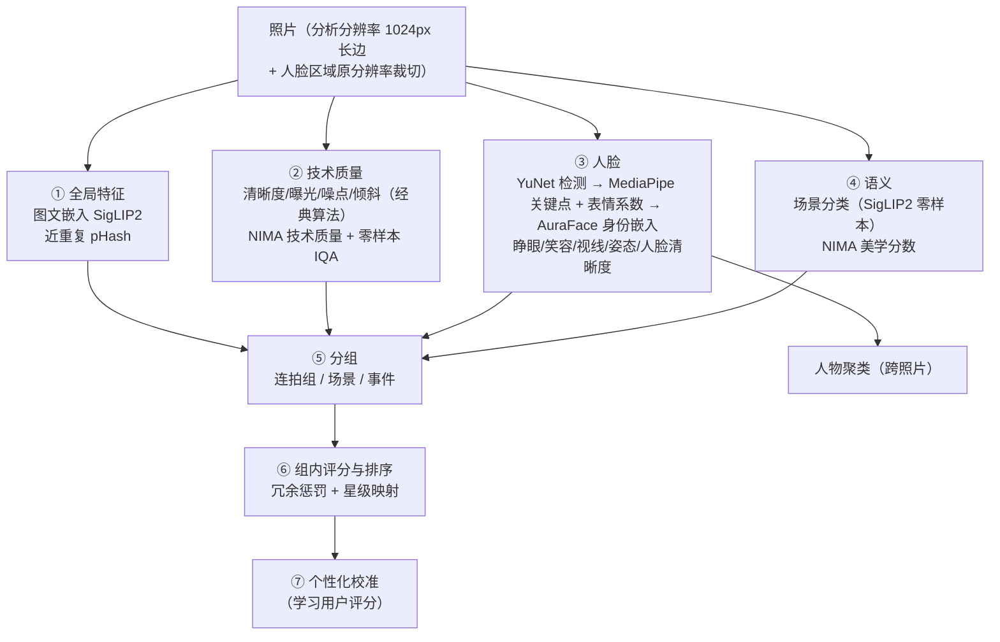
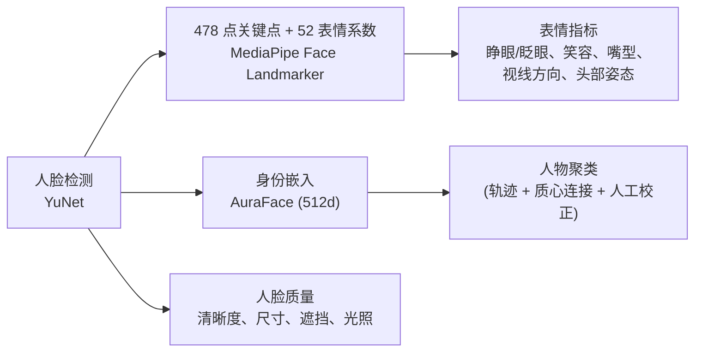
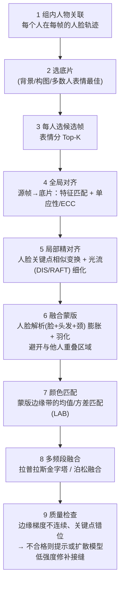

# 03 AI 与算法设计

> 本文描述每个智能功能的算法流程、所用模型（候选，详见 [07 模型清单](07-模型清单与许可.md)）、低端硬件下的替代算法，以及显存调度策略。
> 原则：**每个功能都有「经典算法兜底」**，GPU 越强效果越好，但没有 GPU 也能用。

## 1. 分析流水线总览



### 分析档位

> 以下为**现状**（`ai-worker/imagepicker_ai/steps/__init__.py` 的 `PROFILES` 与 `ip-core` 的 `Profile`）。设计阶段的 MobileCLIP、DINOv2、TOPIQ/MUSIQ、主体分割（分析阶段）与「深度」档（Q-Align / Qwen-VL 评审）**均未实现**，列为 1.x 计划。吞吐数字为设计估值，未实测（实测见 09 §2.14 与 `bench/`）。

| 档位 | 运行在 | 包含步骤 | 说明 |
|---|---|---|---|
| lite（界面「快速（本机）」） | Rust（`ip-lite` + `ip-core/src/lite.rs`），无 AI 组件也可用；Android 唯一可用的分析 | pHash、清晰度、曝光/过曝欠曝比例、噪点、倾斜 | 没有人脸/嵌入/美学：无闭眼、无人物、评分只有技术分；分组靠 pHash（连拍 P 0.96 / R 0.97，合成图库） |
| fast（界面「快速」） | AI Worker | `phash`、`quality`（清晰度/曝光/噪点/倾斜）、`faces`（YuNet 检测 + MediaPipe 表情系数，装有 `mediapipe` extra 时） | 无嵌入、无美学、无身份嵌入（人物聚类不可用） |
| standard（界面「标准」，默认；配对远程 AI 后另有「标准（远程 AI，需配对）」） | AI Worker | fast + `identity`（AuraFace 身份嵌入）、`embed`（SigLIP2-base）、`aesthetic`（NIMA）、`iqa`（NIMA 技术质量 + 零样本 CLIP-IQA 式提示）、`scene`（零样本 8 类场景） | 倾斜检测属于 `quality` 步骤，三个档位共用同一算法与常量 |

> 分析可在 AI 组件缺失或模型下载失败时用 `fallback_lite` 退回 lite（api-contract-m2 C.2）。

## 2. 智能分组（连拍 / 场景 / 事件）

### 2.1 时间线构建

1. 拍摄时间 = `DateTimeOriginal + SubSecTimeOriginal + OffsetTime`；缺失时降级到文件名中的时间戳（如 `IMG_20251001_123456`）→ 文件 mtime。
2. **RAW+JPEG 配对**视为一个拍摄单元：分组、评分、人脸只计算一次（用 JPEG 或 RAW 内嵌预览），评分与旗标同步到配对双方。
3. **多设备时间对齐**（F2.11，已实现，见 §2.4）：每个会话里每台设备一个恒定时钟偏移，分组、事件和组内排序用「校正时间 = 拍摄时间 + 偏移」，EXIF 时间与文件保持原样。

### 2.2 三级分组算法

```
输入：按时间排序的照片序列 p1..pn，嵌入 e_i（L2 归一化），pHash h_i

连拍组（Burst）—— 顺序分割：
  对相邻 (p_i, p_{i+1})：
    Δt = t_{i+1} - t_i
    sim = 0.6·cos(e_i, e_{i+1}) + 0.4·(1 - hamming(h_i,h_{i+1})/64)
    若 Δt ≤ T_burst(=自适应, 默认 3s) 且 sim ≥ θ_burst(0.85) → 同组
    若 Δt ≤ 30s 且 sim ≥ θ_strict(0.92)               → 同组（慢速连拍/同一构图多次按快门）
    否则 → 新组
  组内再检查：与组首张相似度 < 0.75 时切开（防止长组漂移）

场景（Scene）—— 对连拍组代表嵌入做时间约束聚类：
  相邻连拍组若 Δt ≤ 10min 且代表嵌入 cos ≥ 0.7 → 合并为同一场景
  （HDBSCAN 处理"回到同一地点再拍"的非连续情况**未实现**：场景只按时间顺序合并相邻连拍组）

事件（Event）—— 时间间隔 > 2h 或 GPS 距离 > 5km 切分；
  事件命名：日期 + 反向地理编码（离线 GeoNames 数据集）+ VLM 生成短标题（可选）
```

> 连拍组阈值与上面一致（`analysis/grouping.rs`：`theta_burst` 0.85、`theta_strict` 0.92、漂移 0.75；无嵌入时退化为纯 pHash）。事件层已实现（`analysis/timeline.rs`、`analysis/layers.rs`，API 见 api-contract-m2 C.6）：按场景切分——相邻场景的停顿 > 2 h（`EVENT_GAP_MS`）或「此前最后一个 GPS 位置到下一场景第一个 GPS 位置」> 5 km（`EVENT_DISTANCE_M`，大圆距离）即新事件；没有 GPS 的照片只参与时间判断；拍摄时间用 UTC 绝对时间，时区偏移只用于显示本地日期与时刻。默认名称为本地「日期 + 时间段」；反向地理编码与 VLM 标题尚未接入（`place` / `title` 字段预留）。

### 2.3 重复检测（F2.12）

整个目录库（跨会话）检测，结果存 `photo.dup_group_id`（组内最小照片 id）与 `dup_kind`：

- **完全重复**：`content_key`（头尾各 64 KiB + 长度的 BLAKE3）与文件大小相同；
- **近似重复**：去掉 EXIF 后重新保存的同一张画面——pHash 汉明距离 ≤ 4（`DUP_PHASH_MAX_BITS`；同编码同质量重存 0–2 位，合成图 JPEG 质量 90–95 重编码 24/24 在 4 位内，质量 ≥ 75 约 96%）、宽高比相同，且两张里至少一张没有拍摄时间。连拍相邻帧的 pHash 也常在 0–4 位以内，所以「至少一张无 EXIF」这条是把连拍帧排除在外的关键；用多索引哈希（`max_bits + 1` 段，至少一段完全相同）避免两两比较；
- 两种关系传递合并成组；只标记、不自动删除。

- 阈值 `T_burst` 自适应：统计该设备流相邻间隔的分布，取低谷点（连拍间隔通常 < 1s，普通拍摄间隔 > 5s）。
- 顺序分割的两点补充（阈值不变）：① **回看**：新照片与前 8 张中满足上述规则且最相似的一张同组，而不只看前一张——单张异常帧（眨眼、转头、运动模糊）不再把连拍切成两段，两台相机同时拍摄时交错的照片也各归各组；② **补洞**：夹在同一连拍组中间、由同一相机按连拍节奏（每步 Δt ≤ T_burst）拍下的 ≤ 2 张照片并入该组（连拍中途同一相机拍不出无关照片），相机未知时不补。
- 所有阈值在设置中以「分组松紧度」滑块暴露（松/中/紧），并支持手动拆分/合并组（拖拽），手动操作优先级最高。
- 评测：在标注集上计算 Pairwise F1，目标 ≥ 0.9。

### 2.4 多设备时间对齐（F2.11，P1-2）

同一会话里相机和手机的时钟常差几分钟到几小时，混在一起会让连拍、场景和事件错位。模型是**每个会话、每台设备一个恒定偏移** `offset`：`校正时间 = taken_at + offset`。偏移只在分组（连拍、场景）、事件和组内顺序中使用；`photo.taken_at`、EXIF 和文件都不改（不写任何文件）。没有设备信息或没有 EXIF 拍摄时间（用文件时间）的照片不受影响。

**估计**（`analysis/time_align.rs` 的纯函数 `estimate`，输入每张照片的设备、时间、嵌入 / pHash、GPS 时间差）：

1. **GPS 时间锚定**：GPS 定位时间（`GPSDateStamp + GPSTimeStamp`，UTC，导入时存入 `photo.gps_time_ms`）是时间真值。照片同时有 GPS 时间和 `OffsetTimeOriginal`（此时 `taken_at` 才是真 UTC）时，`gps_time − taken_at` 就是该设备的时钟误差；一台设备至少 3 张、且 ≥ 75% 在 ±5 s 内一致才采信，取中位数。没有 UTC 偏移的照片分不清时区与时钟误差，不参与。有 GPS 锚点的设备偏移是绝对的（校正后为 UTC），其余设备向它们对齐。
2. **视觉共现**：对两台设备，取「互为最佳匹配」的跨设备照片对（图像嵌入余弦 ≥ 0.90；没有嵌入时 pHash 汉明距离 ≤ 8），它们的时间差 `t_A − t_B` 在真实偏移处堆成尖峰，而相似景物在别的时间出现造成的巧合匹配散布在整个 ±24 h 里。先用 ±60 s 窗口找到最密集处，再以 ±10 s 迭代取中位数得到偏移；峰内少于 3 对，或相对均匀散布的期望其显著性 < 0.5 时**拒绝**（不给估计）。置信度 = 显著性 × n/(n+4) × (0.4 + 0.6 × 峰内占比)，n 为峰内对数。每台设备最多取 1500 张均匀抽样参与匹配。
3. **多设备**：没有 GPS 锚点时，照片最多的设备为基准（偏移 0）；其余设备按置信度从高到低贪心连边——A–B、B–C 能推出 C 相对 A（置信度取路径上最小值），所以不必每对设备都有重叠。与其它设备没有足够重叠的设备**不给估计**，只能手动输入。
4. 每台设备报告 `offset`、`confidence`、`evidence`（匹配对数；GPS 时为带 GPS 时间的照片数）和来源（`gps` / `visual` / `reference`）。

**应用**：偏移与最近一次估计存在 `session_device_offset`（迁移 v16，见 05）；估计按需计算（`GET /api/sessions/{id}/devices/offsets`），新的分析运行后清空，**已应用的偏移保留**。用户在「设备」弹窗里采纳估计（置信度 ≥ 0.5 的一次全采纳，或逐台）、手动输入偏移或重置；偏移有变化就用 `regroup_session` 重算连拍 / 场景 / 事件（手动拆分 / 合并的连拍组保留）。接口见 api-contract-m2 C.9。

**精度**：验收口径是「整机偏移样本误差 ≤ 5 s」，需要真实多设备图库。合成数据上（`time_align.rs` 的测试：两到三台设备，偏移从数秒到 ±23 小时，每次拍摄另有约 1/5 的「巧合匹配」地标照片和独拍照片，快门时刻抖动 ±2 s）：随机偏移（±10 小时内）的 40 个会话、60 个设备偏移，误差中位数 0.34 s、p95 0.89 s、最大 0.98 s；GPS 锚定与 pHash 路径各有用例，无重叠的设备、只有巧合匹配、只有 2 对匹配都不给估计。真实照片的数字用 `bench/eval-time-align.py` 在 GPU 机上测（把一台设备的时间平移已知量，看估计能否找回；见 bench/README）。

## 3. 质量评分系统

### 3.1 分项指标

| 维度 | 指标 | 算法（标准档） | 经典兜底（T0） |
|---|---|---|---|
| 清晰度 | 主体区域清晰度 | 主体/人脸区域的拉普拉斯方差 + Tenengrad，按焦距/分辨率归一化；运动模糊方向性检测（梯度方向谱） | 同左 |
| 对焦 | 是否跑焦 | 人脸/主体清晰度 vs 背景清晰度之比；人眼区域高频能量 | 同左 |
| 曝光 | 过曝/欠曝/动态范围 | 亮度直方图、高光溢出比例（主体区域加权）、EXIF 曝光参数 | 同左 |
| 噪点 | 噪声估计 | 平坦区域高频残差（MAD 估计），结合 ISO | 同左 |
| 综合技术质量 | 无参考 IQA | TOPIQ-NR / MUSIQ / CLIP-IQA（pyiqa） | 以上加权 |
| 美学 | 构图/色彩/氛围 | LAION Aesthetic（CLIP/SigLIP 头）、TOPIQ-IAA；深度档：Q-Align / VLM | 三分法/水平/主体占比启发式 |
| 人脸 | 睁眼、笑容、视线、头部姿态、遮挡、人脸清晰度 | 见 §4 | YuNet + EAR 眨眼 |
| 构图 | 水平倾斜、主体被裁切、主体位置 | 霍夫直线/消失线估计倾斜；主体框是否贴边 | 同左 |
| 干扰 | 路人、手指遮挡、杂物 | 非主体人物检测（面积/位置/对焦判断）；镜头边缘手指（肤色+模糊+边缘位置分类器） | 部分 |

> **实现状态（与上表逐项对照）**：清晰度 = 拉普拉斯方差 + Tenengrad（有人脸时取人脸区域），曝光 = 亮度均值 + 高光溢出/暗部压死比例，噪点 = Immerkaer 残差（见 `steps/quality.py` 文件头）；**美学 = NIMA-aesthetic，技术质量 = NIMA-technical + 零样本 CLIP-IQA 式提示**（不是 LAION Aesthetic / TOPIQ / MUSIQ）；**构图分已测量**（§3.1.3，`composition` 列由评分时写入；没有构图值的照片权重在其他分项间重新归一）；**「路人」位 32 与「表情欠佳」位 128 已实现**（§3.1.2）；**运动模糊方向性、跑焦比、手指遮挡未实现**；人脸 EAR 眨眼兜底不存在。

### 3.1.1 倾斜检测（水平校验）

> 实现：`crates/ip-lite/src/tilt.rs`（lite）与 `ai-worker/imagepicker_ai/steps/tilt.py`（fast / standard），同一算法与常量，属于 `quality` 步骤；`crates/ip-lite/tests/parity.rs` 交叉校验（角度差 ≤ 0.01°）。结果存 `analysis.tilt_deg`（度，**顺时针为正**：地平线右低；把照片逆时针转该角度即放平）与 `analysis.tilt_confidence`（0–1）。

在分析尺寸灰度图（长边 ~1024，与清晰度同一张）上做**方向门控、只看近轴的霍夫变换**：

1. 高斯 σ=1 + Sobel；幅值 > 20 的像素按方向分「近水平」H 族与「近竖直」V 族（偏离坐标轴 ≤ 15° + 2°），沿梯度方向做非极大值抑制细化成单像素边；权重随幅值 20→60 线性升到 1。
2. 每个边缘像素只给与自身梯度方向相差 < 2° 的候选角 θ（±15°，0.25° 一档，三角权重）投票，投到该角下的直线偏移 ρ（1 px 一档，线性分摊）；H、V 各一张累加器。
3. 每个 θ 只取 ρ 的局部峰（3 档窗口）且只计共线长度 ≥ 长边 4% 的线（软阈值到 8%），得到角度谱 P_H(θ)、P_V(θ)。树叶、发丝、波纹、织物等短纹理边不会在同一 ρ 上累积。
4. 倾角 = P_H + P_V 主峰 ±0.75° 内上半部分的质心（亚档精度）。
5. 置信度 = 支持度 `1 − e^(−峰值线长 / 0.5·长边)` × 主导度 `1 − 次峰/主峰`（次峰取距主峰 > 1° 的最大值）× 族一致性（某一族自己的主峰在别处时按其强度惩罚：仰拍会聚的竖线 vs 水平地平线、斜放桌沿 vs 竖直门框）。

取舍：单纯的梯度方向直方图会被纹理与透视线带偏，共线峰把证据限定在真正的长直线上，角度精度来自共线性（合成直线误差 < 0.1°）；竖线在相机不俯仰时与水平无关地保持竖直，横线却随透视偏转，所以两族分开统计、互相校验。没有直线的照片（纯色背景人像、美食特写、森林）置信度 ≈ 0，不判定。

**判定**（`scoring.rs` `TILTED_*`）：置信度 ≥ 0.2 且 2° ≤ |倾角| ≤ 10° 标 `tilted`，理由带角度（`{"deg": 3.5}`）。更大的角度多为透视或刻意构图，不标。只是标签：不扣分、不影响星级（倾斜在修图里一键拉直即可，且误判风险高于其他问题）。

**用途**：裁剪面板的「自动拉直」直接用这里存的 `tilt_deg`（见 §6.6），倾角符号约定即 `Crop.angle = tilt_deg`。

**标定**（lite 档实测，`bench/make-tilt-set.py` 把图库 247 张照片——全部风景 + 部分静物/人像/合影——按 0、±1、±2、±3、±5、±8° 旋转并裁掉黑边，共 2717 张；`bench/eval-tilt.py`）：

| 置信度 ≥ | 2° 起判：精确率（真值 \|角\| ≥ 2°） | 召回 \|角\| ≥ 3°（有直线的照片） | 0° 副本误报 | 原图库误报 |
|---|---|---|---|---|
| 0.15 | 0.90 | 0.19（0.29） | 4.5% | 3.3% |
| **0.2** | **0.91** | **0.14（0.21）** | **3.2%** | **2.4%** |
| 0.3 | 0.87 | 0.07（0.12） | 2.4% | 1.1% |

- 置信度 ≥ 0.2 的估计相对同一照片 0° 估计的误差：MAE 0.08°（中位 0.05°，无 > 1°）；按「原图水平」算绝对误差 MAE 1.3°（中位 0.46°）——生成图本身并不都水平（如 `pl09-noon` 海平线约 2.5°），0° 误报与绝对误差里有一部分是真倾斜。
- 召回偏低是有意的：多数照片缺少能定水平的长直线或被透视线干扰，宁可不标。提示词要求「倾斜约 8°」的三张港口图估计为 10–12°，但桅杆方向杂乱、置信度 < 0.05，未标。
- 其他问题标签与星级在原图库上不变（`bench/eval-library.py`）。

### 3.1.2 路人、雕像/海报与「表情欠佳」标签（P1-8，F2.5）

> 实现：`ai-worker/imagepicker_ai/steps/liveness.py`、`steps/faces.py`（`faces` 步骤）与 `crates/ip-core/src/analysis/scoring.rs`（`is_tag_bystander`、`bad_expression`、`subject_flags_live`）。三个常量在 Python 与 Rust 两侧各有一份，改动要同步（`scoring.rs` 的 `ARTIFICIAL_AT`、`TALKING_MOUTH_OPEN`、`EXPR_SMILE_BELOW`、`HALF_BLINK_*` 对应 `liveness.ARTIFICIAL_AT`、`faces.MOUTH_OPEN_TALKING` 等）。标签只是标签：不扣分、不进硬性问题。

**`bystander`（路人，`photo.issues` 位 32）**：照片里有一张脸同时满足
1. 不是主体（`face.is_subject = 0`，§4.2 的 `subject_flags`，含合影成员并入）；
2. 清晰：人脸清晰度 ≥ 0.35（同 `BLURRY_BELOW`）；
3. 够大：框面积 ≥ 画面的 0.3%（约 5.5% × 5.5%，`BYSTANDER_MIN_AREA`），更小的是背景，不值得提示；
4. 不是雕像/海报/屏幕上的脸（`face.artificial < 0.55`）。

理由 `{"count": n}`。`face.is_bystander` 列仍是「非主体且非人造」（「消除路人」的候选，`GET /api/photos/{id}/bystanders` 同口径）；雕像等人造脸不在候选里，但仍可用 `face_ids` 手动消除。

**人造脸（`face.artificial`，0–1）**：`faces` 步骤对每张脸的框内像素做廉价的真人/平面判断，不引入新模型（`face.likely_artificial` = `artificial ≥ 0.55`）。取框内 70% 区域缩到 64 px，四个线索各自平滑到 0–1（1 = 像人造）：

| 线索 | 度量 | 权重 | 0 → 1 的区间 |
|---|---|---|---|
| 饱和度低 | 区域 HSV 平均饱和度 | 0.25 | 0.22 → 0.08 |
| 肤色占比低 | YCrCb 肤色盒（Cr 133–173，Cb 77–127）内像素比例 | 0.25 | 0.55 → 0.15 |
| 纹理极低 | 减去 σ=1.5 高斯模糊后的残差的稳健标准差（MAD×1.4826，灰度级） | 0.30 | 2.5 → 0.6 |
| 平面 | σ=6 模糊后的亮度做平面拟合的 R²（真脸有三维明暗） | 0.20 | 0.85 → 0.98 |

只靠「平」最多得 0.5，达不到阈值 0.55：磨皮后的真脸、低 ISO 的光滑皮肤不会仅因纹理少而被判成人造，代价是色彩正常又很光滑的海报会漏掉。整张图平均饱和度 < 0.07（黑白照）时颜色线索无信息，只用纹理与平面，且得分封顶 0.5：黑白照里不判人造。框短边 < 24 px 的脸证据不足，不判（按真人处理）。人造脸**不参与**主体判定（`subject_flags_live` 先剔除它们，大海报不会把真人挤成路人），也不计表情/闭眼。这些常量是未标定的初值：`bench/eval-bystander.py` 在带标注的合成库上量化误判率（目标 ≤ 10%），据此调权重与阈值。lite 档没有该步骤，`artificial` 为空，一律按真人。

**`bad_expression`（表情欠佳，位 128）**：主体（非人造）脸有 landmarks 且**不在笑**（`smile < 0.35`）时：
- 说话中：`mouth_open`（MediaPipe `jawOpen`）≥ 0.25 → `kind = "talking"`；
- 半闭眼：`eyes_open` ∈ [0.45, 0.65) → `kind = "half_blink"`（低于 0.45 是 `closed_eyes`）。

笑着时张嘴、眯眼不算。理由 `{"count": n, "kind": ...}`。没有 landmarks（lite、未装 mediapipe）则不出此标签。阈值同样是初值：`bench/eval-bystander.py` 对合成库的 `mid-talk` 变体统计召回（目标 ≥ 70%）与其它照片的误报（目标 ≤ 5%），并给出 `mouth_open` 阈值的扫描表。

### 3.1.3 构图分（P1-8，F2.4）

> 实现：`crates/ip-core/src/analysis/composition.rs`（纯函数）；`rescore_bursts` 在评分时算出并写入 `analysis.composition`（0–1）。工作进程只额外给一个显著性框：`quality.saliency`（`steps/composition.py`，32×32 网格上「到全图均色的 Lab 距离 × 中心先验」，取 ≥ 最大值一半的格子并按 5%–95% 分位修剪）存为 `analysis.saliency`。

锚点 = 主体人脸（非人造）的并集框，没有则用显著性框；都没有则不出分（该项不参与综合分，其余权重归一）。四个分项，按存在的分项归一化加权：

| 分项 | 权重 | 含义 |
|---|---|---|
| `thirds` 三分法 | 0.35 | 锚点（人脸取眼线：框顶向下 40%）到三分线/中心的接近度：每个轴取「σ=0.09 的高斯贴近最近三分线」与「0.8 × σ=0.06 的高斯贴近中心」的较大者，两轴取几何平均；居中略低于压在三分线上，贴角/贴边很低 |
| `headroom` 头顶留白 | 0.15 | 仅有人脸且高度 ≥ 画面 8%：头顶到画面顶的距离在 4%–25% 之间为 1；更小线性降到 0（顶着头），更大线性降到 0.3（浪费画面） |
| `horizon` 水平 | 0.20 | 仅当 `tilt_confidence ≥ 0.2` 且 |倾角| ≤ 10°：0° 为 1，6° 起为 0.15；更大的角度多为透视/刻意，不评 |
| `cutoff` 主体被裁 | 0.30 | 人脸框贴左/右/下边（距边 < 1%）的比例 p：`1 − 0.8p`（上边由留白评）；无人脸时显著性框贴边且不到全图 90%：0.6 |

**入综合分**：`COMPOSITION_WEIGHT = 0.08`（人像/合影/夜景/其他；风景/建筑沿用原有的 0.20），与其余分项一起按「存在的分项」归一化，所以没有构图值的照片分数完全不变；好坏构图（0.9 对 0.1）在综合分上约差 0.06，只在其余分项相当时改变排名。构图值与各分项贡献照常写入 `explain`，检视面板条形图可见。不影响硬性问题与星级上限。

### 3.2 综合分与星级映射

```
场景类型 c ∈ {人像, 合影, 风景, 美食, 建筑, 夜景, 宠物, 其他}（SigLIP 零样本分类）
Q = Σ_k w_k(c) · s_k        // 各分项归一化到 0–1，权重随场景类型变化
   − 硬性惩罚（主体人物闭眼 −0.25；严重模糊 −0.3；严重过曝 −0.2 …）
冗余调整：组内与更高分照片高度相似且无独特优点 → 轻度降分（使"每组最佳"更突出）

星级 = 绝对分 + 组内相对排名 的结合：
  base_star = 分段映射(Q)：<0.2→0, <0.35→1, <0.5→2, <0.65→3, <0.8→4, ≥0.8→5
  组内第 1 名 +0.5（取整后不超过 5）；有硬性问题者上限 2 星
```

| 场景 | 主要权重 |
|---|---|
| 人像/合影 | 人脸（0.4）、清晰度（0.25）、美学（0.2）、曝光（0.15）、构图（0.08） |
| 风景/建筑 | 美学（0.4）、技术质量（0.3）、构图（0.2）、曝光（0.1） |
| 夜景 | 降低噪点惩罚、提高清晰度权重（构图 0.08） |
| 其他 | 美学（0.3）、清晰度（0.3）、技术质量（0.25）、曝光（0.15）、构图（0.08） |

（权重以 `analysis/scoring.rs` `weights()` 为准；场景类型缺失时按主体人脸数推断：0 张=其他，1–2 张=人像，≥3 张=合影。）

问题标签与阈值（`scoring.rs`）：**闭眼** = 任一主体人脸 `eyes_open < 0.45`，而 `eyes_open = 1 − max(左眼眨眼系数, 右眼眨眼系数)`，所以**任一只眼闭上**即标闭眼（没有「半眯眼」标签）；**模糊** `sharpness < 0.35`（< 0.20 为严重），另外连拍组内比组内最清晰帧低 20% 以上也标模糊；**过曝/欠曝**见常量 `OVEREXPOSED_*`、`UNDEREXPOSED_*`（高调/低调画面有细节时不标）；**噪点** ≥ 0.22（夜景 0.30）；**倾斜** 见 §3.1.1。`photo.issues` 位：1 闭眼、2 模糊、4 过曝、8 欠曝、16 倾斜、32 路人、64 噪点、128 表情欠佳。硬性惩罚：闭眼 −0.25、严重模糊 −0.30、严重曝光 −0.20；组内冗余 −0.03（嵌入 cos ≥ 0.93）；有硬性问题者最多 2 星；组内第 1 名 +0.5 星。星级分段映射与上面一致。

- **可解释**：每个分项及其贡献都存库，UI 以条形图展示，并生成一句话理由（模板化；深度档由 VLM 生成）。
- **AI 星级永不覆盖用户星级**。

### 3.3 个性化评分（F2.10）

- 训练数据：用户的显式评分、精选/淘汰（`preference_label` 表），以及同一连拍组内未标注的组友（半权重）作为隐式成对偏好。
- 模型（`taste.rs`）：**线性**成对逻辑回归（RankNet 风格，全批梯度下降，L2 = 0.02），输入是分项分数 ⊕ 场景 one-hot（共 9 项测量），**没有 SigLIP 嵌入输入，也没有 MLP**；至少 30 张已标注照片、20 个留出配对才训练，每积累 50 个新标注自动重训。
- 输出与基础分融合：`Q' = (1−α)Q + α·Q_user`，α = 0.6 × 标注数 / 200（封顶 0.6）；在保留集上若个性化不优于基础分则不启用（`active = 0`）。
- 可在设置中查看「我的口味」：例如"你偏好低饱和、更喜欢抓拍而非摆拍"。

### 3.4 自然语言搜索（F2.9）

- **索引**：标准分析的 `embed` 步骤已为每张照片存下 SigLIP2 图像向量（768 维，L2 归一化，f16，`analysis.embedding`），搜索不需要任何额外的图像推理或索引文件。
- **查询**：worker 的 `text.embed` 用同一模型家族的文本塔（`siglip2-base-text`，fp16 ONNX，约 550MB，CPU 可运行；与场景零样本提示词共用 `Embedder.embed_text`）把查询变成同一空间里的向量。查询向量带 256 条 LRU（输入框边输边搜时同一句不会重复推理）。
- **检索**：对范围内（会话或整库，可叠加所有 `/photos` 筛选）的嵌入做精确余弦，一遍扫描、无索引：10 万张约几百毫秒量级（未实测）；超过这个规模再考虑 05 §1.2 的向量索引。
- **打分与阈值**：`score = sigmoid(112.67·cos + b)`（SigLIP 的 sigmoid 损失，分数与其他照片无关），默认下限 0.05（余弦≈0.12），可用 `min_score` 调整。`b = -16.5` 取自 SigLIP 系列公开值，ONNX 导出不含它、未读回校准；它只影响概率刻度和默认阈值，不影响排名。
- **中文支持（核对结果）**：SigLIP2 的文本塔使用约 256k 词表的多语言分词器（仓库登记的 `tokenizer.json` 为 34,363,039 字节，远大于词表只有 32k 的 SigLIP v1），并在多语言 WebLI 数据上训练，所以中文查询直接分词、不需要翻译。我们的预处理（折叠空白、转小写、截断到 64 个 token）对中日韩文字无副作用。**但训练数据以英文为主（据 SigLIP2 论文），中文的检索质量预期低于英文**，尤其是长句、方位关系和少见物体。本轮没有在本机运行模型，未做实测；`bench/eval-search.py` 对 20 个概念各问一次中文、一次英文（共 40 条），分别报告 zh / en 的 recall@20，用来量化差距。若中文明显偏弱，可行的改进是加入一份「中文 → 英文」同义词扩展，或在界面里提示改用英文描述；在有数据之前不做承诺。
- **诚实边界**：未分析的照片搜不到（界面会提示有多少张）；搜索只理解「画面里有什么」的整体描述，不做精确计数、文字（OCR）或人物姓名（用人物筛选）；排名质量以合成图库为准，真实照片未复核（backlog）。
- **评测**：见 §10 与 `bench/README.md`；验收标准 recall@20 ≥ 0.8（09 P1-4）。

## 4. 人脸与表情分析



### 4.1 表情指标

| 指标 | 计算 | 备注 |
|---|---|---|
| 睁眼度 | `eyes_open = 1 − max(eyeBlinkLeft, eyeBlinkRight)`（无 EAR 兜底；未装 MediaPipe 时为空） | 任一眼眨眼系数 > 0.55（`eyes_open < 0.45`）即判闭眼；无「半眯眼」标签；人物筛选「睁眼」用 `eyes_open ≥ 0.55` |
| 笑容 | `mouthSmileLeft/Right` 等表情系数（`smile` 0–1） | 仅一个连续分数，无「自然笑/大笑」分类，无 FER 模型；人物筛选「微笑」用 `smile ≥ 0.5` |
| 视线 | 虹膜关键点相对眼眶位置 + 头部姿态，闭眼视为没看镜头（`gaze_score`） | "看镜头"得分；人物筛选「看镜头」用 `gaze ≥ 0.6` |
| 头部姿态 | 关键点 PnP 求 yaw/pitch/roll | 侧脸过大降分 |
| 嘴型 | `mouth_open` = `jawOpen` 系数（v15） | 只用于「表情欠佳」标签（§3.1.2），无嘴型分类 |
| 遮挡 | （`occlusion` 列预留，未实现） | — |
| 人脸清晰度 | 眼部区域高频能量 | 跑焦/运动模糊 |

**表情分**（`scoring.rs` `expression_score`）= 睁眼 0.40 + 笑容 0.20（`0.4 + 0.6·smile`）+ 视线 0.15 + 姿态 0.10 + 人脸清晰度 0.15，缺项时对剩余权重重新归一；权重固定，不随用户偏好学习。

### 4.2 主体人物判定

合影中并非所有人脸同等重要：主体权重 = 人脸面积 × 居中度 × 清晰度 × 是否为"已命名人物" × 是否看镜头。路人（小、虚、靠边、背向）权重低，且可被标为「路人」用于消除功能；雕像/海报/屏幕上的人造脸（§3.1.2）不参与竞争，也不算路人。

### 4.3 人物聚类

- 512 维身份嵌入，余弦相似度；先在连拍组内用 IoU + 相似度做轨迹关联（`TRACK_COS` 0.30，强相似 0.45；同一人同一组必然同一身份），再跨组做**质心连接**聚类（`PERSON_COS` 0.38）；新建（未命名）人物至少需要出现在 2 张不同照片（`MIN_PHOTOS_NEW_PERSON`），更少的脸保持未归属。**不是 HDBSCAN。**
- 用户命名/合并/拆分作为约束（must-link / cannot-link），后续新照片按最近人物中心分配。
- 人物库跨会话保留（可删除，隐私）。

### 4.4 按人脸筛选（F2.13）

所有人脸筛选都基于 `face` 表的逐脸记录（person_id、表情指标、is_subject），在 SQL 中完成，万张库 < 100ms：

| 筛选 | 实现 |
|---|---|
| 多人 AND / OR / NOT | `photo.id IN (SELECT photo_id FROM face WHERE person_id IN (...) GROUP BY photo_id HAVING COUNT(DISTINCT person_id) = k)`；OR 去掉 HAVING；NOT 用 `NOT EXISTS` |
| 按人状态 | 子查询中附加 `eyes_open ≥ 0.55`、`smile ≥ 0.5`、`gaze ≥ 0.6`（`model.rs` 常量）、`is_subject = 1`、`sharpness ≥ τ`（阈值固定，设置中不可调） |
| 点脸即筛 | 已聚类的脸直接用其 person_id；尚未聚类/孤立的脸用其嵌入做近邻检索（cos ≥ 阈值，在评测集上校准）得到「临时人物」 |
| 以脸搜脸 | 上传图 → 人脸检测（多张脸让用户点选）→ 嵌入 → 与各人物中心及孤立人脸近邻检索 → 返回候选人物（附相似度）供确认 |
| 人数 | 分析阶段回填 `photo.subject_face_count`（只计 is_subject）与 `photo.face_count` |
| 每人最佳 | 对人物 p 的每张照片：`best = 0.6·该人 expression_score + 0.4·照片综合分 Q`，同一连拍组只取最高一张，取 Top-N |

默认人物筛选只匹配**主体**人脸（§4.2），可切换为「包括作为背景路人出现」。

## 5. 最佳表情合成（Best Take）

目标：同一连拍组中，以一张为底片，为每个人选择最佳帧中的脸，合成"全员最佳"。



- **选底片**（第 2 步，`generate.rs` `plan_from_tracks`）：逐帧估算以它为底片时「全员最佳」要做的合成工作与残留风险，不再总用组内最佳：
  - 「足够好」= 表情分距本人组内最佳不超过 0.04（`MIN_GAIN`）；只有可合成（姿态差 ≤ 25°）且比底片原脸高出 0.04 以上的脸才替换（一键全员最佳与选底片用同一规则）。
  - 代价 = Σ 每张需替换的脸 × 脸尺寸权重（√面积，相对最大的脸）+ 6 × 替换后仍低于本人最佳的表情差（超出 0.04 的部分，如无法替换的闭眼）× 权重 + 3 × 缺席的人物 × 权重（人物 = 在至少一半帧、且至少两帧中出现的主体）。
  - 模糊 / 过曝 / 欠曝（`photo.issues`）的帧不作底片，全部帧都有时才参与比较；闭眼、噪点、倾斜不排除（可合成或修图修复）。
  - 在剩余帧中取代价不超过「最低代价 + 0.25」的**排名最靠前**一帧：组内最佳只在别的帧明显省事时才被替代，平局按组内排名，结果确定、可复现。
  - 计划附带 `base_choice`：`mode`（auto / manual）、`reason`（`group_best`、`group_best_issue`、`fewer_missing`、`fewer_replacements`、`fewer_below_best`、`less_work`、`manual`）、`auto_photo_id` 与每帧的 `replacements` / `below_best` / `missing` / `issues` / `cost`，供界面与 CLI 解释；用户可手动指定底片（`?base_photo_id=`、`besttake/auto` 请求体）。
- 结果作为**补丁图层**（patch + mask + 源帧引用）存入编辑栈，可随时切换回原脸或换另一个候选。
- 约束：底片与源帧相机位移过大（单应性残差 > 阈值）或人物姿态变化过大（头部姿态差 > 25°）时，该候选标记「不可合成」，只提供"选这张整图"建议。
- 高端档（T3）可选：用扩散修补模型（inpainting）以低去噪强度只重绘接缝带，消除残余伪影。
- 伦理约束：只允许同一人物（身份嵌入相似度 > 阈值）在同一连拍组内替换。

### 5.1 换成我最好的发型（Hair transfer，同人换发）

场景：同一天 / 同一次活动里，前面的照片头发状态好，后面天热出汗，头发塌、成缕、发亮。用户希望把后面照片里的头发换成自己在另一张照片里的头发，脸保持原样。与 Best Take 的区别：供发照片**不要求同一连拍组**（往往隔了几个小时、换了地点），所以没有背景单应性可用，头部本身是唯一的对齐参照。

**选供发照片**（`GET /api/photos/{id}/hair/donors?face_id=`，`ip-core/src/hair.rs`）：

- 候选 = 同一人物（`person_id`）或同一人脸轨迹的其他照片中的脸；目标脸没有人物也没有轨迹时，取同一会话中身份嵌入余弦 ≥ 0.40（`HAIR_MIN_COS`）的脸。两张脸都有身份嵌入时，余弦低于 0.30（`MIN_IDENTITY_COS`，同 Best Take）的候选视为聚类错误直接去掉。每张照片最多一张脸，列表最多 40 个。
- **姿态门限**：偏航差 > 20°、俯仰差 > 15° 或横滚差 > 20°（`HAIR_MAX_*`）→ `pose_too_different`；供发脸宽 / 目标脸宽 < 0.5（头发要放大 2 倍以上）→ `donor_too_small`。不合格的候选仍列出，但标「不可用」，不会去合成。角度优先用目录库中的人脸姿态，缺失时（lite 档位）用 worker 现场测的关键点姿态。
- **发质评分**（worker `hair.rank`，`besttake/hair.py` `hair_metrics`；最多测 16 个候选 + 目标本身，统一缩放到脸宽 160 px 再测，结果与照片分辨率无关）：
  - `hair_ratio` 头发面积 / 脸部椭圆面积（出汗塌下来的头发面积变小）；
  - `shine` 头发中「比头发中位亮度高 25 L 以上、L > 45、色度 < 18」的高光像素比例（湿 / 油的头发反光）；`skin_shine` 同理统计脸部皮肤（供第二阶段「去汗光」使用）；
  - `roughness` 头发蒙版中被半径 3.5% 脸宽的形态学开运算去掉的比例（细碎发丝、成缕）；
  - `sharpness` 头发内部亮度拉普拉斯绝对值均值（发丝清晰度）。
  - 综合分 =（0.35 × 体积 + 0.25 × 干爽 + 0.20 × 整齐 + 0.20 × 清晰）× 姿态系数；体积 = 头发面积 / 本人（目标 + 候选）中位数，封顶 1.3 倍；干爽 = 1 − shine / 5%；整齐 = 1 − roughness / 30%；清晰 = 清晰度 / 中位数，封顶 1.5 倍；姿态系数 = 1 − 0.3 × 最大角度差 / 其门限。
  - 理由（`cues`，界面逐条显示）：相对目标本身 `fuller`（面积 +8%）、`less_shine`（高光 < 目标的 70% 且至少低 0.3 个百分点）、`tidier`（碎发少 3 个百分点）、`sharper`（+15%），以及 `similar_pose`（各角度差 ≤ 8°）、`earlier`（拍得更早）、`same_session`。
  - 排序：同一会话优先 → 可用优先 → 分数 → 时间最近。worker 不可用或缺模型时照样列出（`ranked:false`、`rank_error`），只是没有分数。
- 服务端强制同人（`POST /api/photos/{id}/hair`，`check_hair_identity`）：人物不同且不在同一轨迹 → `422 hair_person_mismatch`；两边都有身份嵌入时余弦低于 0.30（有人物 / 轨迹关联）或 0.40（无关联）→ `422 hair_low_similarity`；没有任何关联又没有嵌入可比 → `hair_person_mismatch`。姿态门限同样在服务端检查（`hair_pose_too_different` / `hair_donor_too_small`），不启动任务。

**合成**（worker `hair.compose`，`besttake/hair.py` `hair_compose_arrays`，纯 numpy / OpenCV，模型注入）：

1. 两张脸的 478 点关键点 + 头部姿态；姿态 / 尺寸门限同上（worker 再查一次）。
2. 对齐：只用稳定关键点（脸轮廓去掉下巴弧线、鼻梁，与 Best Take 的 `STABLE_IDX` 相同）拟合**相似变换**（缩放、旋转、平移，LMedS）把供发照片映射到目标；拟合残差 > 8% 脸宽 → `face_not_aligned`。工作区域 = 目标脸周围（宽 ±1.3 倍脸宽，上方 1.5 倍脸高，下方 1.4 倍）。
3. 分割：selfie-multiclass 分别作用于目标裁切与对齐后的供发裁切，取头发概率；只保留与头部相连的头发连通域（别人的头发不算）。供发头发面积 < 4% 脸部椭圆 → `donor_no_hair`。
4. **保护区**：目标脸眉毛线以下的整张脸（脸部椭圆）以及眼、眉、嘴多边形，混合权重强制为 0（向外平滑过渡），保证目标的脸、眼睛、嘴原样不动；眉毛线以上的额头可以接收供发的刘海，目标自己的碎发挂在额头上时用供发照片对应位置的额头皮肤替换。
5. **区域**：粘贴区 = 供发头发（+ 额头上目标有头发的部分）；填充区 = 目标头发（含附近 0.3 倍脸宽内的零散发丝连通域，再外扩 3% 脸宽，覆盖飞起的碎发）中未被供发头发覆盖、且不在脸上的部分，用目标照片周围的背景补全：装了 LaMa 时用 LaMa（同 `inpaint.run` 的 `inpaint_arrays`），否则 OpenCV Telea。
6. **光线匹配**：两张脸皮肤（去掉五官、去掉最亮的 15% 即汗光）的 LAB 中位数之差就是两张照片的光线 / 白平衡差（同一个人的皮肤），把它加到供发图像上；限幅 L ±18、a/b ±8。皮肤像素不足时不匹配并给出 `lighting_unmatched` 警告。
7. **软蒙版**：发丝边缘用供发头发的概率本身（smoothstep 0.25–0.75 + 轻微模糊）作 alpha，不做二值硬切；整个补丁 alpha 再按 1.2% 脸宽高斯羽化，保护区内为 0。
8. 质量：姿态差（超过门限 60% → `pose_differs`）、填充面积 / 粘贴面积 > 35% → `large_fill`、供发脸宽 < 目标 0.8 倍 → `donor_small`、接缝带梯度不连续 > 0.6 → `seam`；综合成 `quality.score`。

**存储**：结果是编辑栈里的一个 `patch` 操作，`kind: "hair"`，每张脸（`base_face_id`）一个，与 Best Take 补丁同样在裁剪前叠加（渲染顺序 02 §5.3）。`amount` = 强度（之后可随时调，不必重算），`enabled:false` = 暂时看原发型，删除该操作 = 撤销；另外记录 `person_id`、`source_photo_id`（供发照片）、`source_face_id`、对齐参数 `align {scale, rotation_deg, dx, dy, landmark_rms}` 与 `warnings`。资产与导出、撤销、复制规则同其他补丁（照片专属资产，不随同步 / 预设复制）。

**已知风险**（需要真实照片验证，见 backlog）：发丝边缘（尤其浅色背景前的深色细发、逆光发丝）只有 selfie-multiclass 256×256 的分辨率，可能出现光晕或发丝变粗；供发与目标背景不同，发丝间透出的是供发照片的背景；头发长度差很多时填充面积大（LaMa 较好，Telea 只适合小面积）；侧光方向不同的照片，只做了整体光线平移，头发上的明暗方向不会变；头部姿态接近门限时，2D 相似变换无法表现头发的立体转动。验证脚本：`bench/hair-transfer-demo.py PHOTO_DIR` 输出「目标 / 供发 / 结果 / 蒙版」对照图。

### 5.2 生成式换发型（设计，未实现）

5.1 的直接粘贴受限于姿态：头转动 20° 以上、或希望在不同光线下自然地「重画」头发时，需要生成式方法。设计如下（需要用户的 GPU 电脑评估，T3 档位）：

- **方法**：SDXL Inpainting（已在 `models/registry.yaml` 中作为 `sdxl-inpaint` 的可选增强包）只重绘目标的头发区域（5.1 的粘贴区 ∪ 填充区，外扩 4% 脸宽并羽化），脸部保护区不进入蒙版，因此身份由原像素保证，而不是由模型保证。条件输入：
  - **参考发型**：供发照片中按 5.1 对齐、裁到头发区域的图像，通过 IP-Adapter（SDXL 版 `ip-adapter-plus_sdxl_vit-h`）注入，权重 0.6–0.8；备选「reference-only」注意力注入（无需额外权重，参考图的 self-attention K/V 拼接进去噪 UNet），适合不想多下载模型时；
  - **结构**：目标头部的轮廓 / 姿态用 ControlNet（SDXL depth 或 softedge，从目标图计算）约束，保证头发贴合目标的头型与转角；
  - **初始化**：用 5.1 的粘贴结果作为 img2img 起点（去噪强度 0.45–0.6），而不是纯噪声，这样颜色与发型来自本人；
  - **文本**：只用中性描述（`natural hair, same hairstyle, photo`）+ 负面词（`wet hair, greasy, sweat, extra hair, hat`），不改变发型类别。
- **身份**：脸部像素不重绘；另外把结果的身份嵌入（AuraFace）与目标比较，余弦低于 0.6 时判为失败不写入（防止头发蒙版误含脸部边缘导致的五官改变）。
- **模型与许可**（1.0 版的许可立场是「个人非商业使用」，09 §5.5 D2）：SDXL Inpainting 0.1（CreativeML OpenRAIL++-M，可用）；IP-Adapter SDXL（Apache-2.0，权重随 h94/IP-Adapter 发布；ViT-H 图像编码器为 OpenCLIP，MIT 系）；ControlNet SDXL depth / softedge（多为 OpenRAIL++ 或 Apache-2.0，逐个核对）；FLUX.1 Fill [dev] 质量更高但为非商用许可，只能作为标注「非商用」的可选项。都写入 `docs/07` 的模型清单后才能上线。
- **资源**：SDXL + IP-Adapter + ControlNet 约 10–12 GB 显存（fp16），1024 方形裁切，30 步约 8–15 s（RTX 4070 级别，未测）；与其他扩散模型互斥（ModelManager，03 §8.2）。低于 T3 不提供。
- **评测计划**：
  1. 数据：用户自己的 3–5 组「同一天前后」照片（每组 1 张好发型 + 3–5 张出汗后的），另加姿态差 10° / 20° / 30° 三档；
  2. 指标：身份余弦（结果 vs 目标）≥ 0.6；脸部保护区像素差 = 0（结构保证）；发区与供发的颜色 / 纹理统计（LAB 均值差、高光比例 `shine`、`roughness`）应接近供发而非目标；接缝带梯度不连续；每张耗时与显存峰值；
  3. 主观：用户在 `bench/hair-transfer-demo.py` 式的对照图上对比 5.1（直接粘贴）与 5.2（生成式），按「像不像自己 / 发型对不对 / 边缘自然吗」三项 1–5 分；
  4. 上线条件：在姿态差 20–30° 的组上，主观分明显优于「不可用」（即用户愿意使用），且身份失败率 < 5%。

## 6. 光影与色彩智能调整

### 6.1 一键自动（F5.3）

> **现状**：`ip-render/src/auto.rs` 只有下表「经典兜底」一列的**规则实现**（`POST /api/edits/{id}/auto`，在 ≤256×256 的子采样上确定性计算）；学习型 AWB、Zero-DCE++、Image-Adaptive 3D LUT 均未实现（学习型风格用内置预设与 LUT 代替）。

| 子任务 | 标准方案 | 经典兜底 |
|---|---|---|
| 白平衡 | （学习型 AWB 未实现）灰度世界 + 白点 + 肤色约束 | 同左 |
| 曝光/色调 | 主体加权的直方图目标匹配 → 输出 曝光/高光/阴影/白/黑 参数 | 同左（规则） |
| 色彩 | 场景自适应自然饱和度；天空/植被/肤色分区处理 | HSL 规则 |
| 去雾/通透 | 暗通道先验 → 输出"去雾"参数 | 同左 |
| 低光 | Zero-DCE++（轻量）估计曲线 → 转换为曲线参数 | 自适应伽马 + CLAHE |
| 学习型风格 | Image-Adaptive 3D LUT（轻量，几 ms）预测 LUT 混合权重 | 预设 |

**关键设计：AI 输出的是"滑块参数"，而非直接改图**。用户看到的是"曝光 +0.35、阴影 +22、色温 +300K"，可继续微调；批量时每张单独预测参数，保证一致的观感而不是一刀切。

### 6.2 组内统一（F5.6）

把参考照片的调整同步到组内其他照片时：先同步参数，再以参考图渲染结果为目标，对每张做曝光/白平衡的小幅自适应匹配（主体区域亮度与灰点匹配），避免因原片曝光差异导致同步后不一致。

### 6.3 风格参考迁移（F5.7）

> **未实现**：没有 `color.match_reference` worker 方法，也没有对应接口；界面里的「匹配参考图…」按钮是**禁用的占位**（`web/src/components/edit/BasicPanels.tsx:48`，提示「后续版本提供」）。以下为 1.x 设计。

从参考图统计 LAB 分区色彩分布（阴影/中间调/高光），求解最接近的色彩分级参数 + 曲线（可微渲染器上梯度优化，~100 次迭代，GPU < 1s），输出仍然是可编辑参数。

### 6.4 智能蒙版（F5.4）

| 蒙版 | 模型 | 兜底 |
|---|---|---|
| 主体 / 人物 | **已实现**：BiRefNet（`birefnet-lite*` / `birefnet-fp16`，按档位）；人物 = 脸框附近裁剪 + 连通域/分水岭选出该人。SAM 2 点选细化未实现 | — |
| 天空 | **已实现**：skyseg-u2net（U²-Net），未装时用颜色+位置启发式 | 颜色+位置启发式 |
| 皮肤/头发/衣服 | **已实现**：MediaPipe 多类自拍分割（皮肤 = 身体皮肤 + 面部皮肤）；人脸解析（细分眉眼唇）未采用 | 肤色模型（YCbCr） |
| 指定人物 | 见「主体 / 人物」（`person_id` 关联脸框） | — |
| 深度 | （未采用 Depth Anything） | — |

蒙版以 8-bit PNG（分析分辨率，渲染时引导滤波上采样到原图边缘）缓存。

### 6.5 降噪 / 超分 / 修复

- 降噪：SCUNet（`scunet-color-real-psnr`，ONNX；NAFNet 未采用），输出作为 `denoise` 补丁图层。
- 超分：Real-ESRGAN x2/x4（分块推理），导出时可选。
- 人脸修复：GFPGAN v1.4（CodeFormer 未采用），强度可调。「只在人脸小且模糊时建议」的自动建议**未实现**，由用户手动触发。

### 6.6 自动拉直与智能裁剪（F5.10，P1-11）

实现：`crates/ip-render/src/crop_assist.rs`；接口 `POST /api/edits/{id}/auto-crop`（`ip-core` `edit::plan_auto_crop`，api-contract-m3）；界面为裁剪面板的「自动拉直」「自动裁剪」。两者**只算 `Crop.rect` + `Crop.angle`，不碰渲染管线**（预览与导出仍走同一几何阶段 `geom.rs`），结果由前端写进编辑栈，一步撤销。

**自动拉直**
1. 倾角：`analysis.tilt_deg`（置信度 ≥ 0.2 且 |倾角| ≤ 15°）；没有或不够可信时，对 1024 px 代理图当场跑 `ip-lite` 的同一个估计器（`estimate_tilt`，亮度图长边降到 ~1024，与分析一致）；仍不可信 → 不改动，提示用滑块。
2. 符号：`tilt_deg > 0` = 内容顺时针偏（地平线右低）；`Crop.angle > 0` = 内容逆时针转，所以 `angle = tilt_deg`（取 0.1° 与滑块同步长）。|倾角| < 0.15° 视为水平：`level = true`，angle 0，不改动。
3. 裁剪：在比例 r（像素宽高比；「自由」沿用当前裁剪框的比例，「原始」= 原图比例）下取旋转后图像内**最大的居中轴对齐矩形**：半高 k = min( (W/2)/(r|cosθ|+|sinθ|), (H/2)/(r|sinθ|+|cosθ|) )，半宽 r·k（四个角旋转后都不越出原图，居中即最优）。结果按 1e-4 向内取整，保证不超出。

**自动裁剪（构图建议）**
1. 主体：已存人脸框的并集；没有脸时用显著性代理——48 格网格上「与全图均值的色差（亮度 + r−g + (r+g)/2−b）」平方 × 中心先验，取加权质心与 ±1.5σ 的框；平图退化为中央框。
2. 尺寸：比例下的最大合法裁剪（含当前旋转角）乘 f，f = 主体占裁剪长边的比例 ÷ 0.55，夹在 [0.7, 1]，且不小于能容下主体 + 1% 边距的值。
3. 位置：主体中心对到四个三分线交点之一，选「到位偏差 + 0.1×交点与主体原位置距离」最小且主体框完整在内的候选；主体宽（高）超过裁剪的 45% 时该轴改为居中。越出旋转后图像时沿「居中 → 目标」线二分取最近的合法位置。
4. 全程确定性、无模型依赖，CPU < 几毫秒（不含取代理图）。

**验收**（`crop_assist::tests::one_click_straighten_leaves_at_most_half_a_degree`）：合成「地平线 + 4 根立柱」场景（带噪声）按 ±1、1.5、2、3、4、5、8、10° 旋转（900×600），经真实 CPU 渲染器应用拉直裁剪后再测倾角，比例 3:2 / 1:1 / 自由各一遍：**最大残余 0.14°**（要求 ≤ 0.5°），0 / ±0.05° 的水平图不改动。估计器本身的误差（≈0.1°，见上）决定了残余；未在真实照片上复核（backlog）。

## 7. 人像美化

所有美颜都是**蒙版 + 参数**或**形变场**，可按人物单独设置。

### 7.1 皮肤：磨皮、美白、去瑕疵

```
皮肤蒙版 M = 面部皮肤 ∪ 身体皮肤 − (眉、眼、唇、鼻孔、头发)   // 人脸解析 + 多类分割
磨皮（保纹理频率分离）：
  低频 L = 引导滤波/双边滤波(I, σ 随人脸尺寸自适应)
  高频 H = I − L
  L' = 表面模糊(L) 去除斑驳色块；H' = H · (1 − k·smooth)  并保留细纹理的一部分（毛孔）
  输出 = I·(1−M·s) + (L'+H')·(M·s)
美白/肤色：
  在 LAB 中对 M 区域：L 通道提升 + a/b 向目标肤色均值移动（去黄/去红），强度 w
  保护高光，防止过曝
去瑕疵：
  在皮肤区域检测局部亮度/色度异常小斑点（多尺度 DoG blob，按皮肤纹理自适应阈值，无分类器；`beauty/blemish.py`）→ 渲染器内小块修补
```

### 7.2 脸型：瘦脸、小脸、大眼

- 基于 478 关键点定义控制点：脸颊轮廓点向脸中线方向位移（瘦脸）、眼睛区域局部放大（大眼）、下巴点上移/收窄。
- 形变算法：**MLS（移动最小二乘）刚性形变**或局部径向液化，生成**稠密形变场**（f16 位移图），渲染引擎采样；形变场在人脸区域外平滑衰减为 0。
- 强度上限保护：位移 ≤ 人脸宽度的 6%（自然档 3%）。

### 7.3 身体：瘦手臂、瘦腿、瘦腰、长腿

```
1. 姿态估计：**MediaPipe Pose Landmarker**（33 点，`mediapipe-pose-landmarker-full`；DWPose / RTMPose 未采用），得到肩、肘、腕、髋、膝、踝
2. 人体分割：BiRefNet 人物蒙版，得到该人物的精确蒙版
3. 构建形变：
   - 瘦手臂/腿：以骨骼线段为中轴，对蒙版内、垂直于骨骼方向的像素向中轴收缩（收缩率 r），
     在蒙版外的过渡带内平滑衰减
   - 瘦腰：髋—肩之间腰部区域水平收缩
   - 长腿：髋部以下区域纵向拉伸（仅当腿部下方为地面/简单背景）
4. 背景保护（关键）：
   - 检测背景直线（LSD 直线检测）与重要结构；形变带若跨越直线 → 降低该处强度或改用方案 B
   - 方案 B（T2+）：人物收缩后，用人体蒙版差集得到"露出的背景空洞"，用 LaMa / 扩散修补补全背景，
     从而背景完全不变形
5. 输出：形变场 + （可选）背景补全补丁图层
```

> **现状**：`Warp::Body` 只有上面第 3 步的参数化收缩/拉伸；`protect_background` 开关会在形变会弯折背景直线处降低强度，**方案 B（形变后补全背景空洞）未实现**，「长腿」只做纵向拉伸、不检测下方是否为简单背景。

- 自然度检查：界面按档位（自然/标准/精致）限制位移上限并给出「自然度提醒」；形变后检测衣服纹理拉伸、背景直线曲率的自动检查未实现。
- **按人物生效**：默认只对选中人物；儿童（可选的年龄估计）默认不启用身体形变。

### 7.4 一键美颜档案

用户可为某个已命名人物保存「美颜档案」（如：磨皮 30、美白 20、瘦脸 15），之后该人物出现在任何照片中都可一键应用（且同组照片保持一致）。

### 7.5 去汗光 / 整理碎发（无需供发照片）

5.1 换发型的「无供发」补充：没有更好的照片时，直接减轻出汗的痕迹。两个操作都走 `enhance.run`（`op: deshine | flyaway`，`ai-worker/imagepicker_ai/beauty/sweat.py`），按主体人脸（没有主体时为所有人脸）各生成一个**全强度**补丁；编辑栈里每种一个 `patch` 图层（`kind: deshine | flyaway`），`amount` 就是用户的强度，之后拖滑块不必重算。

- **去汗光**（`deshine`）：在头部裁切上用 selfie-multiclass 的皮肤（脸 + 身体皮肤）与头发概率作区域，眼、眉、嘴多边形除外（保留眼神光与唇部光泽）。局部基准亮度 = 区域内 L 的归一化卷积（皮肤 σ = 12% 脸宽，头发 6%），迭代 3 次把高光像素降权，使大片汗光不会抬高自己的基准；超过基准一个拐点（皮肤 6 L、头发 10 L）的部分只保留 20%，被高光冲淡的色度按 0.85 × 高光程度拉回局部平均色度。只会变暗高光，不改其余皮肤。统计：区域中位亮度 + 拐点 + 8 L 以上的像素比例（处理前 / 后）。
- **整理碎发**（`flyaway`）：头发蒙版（与头部相连的连通域 + 0.3 倍脸宽内的零散发丝）减去「平滑轮廓」（填洞后半径 3.5% 脸宽开运算、2% 闭运算，再外扩 0.8%）即碎发；小于 0.1% 脸宽² 的碎屑忽略（干净轮廓被开运算削掉的角）；脸部椭圆（外扩 2%）内不动。碎发区域用周围背景补全（装了 LaMa 用 LaMa，否则 Telea）。找不到碎发时返回 `no_flyaways`（任务以「没有找到可整理的碎发」结束，栈不变）。
- 测试：`ai-worker/tests/test_sweat.py`（合成头像：高光面积降到处理前的 40% 以下、五官像素不变、远离高光处颜色与纹理保持；碎发像素减少 80% 以上、脸与头发主体不变）。真实照片未验证（backlog）。

## 8. 硬件分级与模型调度

### 8.1 档位定义

| 档位 | 典型硬件 | 能力 |
|---|---|---|
| **T0 CPU** | 无独显 / 老笔记本，8GB+ 内存 | 默认集见 [07 §3](07-模型清单与许可.md)：YuNet、MediaPipe、AuraFace、NIMA、SigLIP2-base（fp32）、BiRefNet-lite-512、skyseg、LaMa、Real-ESRGAN（fp32）。助手无本地模型（规则引擎） |
| **T1 入门 GPU** | Apple M1/M2（统一内存 ≥ 8GB）、4–6GB 独显、Intel/AMD 集显(DirectML) | + SigLIP2-base fp16 与文本塔、BiRefNet-lite、SCUNet、GFPGAN；助手规划模型 Qwen3-4B（有 GPU 时） |
| **T2 中端 GPU** | 8–12GB（RTX 3060/4070）、M 系列 Pro/Max | + BiRefNet-fp16、Real-ESRGAN fp16；本地助手：Phi-4-mini（规划）、Phi-3.5-vision（看图建议/描述），均为 int4 ONNX |
| **T3 高端 GPU** | ≥ 16GB，如 **RTX 4090 24GB** | + SDXL Inpaint（可选增强包，`pro` extra）。Q-Align、7–8B VLM、FLUX Fill、IC-Light、指令式编辑**均未实现** |

> 档位判定见 `ai-worker/imagepicker_ai/hw.py`：≥ 16 GB（容差 512 MB）= T3，≥ 8 GB = T2，≥ 4 GB（容差 256 MB）= T1，否则 T0；Apple M 系列统一内存按 Pro/Max 或基础款映射到 T2/T1；DirectML 集显 = T1；系统内存 < 6 GB 一律降为 T0；NVIDIA 显卡未装 `cuda` extra 时按 T0。上表「能力」是**默认推荐的模型组合**，不是功能门槛。设计中的 3 秒微基准**未实现**。

自动检测：Worker 启动时探测（`nvidia-smi`、onnxruntime 执行提供者、Metal / DirectML 设备、显存、内存、CPU 核数），给出推荐档位。用户可在「设置 → 硬件与模型 → 档位覆盖」手动指定 T0–T3（设置 `models.tier_override`，`auto` = 用检测值；以环境变量 `IMAGEPICKER_TIER` 传给 Worker，空闲的 Worker 会自动重启生效）。覆盖只改变档位（默认模型组合、助手模型、分割模型选择），不改变检测到的硬件与执行提供者；`system.info.hardware` 同时返回 `tier_detected` 与 `tier_overridden`。

### 8.2 显存调度（ModelManager）

```
每个模型在 registry.yaml 中声明：id, task, tier, backend(onnx/torch), precision, vram_mb, ram_mb, load_time
ModelManager：
  - 预算 = 显存总量 × 0.85 − 渲染引擎预留(1–2GB)
  - 常驻集：分析类小模型（检测/嵌入/IQA/关键点，合计 ~2–3GB）
  - 按需加载：大模型（VLM ~6–16GB、扩散 ~8–14GB）加载前按 LRU 卸载其他非常驻模型
  - 互斥组：VLM 与 扩散模型 不同时驻留（24GB 下）
  - 批大小自适应：首批探测显存，OOM 时减半重试；连续 OOM 降档到 CPU/更小模型（部分实现，见 `pipeline.py`）
  - 空闲 N 分钟卸载非常驻模型，释放显存给其他软件（游戏/剪辑）（`sweep_idle`）
```

4090 典型驻留：分析模型组 ~3GB + 渲染 ~1.5GB + [Qwen-VL 7B AWQ ~7GB **或** FLUX Fill NF4/FP8 ~12GB]，留足余量。

### 8.3 无高端显卡时的「智能算法助手」

当硬件不足以运行 VLM/扩散时：

1. **规则专家系统**：把摄影后期经验编码为规则（如"逆光人像：阴影+、高光−、肤色区域曝光补偿"），配合场景分类与直方图特征输出参数，效果稳定、可解释、毫秒级。
2. **经典 CV 替代**：消除用 Telea/PatchMatch 修补；美颜用 MediaPipe 分割 + 引导滤波；分组评分用 pHash + 拉普拉斯 + EAR。
3. **离线命令解析器**：AI 助手的自然语言指令在低端机上用「意图模板 + 实体抽取」（人物名、星级、场景词）解析成筛选/操作，覆盖 80% 常用指令。
4. **远程 GPU（推荐）**：家里有 4090 主机时，笔记本连接主机的 WebUI，或在「设置 → 远程 AI」用一次性配对码把主机设为「远程 AI」（`/api/remote/*`，缩小图上传，令牌认证；当前为明文 HTTP，仅限可信局域网，见 api-contract-m8）。
5. **云端 API（可选，默认关闭）**：**未实现**，代码中没有云端 LLM/VLM 调用路径（计划项，需先定 09 §5.4 D3 联网策略）。

## 9. AI 助手（F8）

### 9.1 架构：工具调用（Tool Use）

```
用户："把这次京都的照片里有小明的、4星以上的挑出来，统一调成胶片风"
   ↓  LLM（本地 Qwen3 / Qwen-VL；或离线解析器；或可选云端）
计划（JSON 工具调用）：
   1. filter(event="京都", person="小明", rating_gte=4)
   2. apply_preset(selection=$1, preset="胶片-暖")
   3. auto_adjust(selection=$1, mode="match_style")
   ↓  执行前在 UI 展示计划与影响范围（"将影响 23 张照片"），用户确认
执行 → 可整体撤销
```

可用工具（`ip-core/src/assistant/tools.rs` `TOOL_NAMES`，共 14 个，每次计划最多 8 步）：`filter`、`set_rating`、`set_flag`、`accept_ai`、`group_keep_top`、`scene_keep_top`、`apply_preset`、`auto_adjust`、`apply_profiles`、`besttake_auto`、`remove_bystanders`、`export`、`describe`、`suggest_edits`。**没有 `search`（自然语言搜索）**；`filter` 的 18 个键（`FILTER_KEYS`）与 `GET /api/photos` 的筛选参数一一对应。本地模型：规划 Qwen3-4B / Phi-4-mini，看图 Phi-3.5-vision（见 07 §3）；低档位用离线规则引擎（`assistant/rules`）。

### 9.2 看图修图建议

VLM 读入预览图（+ 测得的直方图/分项分数作为文本上下文，`llm/facts.py`）→ 输出结构化建议 `{"problems":[...], "adjustments":{"exposure":0.3,...}, "reason":"..."}`（`vlm.suggest`，结果与规则基线 `baseline_adjust` 合并）。让 VLM 比较前后图做自我校验迭代**未实现**。

## 10. 评测体系

| 能力 | 数据 | 指标 |
|---|---|---|
| 分组 | 自建标注集：5 次旅行/聚会共 ~3000 张，人工标注连拍组 | Pairwise Precision/Recall/F1 |
| 组内最佳 | 同上，标注每组用户首选 | Top-1 / Top-3 命中率 |
| 闭眼检测 | 自建 1000 张人脸裁切 + 公开 CEW 数据集 | Recall / FPR |
| 质量评分 | KonIQ-10k、SPAQ（技术）、AVA（美学）抽样 | SRCC / PLCC |
| 人物聚类 | 自建家庭相册 + LFW 抽样 | BCubed F1 |
| Best Take | 50 组人工评审 | 自然度 MOS（1–5），伪影率 |
| 美颜 | 30 张人像人工盲评 | 自然度 / 喜好度 MOS |
| 性能 | `bench/` 固定数据集 | 吞吐、P95 延迟、峰值显存 |

**现状**：已有脚本 `bench/eval-library.py`（问题标签）、`eval-tilt.py`、`eval-standard.py`、`besttake-align.py` 等，数据为 1000 张合成图库（`ip-cli bench`），结果见 `bench/*.md`；表中的真实照片评测（KonIQ/AVA/CEW/LFW 等）与「CI 夜间 4090 Runner」**尚未建立**（09 P0-10/P0-11）。
