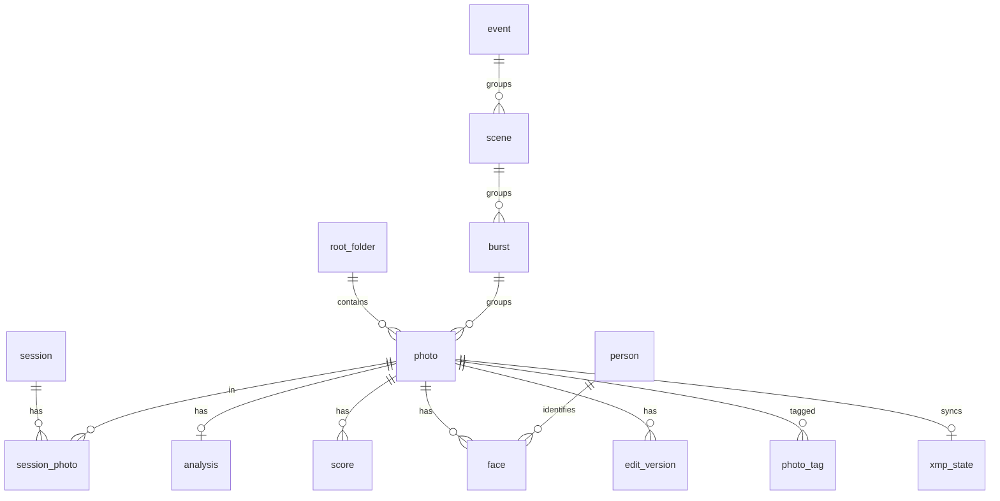

# 05 数据模型与接口设计

## 1. 数据库（SQLite，catalog.db）

PRAGMA：`journal_mode=WAL`、`synchronous=NORMAL`、`foreign_keys=ON`、`mmap_size=268435456`。迁移是 `crates/ip-core/src/db.rs` 中按序追加的 `MIGRATIONS` 数组（`PRAGMA user_version`，**当前为 17**；已发布的迁移只追加、不修改；库的版本高于程序时拒绝打开）。没有使用 `refinery`。

> **本节 SQL 是概念模型**，与实现的差异已在各表注释中标出；权威定义是 `MIGRATIONS`。实际共 24 张业务表：`root_folder`、`device`、`event`、`scene`、`burst`、`photo`、`session`、`session_photo`、`task`、`analysis`、`person`、`face`、`edit_version`、`preset`、`beauty_geometry`、`smart_collection`、`preference_label`、`taste_state`、`taste_score`、`photo_tag`、`xmp_state`、`catalog_meta`、`session_stat`、`session_device_offset`。设计中的 `history`、`tag`、`tag_link` **不存在**（见下）。

完整性与备份：启动后后台 `PRAGMA quick_check`；每天 `VACUUM INTO` 到 `<数据目录>/backups/catalog-*.db`（保留 7 份）；文件打不开时移到 `backups/corrupt-*.db` 并以空目录库启动，由用户从备份恢复（`GET /api/catalog`、`POST /api/catalog/backup`、`POST /api/catalog/restore`，见 [api-contract-m6 §F](api-contract-m6.md)、[02 §8](02-架构设计.md#8-安全与隐私)）。

日志与崩溃记录：`<数据目录>/logs/imagepicker-*.log`（按日 / 5 MiB 滚动，14 天、40 MiB 封顶）与 `<数据目录>/crashes/`（Rust panic 的 `crash-*.txt`、AI worker 的 `worker-*`）；设置页「诊断」导出的诊断包（`POST /api/system/diagnostics`）只含脱敏的文本，不含照片、缩略图、人脸数据、目录库和照片路径（见 [api-contract-m6 §G](api-contract-m6.md)）。



### 1.1 主要表

```sql
CREATE TABLE root_folder (
  id INTEGER PRIMARY KEY, path TEXT UNIQUE NOT NULL,
  portable INTEGER DEFAULT 0, added_at INTEGER NOT NULL
);

CREATE TABLE photo (
  id INTEGER PRIMARY KEY,
  root_id INTEGER REFERENCES root_folder(id),
  rel_path TEXT NOT NULL,                 -- 相对根目录
  file_name TEXT NOT NULL,                -- 文件名（排序用）
  file_size INTEGER, mtime INTEGER,
  fast_key TEXT NOT NULL,                 -- hash(path,size,mtime)
  content_key TEXT,                       -- blake3(head+tail+size)
  format TEXT,                            -- jpeg/heic/raw:arw/...
  pair_id INTEGER,                        -- RAW+JPEG：RAW 行指向显示用的 JPEG/HEIF 行（companion，不属于任何会话，索引 idx_photo_pair；启动时对旧目录库补配对）
  width INTEGER, height INTEGER, orientation INTEGER,
  taken_at INTEGER,                       -- 毫秒，EXIF 原始时间，永不改写；设备时钟偏移按会话存在 session_device_offset，分组时才应用
  taken_at_offset_min INTEGER,            -- 拍摄地 UTC 偏移（分钟，v3），仅用于显示本地时刻
  taken_at_raw INTEGER, device_id INTEGER REFERENCES device(id),
  camera TEXT, lens TEXT, focal REAL, aperture REAL, shutter REAL, iso INTEGER,
  gps_lat REAL, gps_lon REAL,
  burst_id INTEGER REFERENCES burst(id),
  rank_in_burst INTEGER,
  dup_group_id INTEGER, dup_kind TEXT,    -- v13：重复组（组内最小照片 id，整个目录库）/ exact | near
  -- 用户决定（永远优先）
  user_rating INTEGER CHECK(user_rating BETWEEN 0 AND 5),
  flag INTEGER DEFAULT 0,                 -- 1 精选 / -1 淘汰 / 0 无
  color_label TEXT,
  -- AI 建议
  ai_score REAL, ai_rating REAL,          -- ai_rating 允许 0.5 步长展示
  base_score REAL,                        -- 个性化之前的 ai_score（v6）
  issues INTEGER DEFAULT 0,               -- 位掩码：1闭眼 2模糊 4过曝 8欠曝 16倾斜 32路人（bystander）64噪点 128表情欠佳（bad_expression）
  scene_type TEXT,
  thumb_state INTEGER DEFAULT 0,          -- 0 无 1 内嵌 2 网格 3 预览
  analysis_version INTEGER DEFAULT 0,
  has_edits INTEGER DEFAULT 0, edit_hash TEXT,  -- edit_hash：当前编辑栈内容哈希（v5）
  meta_done INTEGER NOT NULL DEFAULT 0,   -- 元数据阶段已完成
  face_count INTEGER, subject_face_count INTEGER,   -- 分析阶段回填，用于人数筛选
  missing INTEGER DEFAULT 0,
  UNIQUE(root_id, rel_path)
);
CREATE INDEX idx_photo_taken ON photo(taken_at);
CREATE INDEX idx_photo_burst ON photo(burst_id, rank_in_burst);
CREATE INDEX idx_photo_rating ON photo(user_rating, ai_rating);

CREATE TABLE device (id INTEGER PRIMARY KEY, make TEXT, model TEXT, serial TEXT,
                     time_offset_ms INTEGER DEFAULT 0, offset_source TEXT, -- auto/manual
                     name TEXT, kind TEXT);   -- 规范化显示名 / phone|camera|drone|action|unknown（v9 增列，打开目录库时回填）
                                              -- time_offset_ms / offset_source 自 v1 起未使用：偏移随会话而不是随设备（见下表）

-- v16（09 P1-2，多设备时间对齐，docs/03 §2.4）：每个会话每台设备一个恒定时钟偏移
CREATE TABLE session_device_offset (
  session_id INTEGER NOT NULL REFERENCES session(id) ON DELETE CASCADE,
  device_id INTEGER NOT NULL REFERENCES device(id) ON DELETE CASCADE,
  offset_ms INTEGER NOT NULL DEFAULT 0,   -- 已应用：校正时间 = taken_at + offset_ms（分组、事件、组内排序用）
  source TEXT NOT NULL DEFAULT 'none',    -- none | auto（采纳了估计值）| manual（手动输入）
  est_offset_ms INTEGER, est_confidence REAL, est_evidence INTEGER,
  est_source TEXT,                        -- gps | visual | reference；最近一次估计，按需计算，新的分析运行后清空
  est_at INTEGER, updated_at INTEGER,
  PRIMARY KEY(session_id, device_id)
);
-- photo.gps_time_ms INTEGER（v16）：GPS 定位的 UTC 时间（GPSDateStamp + GPSTimeStamp），相机时钟的参照；只在导入时读取

CREATE TABLE event (id INTEGER PRIMARY KEY, title TEXT, start_at INTEGER, end_at INTEGER, place TEXT,
                    session_id INTEGER, photo_count INTEGER NOT NULL DEFAULT 0, offset_min INTEGER,
                    gps_lat REAL, gps_lon REAL);  -- v13 增列：事件属于一个会话，随分组重算（api-contract-m2 C.6）
CREATE TABLE scene (id INTEGER PRIMARY KEY, event_id INTEGER REFERENCES event(id), title TEXT, start_at INTEGER);
CREATE TABLE burst (id INTEGER PRIMARY KEY, scene_id INTEGER REFERENCES scene(id),
                    best_photo_id INTEGER, size INTEGER, manual INTEGER DEFAULT 0);

CREATE TABLE analysis (
  photo_id INTEGER PRIMARY KEY REFERENCES photo(id) ON DELETE CASCADE,
  profile TEXT,                           -- lite | fast | standard
  steps_done INTEGER,                     -- 位掩码：嵌入/IQA/人脸/…
  model_versions TEXT,                    -- JSON {step: model id}；按步骤增量据此判断缺哪步；`_skipped`: {step: 已装模型集合指纹} 记住被跳过的步骤（api-contract-m2 C.5.4）
  phash BLOB,                             -- 8 字节
  embedding BLOB,                         -- f16 向量（SigLIP 768/1152d）
  sharpness REAL, exposure REAL, noise REAL, tilt_deg REAL,   -- tilt_deg：度，顺时针为正
  tilt_confidence REAL,                   -- 倾斜估计的置信度 0–1（v10）
  aesthetic REAL, iqa REAL, composition REAL,   -- composition：构图分 0–1，评分时由主体框/显著性/倾角算出（v15 起写入，docs/03 §3.1.3）
  saliency TEXT,                          -- JSON [x,y,w,h]，视觉主体框（v15，工作进程 steps/composition.py）
  mean_luminance REAL, clipped_highlights REAL, crushed_shadows REAL,  -- 曝光问题的输入
  scene_scores TEXT,                      -- JSON：8 类场景得分
  analyzed_at INTEGER,
  explain TEXT,                           -- JSON：分项贡献与理由
  artifacts_dir TEXT                      -- 缓存目录（蒙版、关键点等）
);

CREATE TABLE face (
  id INTEGER PRIMARY KEY,
  photo_id INTEGER REFERENCES photo(id) ON DELETE CASCADE,
  idx INTEGER NOT NULL DEFAULT 0,         -- 在该照片 faces[] 中的位置
  person_id INTEGER REFERENCES person(id) ON DELETE SET NULL,
  person_locked INTEGER NOT NULL DEFAULT 0, -- 用户手动指定（must-link / cannot-link）
  track_id INTEGER,                       -- 连拍组内同一人的轨迹
  bbox_x REAL, bbox_y REAL, bbox_w REAL, bbox_h REAL,  -- 归一化，显示方向
  det_score REAL, embedding BLOB,         -- 512d f16
  eyes_open REAL, smile REAL, gaze REAL, yaw REAL, pitch REAL, roll REAL,
  sharpness REAL, occlusion REAL, expression_score REAL,   -- occlusion 预留，未产生
  is_subject INTEGER, is_bystander INTEGER,   -- is_bystander = 非主体且非人造脸（消除路人的候选）
  artificial REAL,                        -- 0–1：脸在雕像/海报/屏幕上的置信度，≥ 0.55 视为人造（v15，docs/03 §3.1.2）
  mouth_open REAL,                        -- jawOpen 系数（v15），「表情欠佳」标签用
  blendshapes TEXT                        -- JSON 52 系数（没有 landmarks_path 列）
);
CREATE INDEX idx_face_person ON face(person_id, photo_id);
CREATE INDEX idx_face_photo ON face(photo_id);

CREATE TABLE person (id INTEGER PRIMARY KEY, name TEXT, cover_face_id INTEGER,
                     hidden INTEGER DEFAULT 0, beauty_profile TEXT,  -- JSON
                     center BLOB, created_at INTEGER,                -- 平均身份嵌入 f16
                     singleton INTEGER NOT NULL DEFAULT 0);          -- 单张照片的主体人物（v7）

CREATE TABLE edit_version (
  id INTEGER PRIMARY KEY, photo_id INTEGER REFERENCES photo(id) ON DELETE CASCADE,
  name TEXT,                              -- 目前恒为主版本；虚拟副本未实现（每张照片只有一条 is_current = 1 的记录）
  stack TEXT NOT NULL,                    -- JSON 编辑栈（见 §2），按收到的原样保存
  hash TEXT NOT NULL,                     -- 编辑栈内容哈希
  updated_at INTEGER, is_current INTEGER DEFAULT 1
);

-- 没有 history 表：评分/旗标/编辑的撤销在前端 store 中完成，助手执行时服务端返回 `undo` 载荷（api-contract-m6）；服务端无 /undo、/redo。

CREATE TABLE preference_label (           -- 个性化训练数据（v6）
  id INTEGER PRIMARY KEY, photo_id INTEGER REFERENCES photo(id) ON DELETE CASCADE,
  kind TEXT,                              -- rating | flag
  value REAL,                             -- 评分 1..5 / 旗标 +1 -1
  source TEXT DEFAULT 'patch',            -- 只有 patch（用户亲手）且与照片当前值一致的才参与训练；旧库的 accept_ai 行被忽略（03 §3.3）
  legacy INTEGER DEFAULT 0,               -- v17：1.0 记录的标签
  created_at INTEGER NOT NULL, UNIQUE(photo_id, kind)
);
CREATE TABLE taste_state (id INTEGER PRIMARY KEY CHECK (id = 1), model TEXT, labels_at_train INTEGER, active INTEGER,
                          alpha REAL, holdout_accuracy REAL, base_accuracy REAL, pairs INTEGER, traits TEXT, trained_at INTEGER,
                          -- v17（taste v2）：
                          enabled INTEGER DEFAULT 1, feature_version INTEGER, model_version INTEGER, pending_labels INTEGER,
                          positives INTEGER, negatives INTEGER, metrics TEXT, rescore_pending INTEGER);  -- 个性化模型状态（单行，迁移即建）；metrics = 交叉验证 AUC 与基线等 JSON
CREATE TABLE taste_score (photo_id INTEGER PRIMARY KEY REFERENCES photo(id) ON DELETE CASCADE,
                          score REAL NOT NULL, model_version INTEGER NOT NULL);  -- v17：当前风格模型下每张照片的风格分（0..1）；模型变化 / 关闭 / 重置时清空

CREATE TABLE task (id TEXT PRIMARY KEY, kind TEXT, status TEXT, priority INTEGER,
                   params TEXT, progress REAL, error TEXT, created_at INTEGER, updated_at INTEGER,
                   done INTEGER, total INTEGER, finished_at INTEGER);  -- 任务记录，保留最近 200 条（api-contract-m5 G）；status 含 paused（暂停的分析）；analysis 任务的 params 是运行参数（session_id、profile、photo_ids、force、fallback_lite、started_at、resumes…），重启后据此续跑（api-contract-m2 C.5.2）

CREATE TABLE session (id INTEGER PRIMARY KEY, title TEXT, cover_photo_id INTEGER, created_at INTEGER,
                      root_id INTEGER REFERENCES root_folder(id), import_state TEXT NOT NULL DEFAULT 'ready',
                      recursive INTEGER DEFAULT 1, exclude TEXT);  -- 导入选项（exclude 为 JSON 数组），重新扫描 / 文件监听沿用
CREATE TABLE session_photo (session_id INTEGER, photo_id INTEGER, PRIMARY KEY(session_id, photo_id));  -- RAW companion（photo.pair_id 非空）不在此表：网格、分组、分析只见 JPEG；另有 `sk_*` 排序键副本和 `session_stat` 计数表，见 1.3
CREATE TABLE smart_collection (id INTEGER PRIMARY KEY, name TEXT, query TEXT, created_at INTEGER);  -- query = GET /api/photos 的 URLSearchParams（不含 session_id/cursor/limit）
CREATE TABLE photo_tag (photo_id INTEGER, tag TEXT, PRIMARY KEY(photo_id, tag));        -- 关键词（XMP dc:subject）；没有 tag / tag_link 表
CREATE TABLE xmp_state (photo_id INTEGER PRIMARY KEY, sidecar_path TEXT, sidecar_mtime INTEGER, synced_at INTEGER);  -- 上次同步看到的侧车状态（冲突检测）
CREATE TABLE preset (id INTEGER PRIMARY KEY, name TEXT NOT NULL, stack TEXT NOT NULL, created_at INTEGER);          -- 用户预设
CREATE TABLE beauty_geometry (photo_id INTEGER PRIMARY KEY, content_key TEXT, faces_sig TEXT, people INTEGER, partial INTEGER, prepared_at INTEGER);  -- 人像几何缓存索引
```

### 1.2 向量检索

- 会话规模（≤ 2 万张）：启动时把嵌入载入内存（2 万 × 1152 × f16 ≈ 46MB），暴力余弦 + SIMD，< 5ms。
- 大库（10 万+）：启用 `sqlite-vec` 虚拟表或 HNSW（`hnsw_rs`）索引。

### 1.3 会话派生数据（大会话，迁移 v14）

单会话 10 万张时，网格分页和会话列表都不能再按会话成员数计算。两份派生数据由触发器在写入的同一事务里维护，不需要应用层配合：

```sql
CREATE TABLE session_stat (session_id INTEGER PRIMARY KEY REFERENCES session(id) ON DELETE CASCADE,
  photo_count INTEGER, picked_count INTEGER, rejected_count INTEGER, rated_count INTEGER);
-- session_photo 增加排序键副本（来自 photo.taken_at / file_name / user_rating / ai_score）
ALTER TABLE session_photo ADD COLUMN sk_taken INTEGER, sk_name TEXT, sk_rating INTEGER, sk_ai REAL;
CREATE INDEX idx_sp_taken_asc  ON session_photo(session_id, COALESCE(sk_taken, 9223372036854775807), photo_id);
CREATE INDEX idx_sp_taken_desc ON session_photo(session_id, COALESCE(sk_taken, -9223372036854775807) DESC, photo_id);
CREATE INDEX idx_sp_name   ON session_photo(session_id, sk_name COLLATE NOCASE, photo_id);
CREATE INDEX idx_sp_rating ON session_photo(session_id, COALESCE(sk_rating, -1) DESC, photo_id);
CREATE INDEX idx_sp_ai     ON session_photo(session_id, CAST(COALESCE(sk_ai, -0.001) * 1000000 AS INTEGER) DESC, photo_id);
CREATE TABLE catalog_meta (key TEXT PRIMARY KEY, value TEXT NOT NULL);  -- session_derived_epoch
```

- **计数**：`session_stat` 与 `GET /api/sessions` 的 `photo_count / picked_count / rejected_count / rated_count` 一一对应。计数对象是 `session_photo` 的行，所以 RAW companion（不在 `session_photo`）不计入。触发器覆盖：会话建立、成员加入 / 移除（配对时 `DELETE FROM session_photo`）、`photo.flag` / `photo.user_rating` 变化、照片删除（`BEFORE DELETE` 先解除成员关系）、会话删除（级联）。
- **排序键**：`GET /api/photos` 的 `taken_at / -taken_at / name / rating / ai` 五种排序各有一个索引，表达式与查询里的排序表达式逐字相同，成员直接按页序从索引读出，`LIMIT n+1` 即停，不再访问整个会话。游标语义不变：`(键, photo_id)`，键相同按 `photo_id` 升序，无拍摄时间的照片排在末尾（升序）或最后（降序）。`total` 在没有筛选时读 `session_stat.photo_count`。分页接口只有游标（没有 `offset` 参数），因此对现有客户端没有变化。
- **修复**：`catalog_meta.session_derived_epoch` 与代码里的 `SESSION_DERIVED_EPOCH` 不一致（或被删除）时，下次打开目录会调用 `catalog::rebuild_session_derived` 重新计算两份数据；修改派生数据的定义时递增该常量。一致性测试：`tests_scale.rs`。

## 2. 编辑栈格式（Edit Stack v1）

类型定义的唯一出处是 `crates/ip-render/src/lib.rs` 的 `EditStack` / `Op`（serde；字段名即下面的 JSON 键）。**未知的 `type`（以及 `warp` / `patch` 的未知 `kind`）会被忽略而不报错，缺省字段取默认值**，所以旧栈可被新版读取；但缺少**必填**字段（`crop.rect`、`patch.kind` / `asset` / `rect`、`local.mask` / `adjust`、`lut.file`）时整份栈无法解析。`crates/ip-render/tests/schema.rs` 的解析测试（`parses_doc05_stack_and_ignores_future_ops`、`parses_m4_portrait_ops`、`parses_m5_patch_op`）覆盖下面示例的每一种 op 形状；示例本身（逐字段对照类型定义写成）：

```jsonc
{
  "version": 1,
  "ops": [
    { "id": "op1", "type": "crop", "rect": [0.02, 0.05, 0.96, 0.9], "angle": -1.3, "aspect": "4:5" },
    { "id": "op2", "type": "patch", "kind": "best_take", "asset": "bt_12", "rect": [0.31, 0.12, 0.2, 0.28],
      "feather": 0.12, "amount": 1.0, "enabled": true, "person_id": 12, "source_photo_id": 4229 },
    { "id": "op3", "type": "patch", "kind": "inpaint", "asset": "inp_3", "rect": [0.6, 0.5, 0.15, 0.2] },
    { "id": "op3b", "type": "patch", "kind": "hair", "asset": "hair_12_881", "rect": [0.25, 0.02, 0.32, 0.4],
      "amount": 0.8, "person_id": 12, "source_photo_id": 4100, "base_face_id": 881, "source_face_id": 771,
      "align": { "scale": 1.04, "rotation_deg": 2.1, "dx": 0.01, "dy": -0.02, "landmark_rms": 0.004 } },
    { "id": "op4", "type": "warp", "kind": "face", "person_id": 12, "level": "natural", "slim": 25, "chin": 0, "eyes": 10, "nose": 0 },
    { "id": "op5", "type": "warp", "kind": "body", "person_id": 12, "level": "natural",
      "arms": 20, "legs": 15, "waist": 10, "lengthen_legs": 0, "protect_background": true },
    { "id": "op6", "type": "global",
      "exposure": 0.35, "contrast": 12, "highlights": -30, "shadows": 22, "whites": 5, "blacks": -4,
      "temp": 300, "tint": 2, "vibrance": 10, "saturation": 0, "clarity": 8, "dehaze": 0,
      "curve": { "rgb": [[0, 0], [0.25, 0.22], [0.75, 0.8], [1, 1]] },
      "hsl": { "orange": { "h": 0, "s": -5, "l": 8 } },
      "grading": { "shadows": [220, 0.1], "highlights": [40, 0.08], "balance": 0 },
      "source": "ai_auto@2" },
    { "id": "op7", "type": "local", "mask": { "kind": "ai", "target": "sky" }, "amount": 1.0, "invert": false,
      "adjust": { "exposure": -0.3, "saturation": 10 } },
    { "id": "op8", "type": "beauty", "person_id": 12, "level": "natural",
      "smooth": 30, "whiten": 20, "blemish": true, "eye_brighten": 10, "teeth_whiten": 0, "dark_circles": 0 },
    { "id": "op9", "type": "lut", "file": "film_warm", "amount": 0.6 },
    { "id": "op10", "type": "output_sharpen", "amount": 20 }
  ]
}
```

与旧版文档的差别（均以代码为准）：没有 `base`（RAW 显影参数，RAW 只用内嵌预览）；`crop.rect` 必填，`angle` 单位是度、**正值 = 内容逆时针**（`ip-render` 注释），与分析的 `tilt_deg` 符号约定的关系见 03 §6.6；`patch` 必须带 `asset`（不透明资产 id，由 `MaskProvider::patch` 解析）和 `rect`（转正后的归一化 `[x, y, w, h]`），没有 `mask` / `transform` 字段，`kind` 取 `best_take | hair | inpaint | denoise | face_restore | deshine | flyaway`（`deshine` / `flyaway` = 去汗光 / 整理碎发，03 §7.5；`hair` = 换发型，附加字段 `base_face_id` / `source_face_id` / `align` / `warnings` 按原样保存，见 api-contract-m5 H）；`global` 的调整量直接平铺在 op 上（等同 `Adjust`）；`local.mask` 的 `kind` 为 `ai`（`target` ∈ subject / background / sky / person / skin / hair / clothes，可带 `person_id`）、`radial`（`center`、`radius`、`feather`）、`linear`（`start`、`end`）；`lut.file` 是内置 LUT id 或 `.cube` 绝对路径；`level` ∈ `natural | standard | refined`；`id` 字段不在类型里（保存时按原样透传，渲染忽略）。

- 渲染顺序见 [02 §5.3](02-架构设计.md)：补丁（裁剪前）→ 裁剪/旋转 → 形变 → `global` / `local` / `beauty`（按 `ops` 中出现的顺序）→ LUT → 输出锐化。
- 引用人物/蒙版的操作在渲染时**按需重新生成**AI 资产（缓存失效时），因此编辑栈可复制到其他照片：`person_id` 在目标照片中找到同一人物即生效，找不到则跳过并提示。
- 预设 = 编辑栈中不含照片特定资产的子集（`preset` 表；内置预设来自 `builtin_presets()`）。
- 可导出自有 `.ipedit.json` **未实现**。
- 本文档的 JSON Schema 不由代码生成（没有 `schemars` 依赖）；若要机器可读的 schema，应由 `ip-render` 类型派生（待办，见 09 §3 05 行）。

## 3. API（HTTP + WebSocket）

基址：`http://127.0.0.1:<port>/api`。认证（`auth.rs`）：桌面壳用启动时生成的会话令牌（`Authorization: Bearer` 或 `?token=`，换取 HttpOnly Cookie，所有者角色）；局域网用 `POST /api/auth/login` 之后的会话 Cookie（所有者 / 只读访客两种角色）；未配置令牌且来自回环地址的本机 `serve` 无需认证。**没有 OpenAPI / `utoipa` 生成**：接口契约是 `docs/api-contract-m1…m8.md`，前端类型手写在 `web/src/api/types.ts`。路由的权威来源是 `crates/ip-server/src/lib.rs`（`api_router`）及其合并的 `auth::routes()`、`remote::routes()`；下表逐条列出，**设计中有、代码里没有的接口放在表后单独列出**。

### 3.1 资源接口（现状）

| 方法 | 路径 | 说明 / 契约 |
|---|---|---|
| GET | `/health` | 存活检查 |
| GET | `/import/sources` | 已插入的存储卡（含 DCIM 的可移动卷：标签、路径、剩余/总容量、照片数估计）；只列出，从不自动导入 |
| POST | `/import/card` | `{source, dest, pattern?, title?, exclude[]}` → `202 {task_id}`：把卡上的新文件复制（不移动）到 `dest` 下的日期文件夹，逐个校验、不覆盖、跳过已导入，再作为会话导入；可取消，结果在 `GET /tasks` 的 `params.report`（见 api-contract-m1「从存储卡导入」） |
| POST | `/import` | `{paths[], session_title?, recursive, exclude[]}` → `{session_id, task_id}`（m1） |
| GET | `/sessions` | 会话列表（含 `photo_count / picked_count / rejected_count / rated_count`，来自 `session_stat`） |
| GET / DELETE | `/sessions/{id}` | 会话详情 / 删除会话（不删原图） |
| GET | `/sessions/{id}/devices` · `/sessions/{id}/filter-options` · `/sessions/{id}/timeline` | 设备列表（含时间偏移）/ 镜头、关键词、拍摄时间跨度 / 事件时间线（m1、m2 C.6） |
| GET | `/timeline?granularity=year\|month\|day&from&to&session_id?` + `/photos` 的筛选参数 | 资料库时间线（F1.9）：全部会话（或一个）按本地拍摄日期分桶，`{buckets:[{key,from,to,count,photo_ids}],undated,total,events}`；`from`/`to` 可直接作 `taken_from`/`taken_to`（API 契约 M2 C.7） |
| GET / PUT | `/sessions/{id}/devices/offsets` | 多设备时间对齐：每台设备的已应用偏移与估计（`?refresh=1` 重新估计）；`PUT {action: accept\|set\|reset, device_id?, device_ids?, offset_ms?}` 采纳 / 手动输入 / 重置，偏移变化后重算分组（api-contract-m2 C.9） |
| POST | `/sessions/{id}/rescan` · `/sessions/{id}/relocate` | 重新扫描（文件监听也走此路径）/ 重新定位已移动的文件夹（m1「RAW+JPEG 与文件」） |
| POST | `/photos/reject-files` | 把淘汰照片的文件移到回收站/隔离目录（需显式确认，m1） |
| GET / PATCH | `/photos` | 查询（筛选参数见 §3.2 / §3.2.1，游标分页，自然语言搜索走 `/search`，`/photos` 无 `q` 参数；另有 `ids` 精确筛选）/ 批量更新 `{ids[], user_rating?, flag?, color_label?}` |
| GET | `/search` | 自然语言搜索（F2.9）：`q, session_id?, limit?, min_score?` + 与 `/photos` 相同的筛选参数 → `{query, model, threshold, min_score, min_similarity, low_confidence, hits:[{photo_id, score, similarity}], total_matched, searched, unindexed}`，按匹配度排序；缺文本模型 → `409 models_missing`。见 [api-contract-m2 C.7](api-contract-m2.md) |
| GET | `/photos/{id}` · `/photos/{id}/analysis` · `/photos/{id}/duplicates` · `/photos/{id}/people` · `/photos/{id}/tags` | 详情 / 分项分与理由 / 重复组成员 / 照片中的人物 / 关键词 |
| POST | `/photos/accept-ai` · `/photos/tags` | 采纳 AI 星级 / 设置关键词 |
| GET | `/thumb/{id}?s=256\|512` · `/preview/{id}?s=1024\|2048\|4096` · `/full/{id}` · `/original/{id}` | 缩略图（ETag）/ 预览 / 全分辨率（缓存 1 GB，原图缺失 404、无法解码 415）/ 原图流（Range） |
| POST | `/viewport` | 视口内照片 id（提升缩略图优先级；WebSocket 也可发 `viewport` 消息） |
| POST | `/export` | `{ids[] 或 folders, dest, long_edge, aspect, format(jpeg\|png\|tiff\|webp), quality, strip_gps, strip_metadata, name_template, upscale, watermark}` → task_id（m5 F） |
| POST | `/export/collage` | `{ids[2..30], dest, layout: grid\|story\|contact, width, height, gap, margin, background, fit: cover\|contain, caption_name, caption_rating, format, quality, name_template, apply_edits, watermark}` → task_id（拼图 / 联系表；见 [api-contract-m5](api-contract-m5.md) F.2 节） |
| GET | `/export/presets` | 唯一的导出预设表，导出对话框与助手共用 |
| GET | `/fs/roots` · `/fs/list` | WebUI 模式下的服务端目录浏览（仅白名单根） |
| GET | `/system/hardware` · `/system/lan` | 硬件与档位（含 `tier_detected` / `tier_overridden`）/ 局域网地址与状态 |
| POST | `/system/diagnostics` | 诊断包（zip，仅所有者；m6 G） |
| GET | `/models` · POST `/models/ensure` · DELETE `/models/{id}` | 模型列表 / 确保就绪（必要时下载，进度走 WebSocket）/ 删除。**无 `/models/{id}/download`** |
| POST | `/analysis/run` · `/analysis/cancel` · `/analysis/pause` · `/analysis/continue` | `profile: lite\|fast\|standard`、`photo_ids?`、`force?`、`fallback_lite?`（m2 C） |
| GET | `/analysis/plan` · `/analysis/status` | 将做什么 / 当前运行状态 |
| GET | `/groups` · POST `/groups/split` · `/groups/merge` | 事件 → 场景 → 连拍组树 / 手动拆分、合并 |
| GET | `/bursts/{id}/faces` | 连拍组的人脸矩阵（表情矩阵数据） |
| GET | `/faces/{id}/crop` · POST `/faces/{id}/person` · POST `/faces/search` · DELETE `/faces` | 人脸裁切 / 指定人物 / 以脸搜脸（multipart，`min_similarity` 默认 0.25）/ 清除全部人脸数据（`?confirm=true`） |
| GET / POST | `/people` · POST `/people/merge` · PATCH `/people/{id}` · GET `/people/{id}/faces` · GET `/people/best?ids=&n=` | 人物列表、新建、合并、改名/隐藏、人脸列表、每人最佳 N 张 |
| GET / PUT | `/people/{id}/beauty-profile` · POST `/edits/apply-profiles` | 美颜档案读写 / 对照片应用档案（m4） |
| GET / PUT / DELETE | `/edits/{id}` | 读取 / 保存 / 删除编辑栈 |
| POST | `/edits/{id}/auto` · `/edits/{id}/auto-crop` · `/edits/sync` | 一键调整（返回建议，不保存）/ 自动拉直与裁剪建议 / 同步到其他照片 `{from_id, to_ids[], adaptive}` |
| POST | `/render/preview` | `{photo_id, stack, long_edge, region?}` → 二进制图像 |
| GET / POST / DELETE | `/presets` · `/presets/{id}` · GET `/luts` · POST `/luts/import` · GET `/masks/{id}` | 预设、LUT 与蒙版图（m3） |
| POST | `/photos/{id}/beauty/prepare` | 生成皮肤蒙版、瑕疵点与形变几何（m4） |
| GET / POST / PATCH / DELETE | `/collections` · `/collections/{id}` | 智能集合（保存的筛选，m4） |
| GET | `/bursts/{id}/besttake` · POST `/bursts/{id}/besttake/auto` · POST `/besttake` | 最佳表情计划 / 一键全员最佳 / 按选择合成（`/besttake` 服务端校验同组同人，m5） |
| GET | `/photos/{id}/bystanders` · POST `/photos/{id}/inpaint` · POST `/photos/{id}/enhance` | 路人候选 / 消除 / 降噪、人脸修复、超分（异步，完成事件见 §3.3） |
| GET | `/photos/{id}/hair/donors?face_id=` · POST `/photos/{id}/hair` | 换发型：同一人其他照片中的供发候选（姿态门限 + 发质评分）/ 合成为 `hair` 补丁（服务端校验同人与姿态，422；m5 H） |
| GET | `/assets/{photo_id}/{asset}` | 生成补丁资产图 |
| GET · POST | `/tasks` · `/tasks/{id}/cancel` | 任务记录（最近 200 条）/ 取消。**无 `/tasks/{id}/pause\|resume`**：暂停的是分析（`/analysis/pause`） |
| GET · PATCH · POST | `/taste` · `/taste/train` · `/taste/reset` · GET `/taste/explain/{id}` | 学习我的风格：状态 / 开关 `{enabled}` / 立即训练 / 忘记（可选 `{disable:true}` 同时关闭）/ 单张解释；照片列表的 `taste_score` 与 `sort=taste`（api-contract-m4 C.2） |
| GET · POST | `/assistant/status` · `/assistant/plan` · `/assistant/execute` · `/assistant/describe` · `/assistant/suggest` | 助手（m6）。**无 `/assistant/chat` 流式接口**：先 `plan`（返回计划）再 `execute` |
| GET · PATCH | `/settings` | 设置 |
| GET · POST | `/cache` · `/cache/clear` | 缓存占用 / 清理 |
| GET · POST | `/onboarding` · `/onboarding/done` | 首次运行引导与人脸同意状态 |
| POST | `/xmp/sync` | XMP 同步（m6 C） |
| GET · POST | `/catalog` · `/catalog/backup` · `/catalog/restore` | 目录库完整性 / 备份 / 恢复（m6 F） |
| GET · POST · DELETE | `/runtime` · `/runtime/install` · `/runtime/cancel` | AI 组件安装器（私有 Python 环境，m7） |
| POST | `/auth/login` · `/auth/logout` · `/auth/password` · GET `/auth/me` | 局域网登录（m6） |
| POST / GET / DELETE | `/remote/pair/start` · `/remote/pair/complete` · `/remote/devices` · `/remote/devices/{id}` · `/remote/rpc` · `/remote/files/{id}` · `/remote/ping` · `/remote/connect` · `/remote/status` | 远程 AI：配对码、设备令牌、缩小图上传、客户端连接（m8 C） |
| GET | `/events` | WebSocket 事件流（§3.3） |

**设计中有但代码里没有的接口**（已从上表移除；不要在客户端依赖）：`GET /faces?photo_id=|burst_id=`（改用 `/bursts/{id}/faces`、`/people/{id}/faces`）、`POST /groups/{id}/keep-top`（只作为助手工具 `group_keep_top` 内部执行）、`POST /people/{id}/split`、`POST /besttake/{burst_id}/plan|compose`（改为 `GET /bursts/{id}/besttake`、`POST /besttake`）、`POST /inpaint/{photo_id}`（改为 `/photos/{id}/inpaint`）、`/models/{id}/download`、`/tasks/{id}/pause|resume`、`POST /assistant/chat`、`POST /undo` `/redo`、`GET /fs/browse`（改为 `/fs/roots` + `/fs/list`）。

### 3.2 人脸筛选参数（`GET /photos`）

| 参数 | 示例 | 说明 |
|---|---|---|
| `persons` | `1,2` | 包含的人物 ID |
| `person_mode` | `all` / `any` | 全部同框（默认）/ 任一 |
| `exclude_persons` | `3` | 排除的人物 ID |
| `face_ids` | `881` | 点脸即筛：按某张脸（未聚类时按嵌入近邻；任一张，最多 50 张） |
| `face_similarity` | `0.38` | `face_ids` 的余弦相似度阈值 0..1，默认 0.38（聚类阈值） |
| `person_state` | `eyes_open,smiling,looking,subject,sharp` | `persons` 中每个人都须满足 |
| `include_background` | `false` | 是否也匹配作为背景路人出现的人脸 |
| `faces_min` / `faces_max` | `2` / `3` | 主体人数范围；`faces_max=0` 即无人照 |

### 3.2.1 其他筛选参数（`GET /photos`）

| 参数 | 示例 | 说明 |
|---|---|---|
| `rating_gte` / `ai_rating_gte` / `flag` / `color_label` | `4` / `3.5` / `picked` / `red` | 用户星级 / AI 星级下限、旗标（`picked`、`rejected`、`unflagged`、`not_rejected`）、色标（red/yellow/green/blue/purple） |
| `issues_none` / `issues_any` | `true` / `blurry,closed_eyes` | 无任何问题标签 / 含任一问题标签 |
| `burst_best_only` / `burst_id` / `event_id` / `duplicates` / `scene_type` / `has_edits` | | 每组最佳 / 指定连拍组 / 指定事件 / 仅重复组成员 / 场景 / 已编辑 |
| `device` | `3,5` 或 `none` | 设备 id 列表（逗号分隔 OR），`none` = 无设备信息 |
| `lens` | `RF 24-70mm F2.8 L IS USM` | 镜头（`photo.lens` 原样），逗号分隔 OR（名称里的逗号写 `\,`） |
| `taken_from` / `taken_to` | `2024-05-01` / `2024-05-31` | 拍摄时间范围，含两端；日期或毫秒（`photo.taken_at` 的单位） |
| `tags` / `tag_mode` | `kyoto,food` / `all` | `photo_tag` 关键词，默认任一，`all` = 全部 |
| `sharp` | `sharp` / `blurry` / `unknown` | 清晰度状态：`analysis.sharpness` 与 `blurry` 问题位（阈值 0.35） |

会话内可选值：`GET /sessions/{id}/filter-options`（镜头、关键词、拍摄时间跨度）；以脸搜脸：`POST /faces/search` 的 `min_similarity`（默认 0.25）。语义细节见 [api-contract-m1](api-contract-m1.md)「筛选补全」。

### 3.3 WebSocket 事件 `/api/events`

服务器按事件类型每 100 ms 合并一帧（`ws.rs` `COALESCE_MS`）；事件定义在 `crates/ip-core/src/events.rs` 的 `Event` 枚举。

```jsonc
// 服务器 → 客户端
{ "type": "session.updated",    "session": { /* Session */ } }
{ "type": "photos.added",       "session_id": 3, "count": 120 }
{ "type": "thumbs.ready",       "items": [{ "id": 12, "s": 256, "v": "a1b2" }] }
{ "type": "photos.updated",     "items": [{ "id": 12, "ai_rating": 4.5, "issues": 1 }] }
{ "type": "edits.updated",      "items": [ /* EditUpdate */ ] }
{ "type": "task.progress",      "task_id": "t_9", "kind": "analysis", "done": 780, "total": 1204, "state": "running", "error": null }
{ "type": "analysis.progress",  "session_id": 3, "state": "running", "stage": "faces", "done": 780, "total": 1204 }
{ "type": "analysis.updated",   "session_id": 3, "ids": [..] }
{ "type": "groups.updated",     "session_id": 3 }
{ "type": "people.updated",     "session_id": 3 }
{ "type": "beauty.ready",       "photo_id": 12 }
{ "type": "taste.updated",      "labels": 64, "active": true, "alpha": 0.19 }
{ "type": "collections.updated" }
{ "type": "besttake.done",      "photo_id": 12, "results": [..] }
{ "type": "inpaint.done",       "photo_id": 12, "ok": true, "reason": null }
{ "type": "enhance.done",       "photo_id": 12, "op": "denoise", "ok": true, "reason": null }
{ "type": "hair.done",          "photo_id": 12, "face_id": 881, "ok": true, "warnings": [], "reason": null }
{ "type": "assistant.done",     "plan_id": "p_1", "ok": true, "results": [..], "undo": {..} }
{ "type": "settings.updated",   "settings": { .. } }
{ "type": "xmp.conflict",       "session_id": 3, "photo_id": 12, "sidecar": {..}, "catalog": {..} }
{ "type": "runtime.updated",    "runtime": { .. } }
{ "type": "worker.status",      "state": "ready", "tier": "T3", "error": null }
// 客户端 → 服务器
{ "type": "viewport",           "ids": [..] }   // 视口内照片，提升缩略图优先级
```

模型下载进度不再有独立的 `model.download` 事件，而是 `task.progress` 的 `kind: "model_download"`；`worker.status.state` 的取值以 `ip-worker-client` 为准。

## 4. Core ⇄ AI Worker 协议

WebSocket JSON-RPC 2.0（本地 Worker），地址与令牌由 Core 启动 Worker 时指定（`IP_WORKER_ADDR`、`IP_WORKER_TOKEN`，或 `ai-worker` 命令行参数）。**远程 AI** 不是直连 Worker，而是手机/笔记本经另一台 imagePicker 主机的 `/api/remote/rpc`（HTTP，设备令牌认证，仅 `REMOTE_METHODS` 白名单内的方法，图片只能是已上传文件的 `file:` 引用）调用主机的 Worker，见 [api-contract-m8](api-contract-m8.md)。类型定义在 `crates/ip-worker-client/src/protocol*.rs`，契约见 api-contract-m2/m3/m4/m5/m6。

```jsonc
// 请求
{ "jsonrpc":"2.0", "id": 101, "method": "analyze.batch",
  "params": { "items":[{"photo_id":12,"path":"E:/DCIM/IMG_0001.JPG","orientation":1}],
              "profile":"standard",          // fast | standard；或用 "steps":["phash","quality","faces",...] 显式指定
              "analysis_size":1024, "out_dir":"<cache>/analysis", "allow_download": false } }
// 流式进度（通知）
{ "jsonrpc":"2.0", "method":"progress", "params": { "req":101, "done":32, "total":64 } }
// 结果
{ "jsonrpc":"2.0", "id":101, "result": { "items":[{ "photo_id":12,
    "phash":"a3f0…", "sharpness":0.82, "exposure":0.7, "noise":0.05, "quality":{ "tilt_deg":0.4, "tilt_confidence":0.1 },
    "iqa":0.71, "aesthetic":0.64, "scene_type":"portrait",
    "embedding_file":"…/12.emb.f16", "identity_file":"…",
    "faces":[{ "bbox":[…], "eyes_open":0.97, "smile":0.62, … }] }],
    "steps":[…], "skipped_steps":[…], "models":{…}, "warnings":[], "timings":{…} } }
```

| 方法 | 说明 |
|---|---|
| `system.info` / `system.ping` / `system.shutdown` | 硬件、档位（含 `tier_detected`、`tier_overridden`）、已加载模型；存活检查；退出 |
| `models.list` / `models.ensure` / `models.unload` / `models.delete` | 模型清单与安装状态 / 确保就绪（必要时下载，流式进度）/ 释放显存 / 删除模型 |
| `analyze.batch` | 批量分析（`profile` 或显式 `steps`） |
| `text.embed` | `{texts[1..16]}` → SigLIP2 文本向量（与图像嵌入同一空间，L2 归一化），自然语言搜索用；缺 `siglip2-base-text` → `-32010` |
| `faces.embed` | 对给定图片提取人脸身份嵌入（以脸搜脸） |
| `mask.generate` | `{photo, target: subject/person/skin/hair/clothes/sky, bbox?}` → 8-bit PNG 蒙版 |
| `beauty.prepare` | 皮肤蒙版、瑕疵点、脸型/身体关键点（形变场由渲染器据此生成） |
| `besttake.compose` | 对齐 + 融合，输出补丁与蒙版 |
| `hair.rank` / `hair.compose` | 换发型：发质指标（头发面积、高光、碎发、清晰度、姿态）/ 同人换发补丁（03 §5.1，api-contract-m5 H） |
| `inpaint.run` | `{photo, mask, model: lama\|sdxl}` |
| `enhance.run` | 降噪 / 超分 / 人脸修复 |
| `llm.plan` / `vlm.suggest` / `vlm.describe` | 助手规划 / 看图修图建议 / 看图描述 |

设计中的 `faces.landmarks`、`color.auto`、`color.match_reference`、`vlm.chat` **不存在**（自动调色在 Rust 侧 `ip-render::auto_adjust`，风格参考迁移未实现，助手用 `llm.plan`）。

## 5. XMP 侧车互通

- 读：导入时若存在 `IMG_0001.xmp`（或 JPEG 内嵌 XMP），读取 `xmp:Rating`、`xmp:Label`、`xmpDM:pick`/`lr:hierarchicalSubject`、darktable 的 `xmp:Rating`（-1 表示 reject）。
- 写（可配置：关闭 / 仅侧车 / 修改原图 = 侧车 + JPEG 内嵌）：用户评分、色标、旗标（Lightroom 无标准 pick 字段，采用 `xmp:Rating=-1` 表示淘汰的 darktable 约定，并在设置中说明）、关键词、标题。只有「修改原图」模式会改写原图文件，开启需二次确认（`confirm_modify_originals`，见 [api-contract-m6 §C](api-contract-m6.md)）；其他模式不改变原图的任何字节。
- 冲突策略：以最后修改时间为准，冲突时提示用户选择。
- **不写入**编辑栈到第三方格式（各软件不兼容）；可导出自有 `.ipedit.json`。
