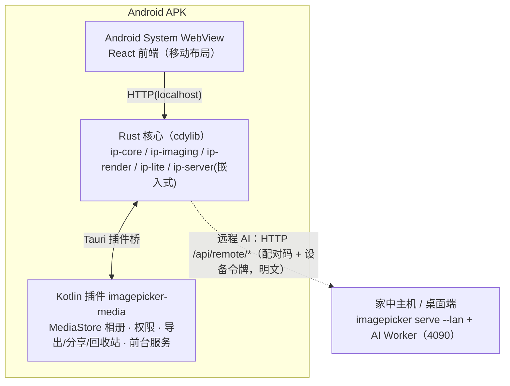

# 08 Android 版本设计

> **状态说明（2026-10-13，与 `main` 对照）**：外壳、Kotlin 插件、移动端布局、lite 分析、远程 AI 均已有代码，CI 能出 debug APK；但 **Android 版从未在真机或模拟器上运行过**（所有「已实现」只指代码存在并有 Rust / Kotlin 单测或 mock 截图，不代表设备上可用）。下文表格新增「状态」列：✅ 代码已实现且有自动测试；🟡 部分实现（缺口在备注）；❌ 未实现（设计目标，1.x）；🧪 另表示**未在设备上验证**。逐项证据见 [09 §2.10](09-完成度评审与收尾计划.md) 与 [api-contract-m8](api-contract-m8.md)。

## 1. 定位

手机是很多人最主要的拍照设备。Android 版的目标是：**在手机上直接完成「挑片 + 轻修 + 分享」**，并能与桌面端/家中 GPU 主机协同完成重计算。

| 能力 | 桌面版 | Android 版（设计目标） | Android 现状 |
|---|---|---|---|
| 浏览、打分、旗标、筛选、对比 | ✅ | ✅（手势优先） | ✅🧪 移动布局、手势挑片、快速挑片（`web/src/components/mobile/*`，`lib/gestures.ts`、`quickCull.ts`；单测 + mock 截图） |
| 连拍/相似分组、基础评分 | ✅ | ✅ 端侧 | 🟡🧪 **只有 lite 分析**（`ip-lite`：pHash 分组 + 清晰度/曝光/噪点/倾斜）；界面里叫「快速（本机）」 |
| 闭眼检测、人物聚类 | ✅ | ✅ 端侧（NPU/GPU / 轻量模型） | ❌ 手机上没有（需要 MediaPipe / 身份嵌入，均未接入）；可经「标准（远程 AI，需配对）」交给主机 |
| 自动光影色彩、预设、基础调整 | ✅ | ✅ 端侧（GPU 渲染） | 🟡🧪 底部抽屉编辑界面已有（`MobileEditDrawer.tsx`），渲染走嵌入的 Rust 渲染器（wgpu 在设备上是否可用未验证，CPU 兜底） |
| 磨皮/美白/瘦脸（人脸关键点） | ✅ | ✅ 端侧 | ❌ 端侧无关键点；经远程 AI 主机 |
| 瘦手臂/瘦腿、Best Take、高质量消除、VLM 助手 | ✅ | ☁️ 连接家中主机（远程 Worker）；端侧 LaMa 轻量消除 | 🟡🧪 远程 AI 配对与缩小图上传已实现，主机只开放 9 个 Worker 方法（分析、蒙版、人像准备、Best Take、消除、增强、以脸搜脸、系统信息/模型列表；`REMOTE_METHODS`），**LLM/VLM 助手方法不在白名单内**；端侧 LaMa 未实现 |
| RAW | ✅ | 仅 DNG + 内嵌预览 | 🟡 内嵌预览解析为共享的 Rust 代码；DNG 未在 Android 上验证 |

## 2. 技术方案

**选型：Tauri 2 移动端（Android）**，复用同一份 React 前端与大部分 Rust 核心。仓库里没有独立的 `apps/android`：Android 工程由 `apps/desktop/src-tauri/gen/android/` 生成，媒体插件在 `apps/desktop/plugins/imagepicker-media/`。



（设计图中的 `ip-infer`（ONNX Runtime Mobile / NNAPI / QNN）和 MediaPipe Tasks 在当前实现里**没有**：`ip-infer` 只有桌面 CPU 的 YuNet 且特性默认关闭，ort 未链接到 Android。）

| 层 | Android 方案（设计） | 状态 / 现状 |
|---|---|---|
| UI | 同一 React 代码 + 移动端布局（响应式断点 < 768px）：底部导航、全屏滑动挑片、底部抽屉式编辑面板 | ✅🧪 `components/mobile/*`、`lib/layout.ts`（单测 + mock 截图 `web/scripts/screenshots-m8.mjs`） |
| 核心 | Rust 交叉编译 `aarch64-linux-android`（+ `x86_64` 模拟器） | 🟡🧪 CI `android-check`（`cargo check`）与 `android`（x86_64 debug APK + Kotlin 单测）；release 的 aarch64 任务写在 `release.yml`，**从未运行**（见 [android-build.md](android-build.md)） |
| 推理 | 新增 `ip-infer`：Rust `ort` 在端侧运行小模型 | 🟡 crate 存在（仅 YuNet，CPU，特性 `infer` 默认关闭），**未链接到 Android**；无 NNAPI/QNN/XNNPACK |
| 关键点/分割 | MediaPipe Tasks（Kotlin AAR，GPU delegate） | ❌ 插件里没有 MediaPipe |
| 渲染 | wgpu（Vulkan）；老设备降级 GLES / CPU；预览代理 ≤ 2MP | 🧪 代码共用桌面渲染器；设备上的适配器选择未验证 |
| 解码 | Android `ImageDecoder` / `BitmapFactory`（硬件 HEIF/JPEG）+ Rust 兜底 | ❌ 无 `ImageDecoder`；Rust 解码器可用，HEIC 只能取文件内嵌 JPEG 层（backlog P2） |
| 相册访问 | MediaStore 查询 + `READ_MEDIA_IMAGES` / 部分访问；缩略图用 `ContentResolver.loadThumbnail` | 🟡🧪 相册列表与权限已实现（`ImagePickerMediaPlugin.kt`、`AlbumAggregator`，Kotlin 单测）；**无 `loadThumbnail`**；DCIM / Pictures / Download 以外的相册能列出但**不能导入**（白名单写死在 `ip-core/src/roots.rs` 与 `src-tauri/src/lib.rs`），SD 卡不在资源作用域 |
| 写操作 | 编辑结果另存到 `Pictures/imagePicker/`；删除走 `MediaStore.createTrashRequest` | 🟡 Kotlin 的 `publishExports` / `share` / `trash` 与 Rust/TS 包装都在，但**界面没有任何调用**；`createTrashRequest` 需 API 30+，而 `minSdk` 为 29 |
| 后台分析 | 前台服务（`dataSync`）+ 通知进度 | 🟡 `AnalysisService.kt` 存在，**界面从未启动它**（后台分析会被系统杀）；Android 15 起 `dataSync` 每日 6 h 上限 |
| 分享 | 系统分享面板 | 🟡 同「写操作」：插件有，界面未接 |

最低版本：**Android 10（API 29，`minSdk = 29`）**；推荐 Android 13+、8GB 内存。Release 变体 `usesCleartextTraffic=false`，而 WebView 加载 `http://127.0.0.1:<port>`，**release APK 很可能白屏**（debug APK 允许明文，CI 掩盖了该问题；见 09 §2.10）。

## 3. 端侧模型（移动档 M）

**现状：端侧没有任何神经网络模型**，下表是设计目标；实际端侧分析 = 纯 Rust 经典算法（`ip-lite`）。

| 任务 | 设计模型 | 状态 |
|---|---|---|
| 人脸检测 + 关键点 + 表情系数 | MediaPipe Face Landmarker | ❌（桌面 AI Worker 才有） |
| 人脸身份 | AuraFace int8 ONNX | ❌ |
| 图文嵌入 | MobileCLIP-S0 / SigLIP2-base int8 | ❌ |
| 人像分割 | MediaPipe Selfie Multiclass | ❌ |
| 清晰度/曝光/噪点/倾斜/pHash | 经典算法（Rust） | ✅🧪 `crates/ip-lite`（与 Python 实现的一致性测试 `tests/parity.rs`） |
| 消除 | LaMa int8（512px 分块） | ❌（经远程 AI 主机） |
| 自动调色 | 规则专家系统 | ✅ 共享 `ip-render::auto_adjust`（规则实现；自适应 3D LUT 未做） |

首装 APK 体积与模型包下载方案未落地（没有端侧模型包）。

## 4. 与桌面/主机协同

1. **远程 AI**（✅ 代码 / 🧪 未在设备上验证）：主机在「设置 → 远程 AI 设备」点「开始配对」生成 6 位一次性配对码（5 分钟有效，界面同时显示二维码），手机在「设置 → 远程 AI」输入**主机地址 + 配对码**完成配对（`/api/remote/pair/*`），之后标准分析、AI 蒙版、人像准备（身体形变所需的关键点）、Best Take、消除、降噪/人脸修复/超分等白名单内的 Worker 方法（`REMOTE_METHODS`）以「缩小图 + 参数」上传到主机（LLM/VLM 助手不在白名单内），返回补丁图层。原图不离开手机；**「上传原图以获得最高质量」选项不存在**。限制：**手机不能扫码**（无 `scanQr`、无 intent filter）；`serve --lan` **不打印二维码**；断线后分析任务是否排队重试存在出入（09 §2.10 / api-contract-m8 C 记为不排队，而界面提示写的是「主机离线，分析任务会排队等待」），待核实；传输为**明文 HTTP**，仅限可信局域网（TLS 是 1.x 计划，09 §5.4 D7）。
2. **会话同步（P2）**：手机上的打分/旗标/编辑栈同步到桌面端（content_key 匹配）——**未实现**。
3. **WebUI 作为备选**（✅）：不安装 APK 也可以在手机浏览器访问主机 WebUI（`serve --lan`，只能处理主机上的照片）；移动布局对浏览器同样生效。

## 5. 移动端 UX（设计稿；界面已实现的部分见下方状态）

```
┌─────────────────────┐     ┌─────────────────────┐     ┌─────────────────────┐
│ 京都 2026      🔍 ⋮ │     │ ◀  组 3/23  · 8张   │     │ ◀ 编辑         ✓  │
│ [全部][精选][待定]   │     │                     │     │                     │
│ ▼ 千本鸟居 · 12组    │     │   [ 全屏照片 ]       │     │   [ 预览 ]           │
│ ┌──┐┌──┐┌──┐┌──┐   │     │                     │     │                     │
│ │▣8││  ││▣3││  │   │     │  ← 滑动切换 →        │     │                     │
│ └──┘└──┘└──┘└──┘   │     │  ↑ 精选  ↓ 淘汰      │     ├─────────────────────┤
│ ┌──┐┌──┐┌──┐┌──┐   │     │ ★★★★☆  AI 4.5 ✨     │     │ ✨自动 光影 色彩 美颜 │
│ │  ││▣5││  ││  │   │     │ 😀😀😑 小红闭眼       │     │ 磨皮 ─────●───       │
│ └──┘└──┘└──┘└──┘   │     │ [#1][#2][#3✓][#4]…  │     │ 美白 ───●─────       │
├─────────────────────┤     ├─────────────────────┤     │ 瘦脸 ──●──────       │
│ 🖼图库 ✨挑片 👤人物 ⚙ │     │  [✨全员最佳] [分享]  │     └─────────────────────┘
└─────────────────────┘     └─────────────────────┘
```

- 挑片手势：左右滑切换、上滑精选、下滑淘汰、双击放大、长按多选、星级点击/滑动。
- 「快速挑片模式」：每组只显示 AI Top-3 卡片，Tinder 式左右滑，适合碎片时间。
- 编辑面板为底部抽屉，参数横向滚动选择 + 单滑块调节（类似主流手机修图 App）。
- 震动反馈：精选/淘汰时轻触觉反馈。

> **状态**：左右滑切换、上滑精选、下滑淘汰、双击放大、快速挑片（AI Top-3 卡片）、底部抽屉编辑、底部导航均有实现与单测（🧪 未在设备上试过）。触觉反馈用 `navigator.vibrate`（`lib/haptics.ts`），应用清单**没有 `VIBRATE` 权限**，WebView 中可能无效。设计稿里的「✨全员最佳」「分享」按钮在移动端挑片界面中没有对应入口（分享未接）。

## 6. Android 专属风险

| 风险 | 应对 |
|---|---|
| Tauri 2 移动端插件生态尚不成熟 | 关键能力（MediaStore、前台服务、MediaPipe）自写 Kotlin 插件；保持插件层薄 |
| NNAPI 在不同厂商上行为不一致、Android 15 起被标记弃用 | （端侧推理尚未落地，此风险推迟）计划优先 QNN / GPU delegate，XNNPACK CPU 兜底 |
| WebView 版本差异 | 前端不依赖 WebGL；要求较新的 Android System WebView（具体下限未测） |
| 端侧发热/耗电 | 分析批量调度、温控降速、仅充电时深度分析选项 |
| 应用商店上架（国内多商店） | 先发 GitHub Release APK + F-Droid（如可能），再评估各商店（Android keystore 与签名尚未配置，09 §5.4 D6） |
