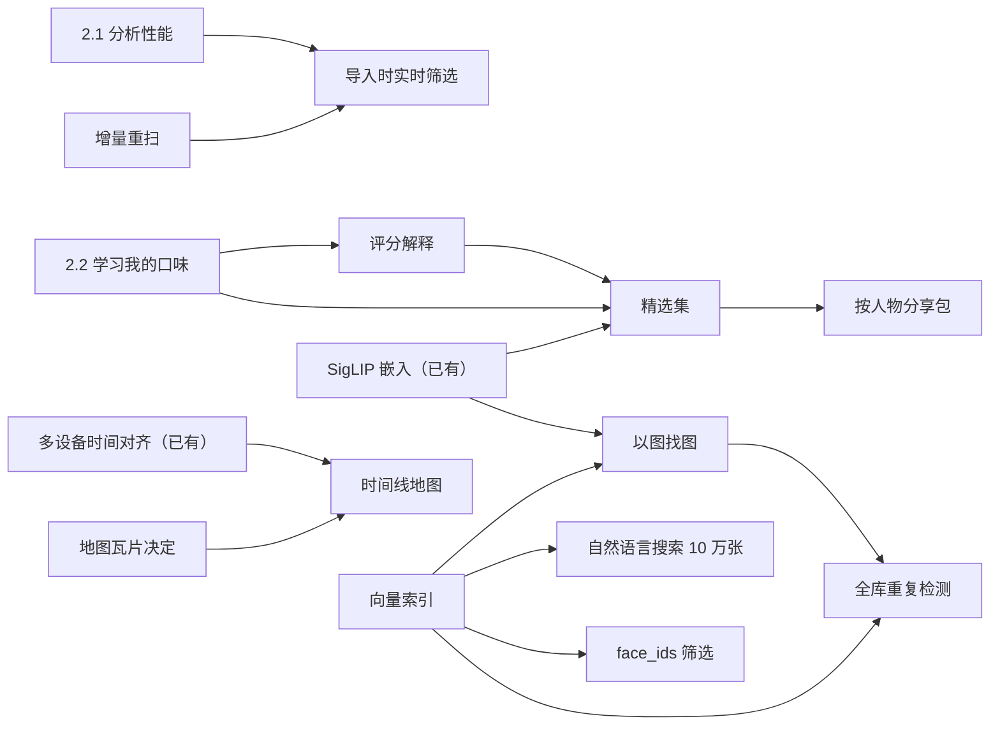

# 10 路线图

> 日期：2026-10-16，基线 `main` 698006c5。
> 本文回答「1.0 之后先做什么、为什么」。状态一律以 [09 完成度评审](09-完成度评审与收尾计划.md)、[backlog](backlog.md) 与代码为准，本文不新增状态判断；引用写成「09 P1-6」「backlog〈事件层〉」「`crates/ip-core/src/taste.rs`」等形式，路径相对仓库根目录。
> 1.0 之前的收尾仍按 09 §5（缺口）与 §8.2（发布门槛）推进；[06 §7](06-项目计划书.md) 的「发布后路线图」由本文取代。
> 规模：**S** ≈ 1–3 人日，**M** ≈ 1–2 周，**L** ≈ 3 周以上（单人估算，不含评测与盲评）。

## 1. 现状

桌面端功能面已基本铺满：09 基线（10-09）时 81 个 PRD 功能编号中 40 完成、26 部分、15 缺失，此后陆续合并了数据安全（P0-1/3/4）、分析续跑与暂停（P0-5）、真 100%（P0-6）、导出格式（P0-8）、事件层（P1-1）、多设备时间对齐（P1-2，#57）、自然语言搜索（P1-4，#56）、筛选补全（P1-5）、文件监听与安全淘汰（P1-6）、可访问性（P1-16）、水印（F9.4）、拼图（F9.5）、存储卡导入（F1.8）、便携模式等。缺的主要不是代码，而是**真实模型、真实照片、真实设备上的证据**（09 §2.15）和负责人的决定。

| 1.0 阻塞项 | 依赖 | 来源 | 验收 |
|---|---|---|---|
| D6 签名与商店账号 | 负责人（证书、Apple 账号、Tauri 更新密钥、Android keystore、AUR） | 09 §5.5 D6、P1-14、[release.md](release.md) | 至少有更新密钥与 keystore；`v0.x.1 → v0.x.2` 自动更新通过 |
| `bench/eval-search.py` | 负责人的 GPU 机 + 标准分析过的 1000 张图库 | 09 P1-4；backlog〈自然语言搜索〉① | recall@20 ≥ 0.8，结果进 `bench/results/` |
| `bench/eval-time-align.py` | GPU 机 + 真实多设备图库 | 09 P1-2；backlog〈多设备时间对齐〉① | 整机偏移估计误差 ≤ 5 s，据此复核 `AlignParams` |
| `bench/eval-bystander.py` | GPU 机 + 逐脸标注 | 09 P1-8；backlog〈问题标签补全〉 | 路人误判 ≤ 10%；说话中召回 ≥ 70%、误报 ≤ 5% |
| `bench/eval-library.py`（standard 档） | GPU 机 | 09 §7.2 | 各行指标达到 09 §7.2 门槛 |
| standard 档端到端评测 | GPU 机，全部模型；人工核验标签（09 §7.1） | 09 P0-10；`bench/eval-standard.py` | 分组 F1 ≥ 0.9、闭眼召回 ≥ 95% / 误报 ≤ 5%、Top-1 ≥ 60% / Top-3 ≥ 85%、BCubed ≥ 0.85、1000 张 < 2 min |
| axe 可访问性冒烟（`pnpm dev:mock` + `pnpm a11y`） | 桌面会话（桥接账号无回环 TCP、无浏览器） | 09 P1-16；backlog〈可访问性余项〉③ | 冒烟通过，桌面与手机视口 |
| GPU 渲染耗时 | GPU 机，`IMAGEPICKER_REQUIRE_GPU=1` | 09 P1-10；backlog〈渲染正确性证据〉 | `bench_render`：拖动 < 50 ms（独显）/ < 150 ms（集显），美颜 < 200 ms |
| 真实存储卡 | 负责人的读卡器 + SD 卡 | backlog〈从存储卡导入〉 | Windows 卷标 / 容量 / 盘类型识别正确，导入与跳过正确 |
| 真实 RAW / HEIC 样张 | 负责人的相机与手机照片（不入库） | 09 P0-7、P0-11；backlog〈HEIC/HEIF 实机验证〉〈RAW 预览〉 | CR3/NEF/ARW/RAF 配对与预览、iPhone/安卓 HEIC（网格、HDR、`imir`）正确；≥ 1000 张自有照片复核阈值 |

## 2. 进行中（Now，2026-10）

两条工作线**刚开始，还没有结果**。下面只写目标和验收标准。

### 2.1 分析性能

**目标**：缩短「导入 → 分析完成」的等待，这是用户最直接感到的成本（PRD §4「标准分析 1000 张 < 2 min」至今未测，09 §2.13）。

| 步骤 | 内容 | 依据 |
|---|---|---|
| 1. 阶段剖析器 | 按阶段计时：导入（扫描、EXIF、缩略图）→ 分析各步骤（`phash`、`quality`、`faces`、`identity`、`embed`、`aesthetic`、`iqa`、`scene`，见 `ai-worker/imagepicker_ai/steps/__init__.py` 的 `PROFILES`）→ 导出；每阶段报告 p50 / p95 与张/秒 | 现有 `ai-worker/scripts/bench_analyze.py` 只给总耗时 |
| 2. CPU 基线 | lite / fast / standard 三档在 CPU 上的基线，结果 JSON 进 `bench/results/` | 09 §7.2「分析吞吐」 |
| 3. GPU 基线 | 同一脚本在负责人的 GPU 机上跑 | 同上；需负责人 |
| 4. 优化（按剖析结果取舍） | ①每张图只解码一次并在各步骤间共享（`pipeline.py` 的解码池已做到 worker 内共享，需确认 Rust 侧缩略图 / lite 与 worker 之间没有重复解码）；②RAW / HEIC 用内嵌预览分析，不做全尺寸解码；③批量推理，并让解码与推理重叠（`pipeline.py` 已有 SigLIP 批处理，扩展到其他模型）；④先跑廉价检查，对确定淘汰的照片（严重失焦、全黑等）跳过昂贵步骤 | `ai-worker/imagepicker_ai/pipeline.py` 文件头、`decode.py` |

**验收**：
- 输出不变：同一图库优化前后的目录库分析结果（分数、标签、分组、人物）一致；④「跳过」只作用于判定规则明确的照片，且跳过的照片在界面上可识别、可强制补算。
- 在 standard 档上每张耗时下降 **≥ X%**；X 在 CPU / GPU 基线出来后确定并回写本节。底线仍是 PRD §4 的 1000 张 < 2 min（GPU）。
- 剖析器可重复运行，CI 里至少跑 lite 档的 CPU 版本做趋势记录。
- 不新增数据库迁移（v17 留给 2.2）。

### 2.2 学习我的口味（第二版）

**现状**：第一版已在 1.0 内（09 F2.10「完成」）：`crates/ip-core/src/taste.rs` 用 `[SigLIP 嵌入 | 评分分项 | 场景 one-hot]` 训练成对逻辑回归，20% 保留集上优于基础分才启用，按 α（0→0.6）与基础分混合，每 50 个新标签重训，可重置（`POST /api/taste/reset`），界面在首页「我的口味」（`Taste.tsx`）。成对样本只取同一会话内的照片，并把「精选 vs 同组未标注」按半权重算入（隐式信号）。

**目标**：让个人排序更可信、更可控、在全库范围内学习。

| 方面 | 第二版目标 |
|---|---|
| 训练数据 | **只用显式信号**：精选 / 淘汰 / 星级，跨会话累积；不再把「未标注」当负样本 |
| 特征 | 图像嵌入（SigLIP）+ 现有评分分项 |
| 模型 | 逻辑回归，纯 Rust（沿用 `taste.rs` 的实现方式，不引入 Python 依赖） |
| 冷启动 | 显式标签数低于阈值时不训练、不显示个性化 |
| 启用条件 | 只有在保留集 **AUC** 高于通用分（`base_score`）时启用；否则界面说明「还在学习」 |
| 控制 | 重训、重置、遗忘（删除某张 / 某会话的标签后重训） |
| 界面 | 按「我的口味」排序、网格角标、设置页卡片（状态、标签数、AUC、重训 / 重置） |
| 存储 | 迁移 **v17**（已为此工作线预留） |
| 评测 | 新增 bench 脚本，读真实目录库（只读）计算保留集 AUC；合成部分沿用 09 §7.2「个性化评分」的规则模拟用户 |

**验收**：09 §7.2 的模拟用户上星级一致率提升 ≥ 5 个百分点、无提升时自动不启用；PRD §6 个性化后星级一致性 ≥ 85%（真实照片，需负责人）；遗忘后的模型不再受被删标签影响（测试覆盖）；所有数据只在本机。

### 2.3 换成我最好的发型（同人换发 + 去汗光）

**目标**：同一天后面出汗、头发塌乱的照片，用本人更早、更好的一张照片里的头发替换（脸不动）；没有好照片时直接去汗光、清理碎发。设计与算法见 03 §5.1 / §7.5，接口见 api-contract-m5 H，状态 09 F6.10。

| 部分 | 状态 |
|---|---|
| 供发候选（同人、姿态门限、发质评分与理由）+ 合成为 `hair` 补丁层，服务端强制同人（422） | 已实现（合成头像测试）；**真实照片需负责人用 `bench/hair-transfer-demo.py` 目检** |
| 去汗光 / 整理碎发（`enhance` 的 `deshine` / `flyaway`，强度 = 图层 `amount`） | 已实现（合成测试），真实照片未验证 |
| 生成式换发型（大姿态差，SDXL Inpainting + IP-Adapter，03 §5.2） | 只有设计；需在负责人 GPU 机上评测后决定 |

## 3. 下一步（Next，1.x）

### 3.1 新功能

| 项 | 动机 | 设计草图（复用现有模块） | 依赖 | 验收 | 规模 |
|---|---|---|---|---|---|
| **评分解释** | 「为什么这张只有 2 星」是信任的前提（06 R7：可解释 + 用户优先） | 已有分项条与理由文本（`web/src/components/ScoreBreakdown.tsx`、`scoring.rs` 的 `Reason`）。补：人脸级理由并定位到人脸框（「脸部失焦」「闭眼 2/5」，数据来自 `faces` 步骤）；同组对比（「比本组最佳低在清晰度」，用 `rank_in_burst`）；口味贡献（2.2 的模型权重） | 2.2（口味贡献部分） | 每张 ≤ 3★ 的照片至少一条具体理由；理由与问题标签位掩码不矛盾；人脸级理由可点到对应人脸；中英文案齐全 | M |
| **精选集 / best-of** | PRD F8.3（P2，09 F8.3「缺失」）；旅行回来最常见的产出 | 按事件 / 场景（`analysis/grouping.rs`、`timeline.rs`）与人物分配名额，组内取最高分（含口味），用 SigLIP 嵌入做多样性去重（MMR）；输出走现有导出、拼图（`collage.rs`）与新增幻灯片 | 3.1 评分解释（让用户理解入选原因）、2.2；规模大时需向量索引 | 合成图库上精选 N 张中坏帧（闭眼 / 模糊）≤ 5%；同一连拍至多 1 张；覆盖全部事件；用户可替换任一张；可导出为相册文件夹 / 拼图 / 幻灯片 | L |
| **以图找图** | 「还有哪些和这张像的」；跨会话找回 | 复用 `crates/ip-core/src/search.rs` 的嵌入扫描与 `POST /api/faces/search` 的交互模式，查询向量换成照片的 SigLIP 嵌入，范围扩到全库 | 已有嵌入（standard 档）；10 万张时需向量索引 | 合成图库上同场景照片 recall@20 ≥ 0.8（复用 `eval-search.py` 框架）；未做标准分析的照片计入「未索引」并提示 | M |
| **时间线地图视图** | PRD F1.9（时间线已完成，地图缺失） | 复用 `library_timeline.rs`；时间用多设备对齐后的结果（迁移 v16 `session_device_offset`）；地图需瓦片来源决定（见 §6） | §6 地图瓦片决定 | 离线模式下零网络请求；GPS 点击筛选与网格一致；修正 backlog〈资料库时间线〉的时区边缘误差 | M（离线瓦片则 L） |
| **按人物分享包** | 聚会后给每个人发他自己的照片 | 复用按人物导出（09 §7.2「每人最佳 / 按人物导出」）、`GET /api/people/best`、去 GPS、水印、拼图 | 3.1 精选集的选片逻辑 | 每个包坏帧率 ≤ 10%（同 09 §7.2）；默认去 GPS；局域网访客看不到人物（沿用现有规则） | M |
| **导入时实时筛选** | 存储卡复制要几分钟，用户在等 | 复用存储卡导入（`card.rs`）与文件监听（`watch.rs`），已复制完整的文件立即生成缩略图并进 lite 分析，复制结束后再补 standard | 2.1 性能、3.2 增量重扫 | 复制开始后首批缩略图在可设定时限内出现；不读写入未完成的文件；复制吞吐下降不超过约定比例（基线定） | L |
| **全库跨会话重复检测** | 同一批照片多次导入、不同文件夹的副本 | 扩展 `analysis/duplicates.rs`：完全重复沿用 `content_key`；近似重复加嵌入近邻，覆盖缩放 / 重编码 / 轻裁剪（09 §7.4 样本 #14） | 以图找图、向量索引 | 09 §7.2「重复检测」36/36（含跨会话）；样本 #14 召回 ≥ 0.9；只标记，绝不自动删除 | M |

### 3.2 性能后续（backlog 已列）

| 项 | 现状 | 做法 | 验收 | 规模 |
|---|---|---|---|---|
| 文件监听增量重扫 | 根目录变化后全量重扫（`watch.rs` → `rescan_root`；backlog〈文件监听〉） | 只重扫发生变化的子目录 | 10 万张根目录下单文件变化不触发全量 IO | S–M |
| 向量索引 | `search.rs` 精确扫描、`face_ids` 线性扫描（backlog〈自然语言搜索〉④、〈筛选补全余项〉②） | 嵌入与身份特征建 ANN 索引（实现方式待评估），精确扫描保留为校验 | 10 万张下搜索 / 以脸搜脸 / 以图找图 recall 与精确扫描相比 ≥ 0.98，延迟在 100 ms 内 | M |
| 带筛选分页索引 | 评分 / 旗标 / 人物筛选在 10 万张时 4–7 ms（backlog〈单会话 10 万张〉，`bench/large-sessions-2026-10-13.md`） | 为高选择性筛选加组合索引，权衡写入代价（现 +17 µs/行） | 10 万张筛选页 < 3 ms，写入代价不翻倍 | S–M |
| 网格 60 fps 真机复测 | 只在无头浏览器测过（09 §2.13；backlog〈网格 60fps〉） | 负责人在 GPU 机桌面会话跑 `web/scripts/perf-real.mjs` | p95 帧时间 ≤ 16.7 ms | S（需负责人） |
| 缩略图预取 | backlog 未列；Loupe 已预读前后各 3 张（02 §5.1），网格缩略图预取尚未评估 | 先看 2.1 剖析器与网格真机数据，有收益再做 | 快速滚动时空白格比例下降（基线定） | S |

### 3.3 文档已推迟到 1.x 的项

| 项 | 来源 | 备注 | 规模 |
|---|---|---|---|
| 「深度」分析档（VLM 评审） | 09 §5.3、§5.5 D4；03 档位现状 | 依赖 T3 模型与评测 | L |
| 虚拟副本 | PRD F4.4、09 §5.5 D4 | 也可在 1.x 决定从 PRD 删除 | M |
| 风格参考迁移（「匹配参考图」） | PRD F5.7、03 §6.3（`BasicPanels.tsx` 按钮为禁用占位） | 03 已有 1.x 设计 | M |
| 局域网 / 远程 AI 的 TLS | 09 §5.5 D7、02 §8、PRD F10.3 | 自签证书 + 证书固定 | M |
| 服务端持久撤销 | 09 §4 第 13 条（05 的 `history` 表） | 跨端一致性需先设计 | M |
| 水印进服务端预设 | backlog〈导出水印余项〉 | 见 §6 决定 | S |
| 移动端搜索入口 | 桌面顶栏有搜索（用户指南 §6），`web/src/components/mobile/` 无搜索入口 | 复用同一接口 | S |
| 重打光 / 虚化、扩图、指令编辑 | PRD F5.9、F7.2、F7.3；09 §5.3 | T3 实验 | L |
| 描述与标签写入 XMP、云端 API | PRD F8.4、F8.5 | 云端默认关闭 | M |
| 生成式接缝修补、身体形变背景补全 | PRD F4.5、F6.7；backlog | — | M |
| 学习型自动调色、会话同步 | 09 §5.3 | 会话同步见 06 §7 1.4 | L |
| P3 输出、HDR HEIC 色调映射 | 09 §5.3；02 §5.3；backlog〈HEIC 色彩余项〉 | — | M |
| 事件命名（离线逆地理编码 / VLM 短标题） | backlog〈事件层余项〉 | `event.title` / `place` 已预留 | M |
| 导出余项：有损 WebP、16 位 TIFF、自定义导出预设 | backlog〈导出格式余项〉 | — | S–M |
| 镜头名规范化 | backlog〈筛选补全余项〉① | 参照设备名规范化 | S |
| Flatpak；Android 端侧 ONNX Runtime 与 MediaPipe | 09 §5.3；backlog〈`ip-infer`〉 | Android 1.0（09 P1-19）之后 | L |
| 文件夹内 `.imagepicker/`、WebGL 瓦片查看器 | 02 §7、02 §2 | 视需要 | M |

## 4. 以后（Later，探索中）

以下**只是值得记下的想法**，没有设计、没有排期，可能放弃。

| 想法 | 为什么值得看 | 主要不确定性 |
|---|---|---|
| 移动端端侧挑片模型 | 手机不连主机也能闭眼 / 人物判断（08；backlog〈lite 档 faces〉） | 机型碎片化（06 R11），Android 尚未真机运行 |
| Lightroom / Capture One 目录互通 | 现在只有 XMP 侧车（PRD F3.7），专业用户要的是目录级导入导出 | 目录格式私有、版本多 |
| 视频 / 动态照片选帧 | 06 §7 1.3：Live Photo 抽帧、短视频精彩帧 | 解码依赖与许可 |
| 插件系统（第三方模型 / 预设） | 06 §7 1.4 | 安全边界、模型许可 |
| 多用户家庭库、iOS | 06 §7 2.0 | 权限模型；Tauri iOS 成熟度 |

## 5. 排序原则与依赖

排序按以下顺序，前一条优先：

1. **用户等待时间**：导入、分析、滚动越快越好（2.1、3.2、导入时实时筛选）。
2. **信任与可解释**：用户要能相信并理解 AI 的判断（2.2、评分解释）；没有这一步，精选集这类「替用户做选择」的功能不该先做。
3. **分享**：把挑好的照片交出去（精选集、按人物分享包、地图）。
4. 同一层内，复用现有模块多、需要负责人资源少的先做；需要新模型或新许可的放后。

## 6. 负责人决定（2026-10-16 已定）

负责人在 2026-10-16 把下列事项委托给开发负责人按最优方案决定（「I will pick your best solution」）。以下为**已定**，09 §5.5 同步；要推翻任何一项，只需改这里与 09 §5.5。

| # | 事项 | 决定 | 理由 / 仍需负责人做的事 |
|---|---|---|---|
| D1 | 产品名 | **1.0 沿用 imagePicker**（安装包、界面、文档不改名）；「拾光 PickLight」「一眼挑」留作 1.x 品牌备选 | 改名不影响功能，却牵动安装包、商店、文档与已装用户；1.0 前不值得。正式公开发布前由负责人做一次商标检索 |
| D2 | 默认模型许可（NIMA、skyseg、GFPGAN、Real-ESRGAN ×4），是否商用 | **1.0 定位个人非商用**：保留现有模型，同意弹窗与设置页继续标注许可；任何商用计划之前先替换 NIMA（自训 SigLIP 头）并完成许可审计 | 现有标注已落地（#26）；替换模型会改变评分，需要基准复测 |
| D3 | `privacy.allow_network` | **保持「无用户操作不联网」** | 已落实（PRD F10.6） |
| D4 | 1.0 范围 | **按 09 §5.5**：深度档与虚拟副本在 1.x | 已落实 |
| D5 | macOS 最低版本 | **13** | 已落实（#52） |
| D6 | 签名与分发 | **1.0 只在 GitHub Releases 发布**：桌面安装包暂不做代码签名（用户指南说明 SmartScreen / Gatekeeper 的放行步骤），**必须有** Tauri 更新签名密钥与 Android release keystore；Windows 证书 / SignPath、Apple 公证、AUR、Flathub、F-Droid、国内商店列入 1.x | 不花钱、不等账号审核也能发布。**仍需负责人**：在自己的机器上生成更新密钥与 keystore（私钥不进仓库、不交给 AI），填入 GitHub Actions secrets，见 [release.md](release.md) |
| D7 | 局域网 / 远程 AI 明文 HTTP | **1.0 文档标注仅限可信局域网**；TLS 在 1.x（§3.3） | 已落实 |
| D8 | 「修改原图」（内嵌 XMP） | **保留为默认关闭、需二次确认的高级选项** | 已落实（#8） |
| D9 | 水印是否按导出预设保存 | **是**：服务端预设表加可选水印字段，旧预设不带水印 | 预设本来就是「一次设好反复用」；随 1.x 实现 |
| D10 | 全局 / 局部 / 美颜层的渲染是否依赖栈中顺序 | **保持现状：按栈顺序叠加**（02 §5.3；`ip-render/tests/correctness.rs` 把相对顺序视为编辑内容）；09 §4 第 6 条已改为与实现一致 | 改成固定顺序会改变已有编辑的渲染结果 |
| D11 | 地图瓦片来源（§3.1 时间线地图） | **默认离线底图**（随应用分发的低精度世界底图）；在线瓦片是可选项，首次开启时说明会向瓦片服务商发送大致位置并征得同意，可随时关闭 | 与 D3「无用户操作不联网」一致 |
| D12 | 口味模型第二版是否默认开启 | **默认开启，但只在留出集 AUC 胜过通用分后才参与排序**；冷启动前只显示进度；设置页可关闭、可遗忘 | 无效时不影响排序，有效时用户无需找开关；数据只在本机 |

## 7. English summary

**Status.** The desktop feature set is largely in place (docs/09; many P0/P1 gaps closed since 10-09). What 1.0 still lacks is evidence on real models, photos and devices. All owner decisions were settled on 2026-10-16 (section 6: 1.0 keeps the name imagePicker, is personal/non-commercial, ships via GitHub Releases with unsigned desktop installers but a Tauri updater key and Android keystore). Blockers that need the owner: generating those two keys and adding them as CI secrets (D6), and runs on the owner's GPU PC or desktop session: `bench/eval-search.py`, `eval-time-align.py`, `eval-bystander.py`, `eval-library.py`, the standard-profile evaluation (P0-10), the axe a11y smoke test (`pnpm dev:mock` + `pnpm a11y`), GPU render timing, a real SD card, and real RAW/HEIC samples.

**Now (2026-10), started with no results yet.** (a) *Analysis performance*: a stage profiler (import → each analysis step → export, p50/p95, photos/s), CPU then GPU baselines, then decode-once, embedded previews for RAW/HEIC, batched inference overlapped with decoding, and cheap checks first. Outputs must stay identical; the per-photo speed-up target is set from the baseline. (b) *Learn my taste v2*: rebuilds the existing `taste.rs` model on explicit pick/reject/rating labels across sessions, with embedding plus existing scores, Rust logistic regression, a cold-start threshold, held-out AUC gating against the generic score, retrain/reset/forget, sorting/badge/settings card, and a bench script for real-library AUC (migration v17).

(c) *My best hair*: replace sweaty, flat hair with the same person's hair from an earlier photo (donor ranking with reasons, pose gate, server-side same-person check, a `hair` patch layer), plus donor-free sweat-shine and stray-strand cleanup; implemented and tested on synthetic heads, real photos need the owner's eyes (`bench/hair-transfer-demo.py`); a generative restyle for large pose changes is design only (03 §5.2).

**Next (1.x).** Score explanations (face-level, group-relative), a best-of album with diversity across events, people and scenes, find-similar across sessions, a timeline map, per-person share kits, culling while the card is still copying, library-wide duplicate detection; performance follow-ups (incremental watcher rescans, a vector index for 100k-photo search and `face_ids`, filtered-page indexes, real-GPU grid check, thumbnail prefetch); and the items docs already defer to 1.x (deep profile, virtual copies, style reference, TLS, server-side undo, per-preset watermark, mobile search entry, and others in §3.3).

**Later (exploratory).** On-device mobile culling models, Lightroom/Capture One catalog integration, video and Live Photo frame picking, plugins, multi-user library and iOS.

**Priorities.** User waiting time first, then trust and explainability, then sharing. Taste → explanations → best-of album; embeddings → find-similar → library duplicates; a vector index underpins all of these at 100k photos. Section 6 records the owner decisions (settled 2026-10-16), including D9 per-preset watermarks, D10 stack-ordered layers, D11 offline-first map tiles and D12 taste v2 on by default but gated on held-out AUC.
